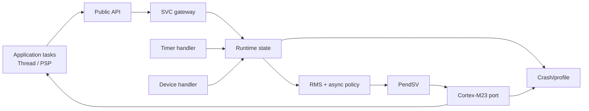
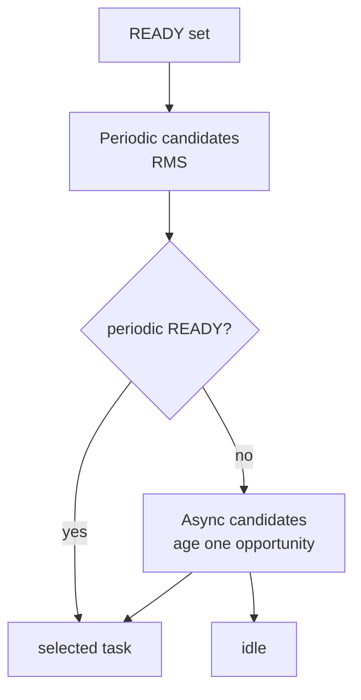
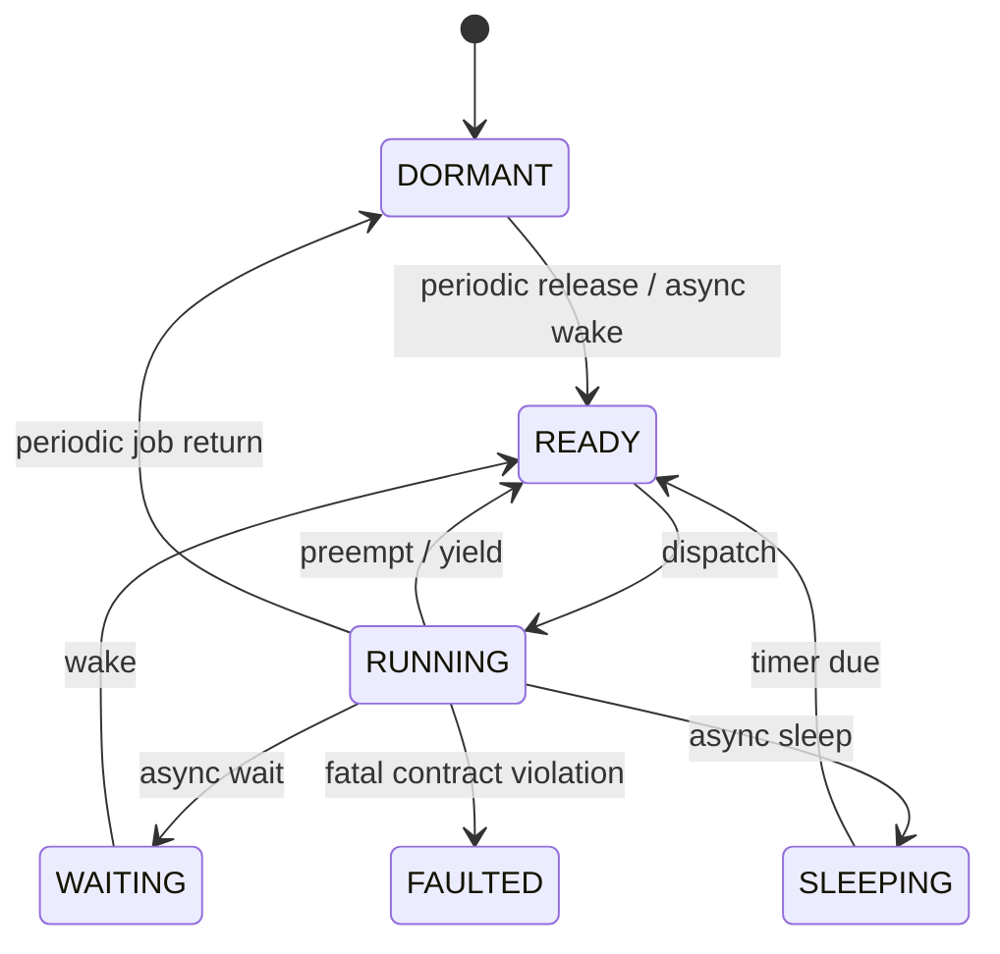

# Purpose

ArghtOS is a statically allocated preemptive Cortex-M23 scheduler.

It protects synchronous compile-time RMS tasks and schedules asynchronous event workers only in residual capacity.

# Key goals

* Soft target: complete ArghtOS resident footprint near or below 1.5 KiB at 32 tasks.
* Count kernel/port `.text`, `.rodata`, literals, data, descriptors, runtime state, and MSP.
* Exclude application task stacks and application task bodies from the ArghtOS-overhead subtotal, while including them in total system SRAM.
* Keep API small and deterministic.
* Use MSP for kernel/handler execution and PSP for tasks.
* No dynamic allocation.
* Thin hardware handlers activate predeclared async workers.
* Keep Cortex-specific mechanism separate from scheduling policy.
* Preserve traceability to P0-P7.

# Concrete v1 baseline

* `ARGHTOS_MAX_TASKS=32` default, adjustable up to 254.
* C0 descriptor: 16 B/task.
* C8 runtime control: 20 B/task.
* C9 global state: 20 B.
* 32-task metadata lower bound: 1172 B.
* optional crash record: 64 B.
* periodic tasks: synchronous, phase 0, `D=T`.
* periodic priority: RMS, shorter period first, task-ID tie break.
* async priority: base priority plus dispatch-opportunity age credit.
* async aging does not use scheduler time.
* one-bit pending-wake handshake; no event multiplicity.
* task handoff occurs only through PendSV.
* ownership-changing task APIs enter through SVC.
* tasks execute privileged on PSP.
* kernel/handlers execute on MSP.

# Soft-target status

```text
1536 B soft target
-1172 B metadata
-------------------
 364 B remaining
```

That remaining 364 B must still contain ArghtOS/port code, read-only constants/literals, MSP reservation, and any additional resident bytes.

Therefore the architecture does **not** presently establish that the 1.5 KiB target is feasible.

The target is an explicit optimization risk for implementation.

# Major structure



# Scheduling domains



The reference selector performs at most two bounded scans of `task_count <= ARGHTOS_MAX_TASKS`.

# Task model



# Ownership model

| Resource | Owner | ArghtOS footprint? |
|---|---|---|
| ArghtOS/port code | ArghtOS/port | yes |
| read-only scheduler constants | ArghtOS/port | yes |
| C0 descriptor table | application-declared, scheduler-required | yes |
| C8/C9 state | ArghtOS | yes |
| MSP | system integration | yes in reported footprint |
| task PSP stacks | application | excluded from ArghtOS subtotal |
| application task bodies | application | excluded from ArghtOS subtotal |
| hardware event queues/DMA | driver/application | excluded from ArghtOS subtotal |
| crash record | configured storage | yes when enabled |

# Architectural rules

1. One active periodic instance maximum.
2. Periodic tasks do not self-suspend through wait/sleep.
3. Async wake is idempotent; multiplicity belongs to the driver.
4. Periodic selection precedes async selection structurally.
5. Async age credit advances only on async dispatch opportunities.
6. Timer catch-up is arithmetic, not one loop per missed release.
7. Scheduler mutation is serialized through C4 critical-section rules.
8. PendSV is the only task execution handoff.
9. No dynamic memory.
10. Every resident ArghtOS byte is footprint-visible.

# Dependencies

* [P0](../proof/P0-static-configuration-validity.md)
* [P1](../proof/P1-task-state-invariants.md)
* [P2](../proof/P2-context-stack-integrity.md)
* [P3](../proof/P3-wake-wait-race-freedom.md)
* [P4](../proof/P4-time-release-correctness.md)
* [P5](../proof/P5-priority-domain-isolation.md)
* [P6](../proof/P6-rms-schedulability.md)
* [P7](../proof/P7-bounded-memory-and-work.md)
* [P8](../proof/P8-async-starvation-avoidance.md)

# Dangerous aspects

* Lost wake at wait transition.
* PSP/context corruption.
* Hidden resident code/constant size.
* MSP underestimation.
* Timer wrap/catch-up errors.
* Async aging crossing class semantics.
* ISR/kernel latency invalidating P6 assumptions.
* Task return/trampoline mismatch.

# Boundary specification

ArghtOS owns scheduling semantics, task execution ownership, scheduler metadata, profiling, and crash capture.

Device semantics, application event storage, application task bodies/stacks, WCET evidence, and total system SRAM integration remain outside the kernel, but are reported by S0.
