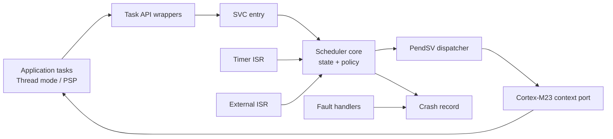
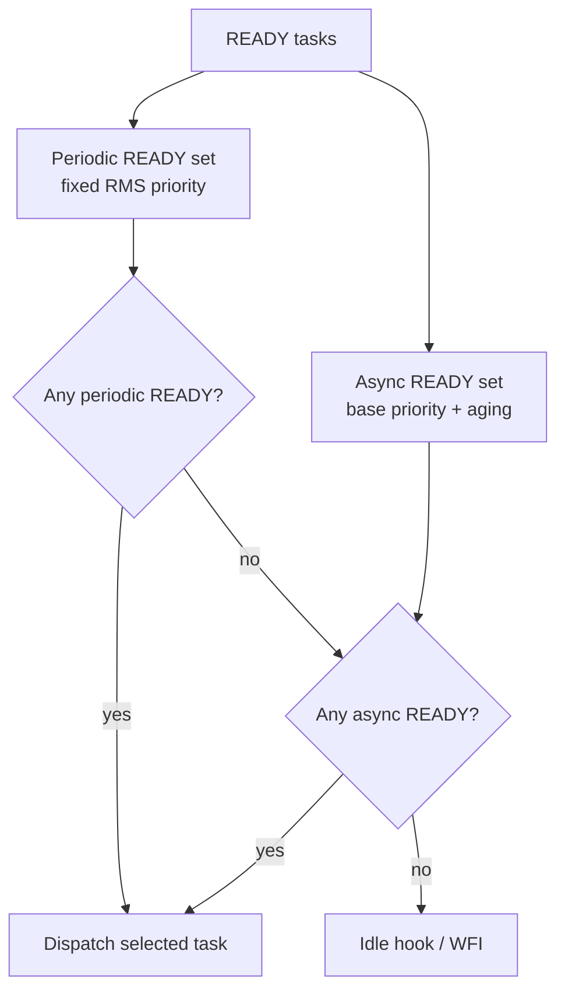
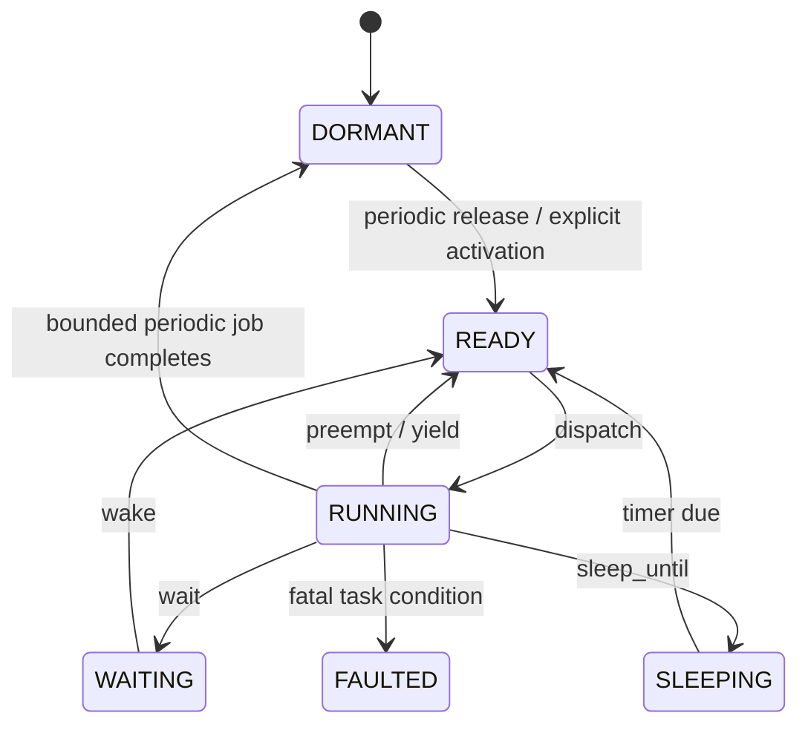

# Purpose

ArghtOS is a statically allocated, preemptive scheduler for Cortex-M23. It protects a compile-time periodic RMS domain while allowing asynchronous event-driven tasks to run in residual capacity with bounded priority aging.

# Key goals

* Keep scheduler-owned SRAM near or below 1.5 KiB at the default 32-task configuration, excluding application task stacks.
* Keep the public API small and deterministic.
* Use MSP for scheduler/exception execution and PSP for task execution.
* Keep all task descriptors and stacks statically allocated.
* Permit dynamic activation of predeclared asynchronous tasks from thin ISRs.
* Make scheduler behavior traceable to the proofs in [../proof/](../proof/).
* Keep platform-specific Cortex-M23 mechanics outside the policy core.
* Make all scheduler work bounded by compile-time configuration.

# Architectural rules

1. Periodic tasks are bounded jobs. One release creates at most one active job.
2. Asynchronous tasks are persistent workers. Wake is idempotent and does not preserve event multiplicity.
3. Periodic RMS priority dominates the asynchronous priority domain.
4. Aging operates only inside the asynchronous domain.
5. Task-facing blocking/yield operations enter Handler mode before scheduler ownership changes.
6. The context switch is centralized in PendSV.
7. Timer and external ISRs may make tasks READY, then request scheduling; they do not run application work.
8. Task stacks are application-owned fixed storage.
9. Scheduler state is statically bounded; no dynamic allocator exists.
10. The platform clock is monotonic and absolute-time based; the scheduler is tickless.

# Major structure

# Scheduling domains

The selector may use a bounded linear scan over at most `SCHED_MAX_TASKS`. This minimizes metadata and keeps the first architecture simple. A later bitmap implementation is permitted only if it preserves the same contracts and proofs.

# Task model

# Ownership model

| Resource | Owner |
|---|---|
| MSP | scheduler / exceptions |
| PSP while task runs | current task |
| Task stack storage | application, statically supplied |
| Task descriptor | immutable configuration, preferably flash |
| Runtime task record | scheduler |
| Hardware event data / queues | driver or application |
| Event multiplicity | driver or application |
| Scheduler clock | platform timer contract |
| Crash record | scheduler-owned fixed record or application-provided fixed record |

# Dependencies

* [P0 static configuration](../proof/P0-static-configuration-validity.md)
* [P1 task state](../proof/P1-task-state-invariants.md)
* [P2 context integrity](../proof/P2-context-stack-integrity.md)
* [P3 wake/wait race freedom](../proof/P3-wake-wait-race-freedom.md)
* [P4 time correctness](../proof/P4-time-release-correctness.md)
* [P5 priority isolation](../proof/P5-priority-domain-isolation.md)
* [P6 RMS schedulability](../proof/P6-rms-schedulability.md)
* [P7 bounded work](../proof/P7-bounded-memory-and-work.md)

# Dangerous aspects

* A lost wake at the RUNNING-to-WAITING boundary.
* Corrupt PSP or task stack metadata.
* Async aging accidentally crossing the periodic priority boundary.
* Timer wraparound or incorrect compare semantics.
* Scheduler mutation from multiple exception contexts without a clear serialization rule.
* Long ISR or critical-section execution invalidating response-time assumptions.
* Task return semantics differing between periodic bounded jobs and asynchronous workers.
* Crash handling trusting already-corrupted task memory.

# Boundary specification

**Inside ArghtOS:** task state, dispatch policy, release bookkeeping, context-switch request, profiling counters, fixed crash record, API validation.

**Outside ArghtOS:** device drivers, hardware queues/FIFOs, application event counts, task stack allocation, actual task WCET proof, vendor timer implementation, reset persistence transport, application power policy.

The kernel may observe or call external services only through the contracts defined in [contracts/](contracts/).
