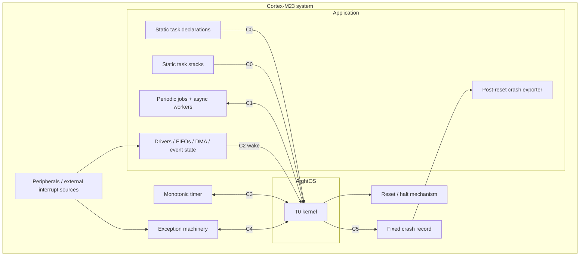
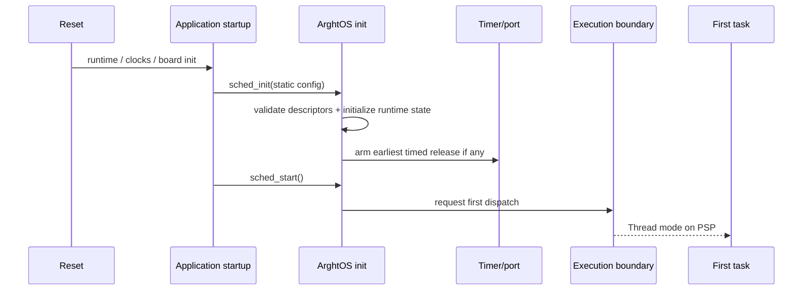

# Key goals

* Make every external dependency explicit.
* Keep device semantics outside scheduler policy.
* Show where application responsibility begins.
* Prevent hidden storage, timing, or logging dependencies.

# System view

# External entity: application tasks

**Key goal:** perform bounded periodic jobs or persistent asynchronous work.

**Dependencies:** C1 lifecycle/API.

**Dangerous aspects:** violating WCET assumptions, retaining stale device state, corrupting memory.

**Boundary specification:** tasks request scheduler operations; they never modify scheduler internals.

# External entity: device drivers and thin interrupt handlers

**Key goal:** preserve hardware event data and defer substantial work.

**Dependencies:** C2 interrupt wake.

**Dangerous aspects:** assuming wake counts events, clearing hardware too early, excessive handler latency.

**Boundary specification:** drivers own event data; the scheduler owns worker eligibility.

# External entity: platform timer

**Key goal:** provide monotonic time and one-shot wake capability.

**Dependencies:** C3 time/timer.

**Dangerous aspects:** wrap, horizon, or frequency-change mismatch.

**Boundary specification:** timer provides mechanism; kernel provides deadline policy.

# External entity: Cortex-M23 execution environment

**Key goal:** provide Handler-mode kernel execution and PSP/MSP task/kernel separation.

**Dependencies:** C4 execution boundary.

**Dangerous aspects:** nesting, stack corruption, ABI mismatch.

**Boundary specification:** processor mechanism is encapsulated by B4.

# External entity: reset/crash environment

**Key goal:** preserve or expose fatal diagnostic evidence.

**Dependencies:** C5 diagnostics.

**Dangerous aspects:** fault-path recursion or transport side effects.

**Boundary specification:** kernel writes a fixed record; system policy decides retention, export, and restart.

# Boot integration

# Dependencies

[T0](T0-top-level-kernel.md), all contracts in [contracts/](contracts/), and proofs in [../proof/](../proof/).

# Dangerous aspects

The system boundary is where proof assumptions can be invalidated: unbounded interrupt handling, incorrect timer behavior, overlapping task stacks, unpreserved event data, or application code exceeding WCET.

# Boundary specification

ArghtOS owns scheduler semantics and CPU execution ownership. It does not become a driver framework, IPC framework, memory allocator, filesystem, logging transport, or hardware abstraction layer.
