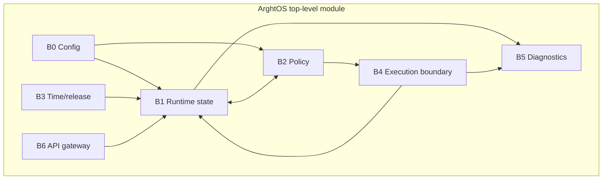
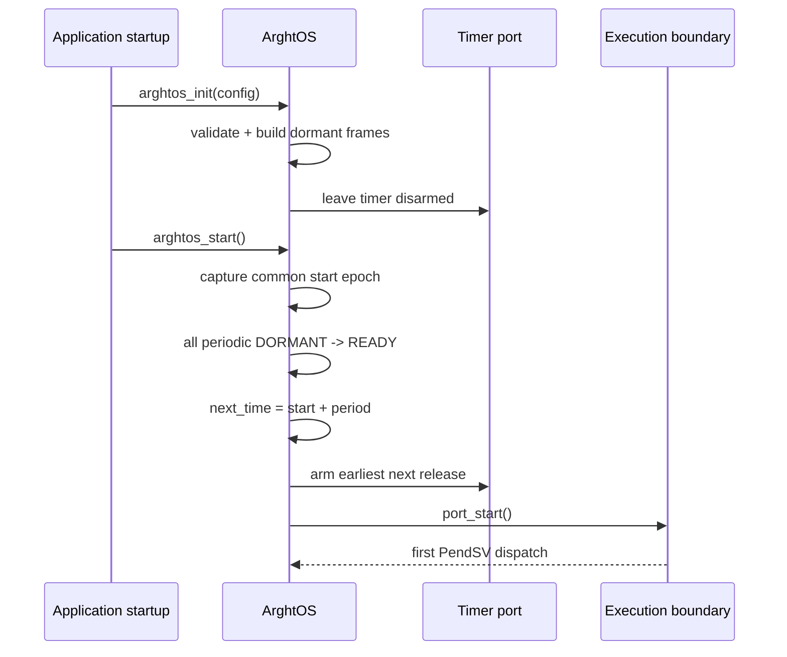
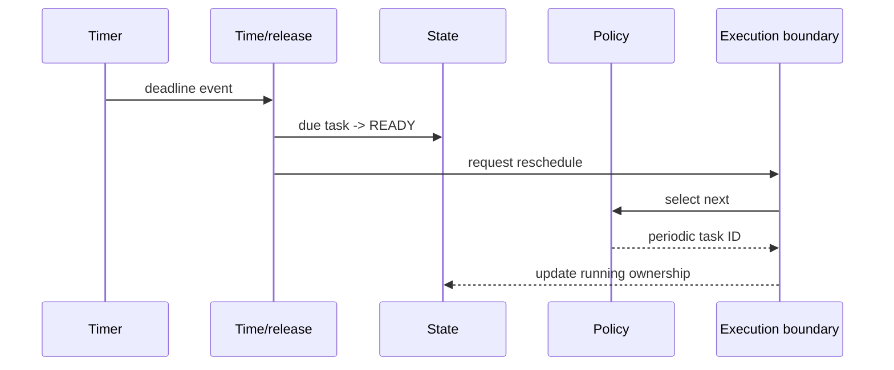
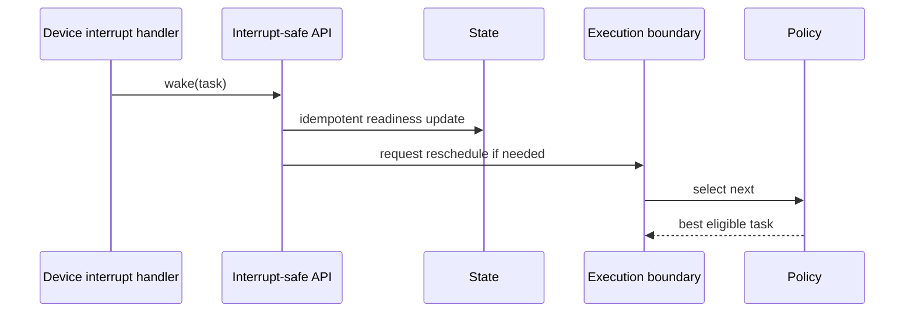
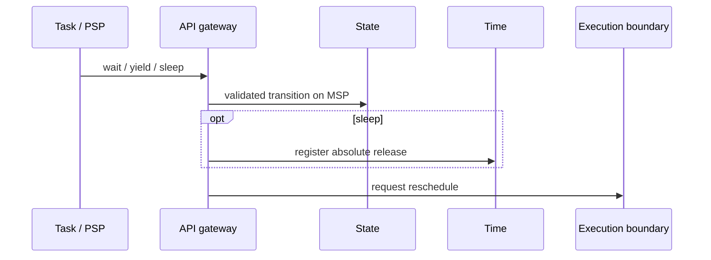

# Key goals

* Present one coherent scheduler module to the application.
* Integrate all code blocks without circular ownership.
* Keep policy, mechanism, time, and diagnostics separable.
* Ensure every external dependency crosses a named contract.
* Preserve direct traceability from implementation modules to proofs.

# Integrated topology

# Start path

# Periodic release path

# Asynchronous wake path

# Task wait/yield/sleep path

# Dependencies

All contracts C0-C10 and proofs P0-P8.

# Dangerous aspects

* Shared-state ownership becoming ambiguous between B1, B3, B4, and B6.
* Context mechanics leaking into policy.
* Timer code selecting tasks directly.
* Diagnostics growing into a logging subsystem.
* A second public API bypassing B6.
* Immutable configuration copied into mutable RAM unnecessarily.

# Boundary specification

T0 owns the scheduler as a subsystem. Its only external surfaces are static task configuration, the public task API, interrupt-safe wake, platform time/timer services, Cortex-M23 execution hooks, application task entry points/stacks, and the fixed crash-record/halt-reset hooks.

Everything else is private implementation.
