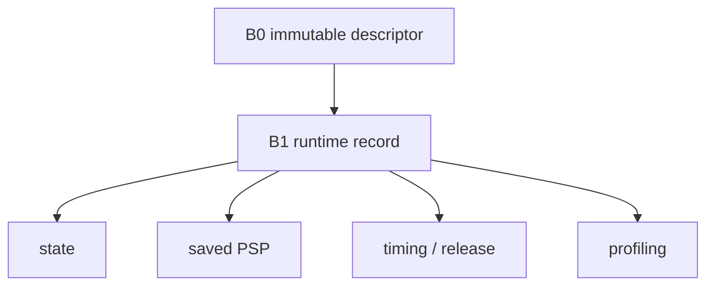

# Key goals

* Represent the P1 state machine compactly.
* Store only mutable data required at runtime; all of it is resident SRAM.
* Keep enough information for context continuation, timed release, async aging, and mandatory profiling.
* Make resident state a transparent function of `ARGHTOS_MAX_TASKS`.

# Concrete per-task state

B1 implements the 20-byte C8 record:

* saved PSP;
* next timed release/sleep deadline;
* cumulative CPU ticks;
* observed maximum contiguous run;
* saturating periodic overrun count;
* async age credit;
* state and flags.

The current RUNNING interval start is stored once in C9, not per task.

# Provides

Mutable task state to B2, B3, B4, B5, and B6.

# Requires

[C0](../contracts/C0-static-task-configuration.md).

# Dependencies

[P0](../../proof/P0-static-configuration-validity.md), [P1](../../proof/P1-task-state-invariants.md), [P7](../../proof/P7-bounded-memory-and-work.md).

# Dangerous aspects

* Per-task fields multiplying into unexpected SRAM growth.
* Non-atomic state mutation across execution contexts.
* Profiling counters overflowing silently.
* Runtime state becoming a second source of immutable configuration truth.
* Saved PSP being updated by more than one owner.

# Boundary specification

B1 is the sole owner of scheduler-mutated per-task state. Application code never writes it.
