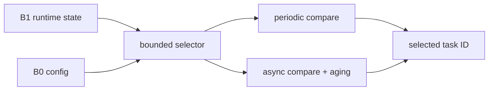

# Key goals

* Implement [C6](../contracts/C6-scheduling-policy.md) exactly.
* Remain independent of Cortex exception mechanics.
* Keep behavior deterministic and host-testable.
* Bound work by `ARGHTOS_MAX_TASKS`.

# Internal subfunctions

* periodic candidate comparison;
* async effective-priority calculation;
* async candidate comparison;
* deterministic tie-break;
* idle selection.

# Provides

[C6 scheduling policy](../contracts/C6-scheduling-policy.md).

# Requires

B0 immutable descriptors and B1 runtime state. Async aging uses dispatch opportunities, not elapsed time.

# Dependencies

[P1](../../proof/P1-task-state-invariants.md), [P5](../../proof/P5-priority-domain-isolation.md), [P6](../../proof/P6-rms-schedulability.md), [P7](../../proof/P7-bounded-memory-and-work.md).

# Dangerous aspects

* Coupling selection to PendSV implementation.
* Signed/unsigned priority mistakes.
* Non-deterministic tie resolution.
* Hidden loops beyond the bounded task scan.
* Aging influencing periodic ordering.

# Boundary specification

B2 returns an identity. It does not save or restore context, program timers, or change peripheral state.
