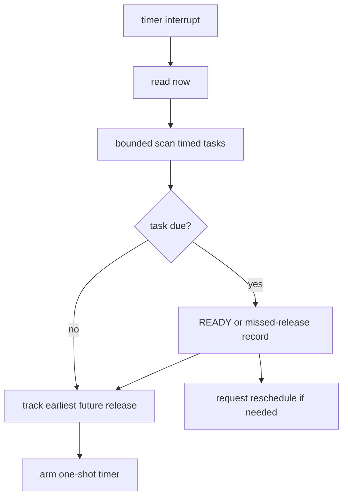

# Key goals

* Implement wrap-safe absolute-time comparison.
* Maintain each timed task's next release.
* Determine and arm the earliest future scheduler event.
* Release all tasks due at an observed timestamp.
* Detect missed periodic releases instead of creating additional task instances.

# Provides

Kernel-side implementation of [C3](../contracts/C3-time-timer.md).

# Requires

Platform timer functions, B0 descriptors, and B1 state.

# Dependencies

[P4](../../proof/P4-time-release-correctness.md), [P6](../../proof/P6-rms-schedulability.md), [P7](../../proof/P7-bounded-memory-and-work.md).

# Dangerous aspects

* Wraparound bugs.
* Release drift caused by using the wrong epoch for the next period.
* Hardware timer horizon mismatch.
* Release-processing cost omitted from timing analysis.
* Creating multiple active instances of one periodic task.

# Boundary specification

B3 decides timed eligibility and next timer programming. It does not choose which READY task runs.
