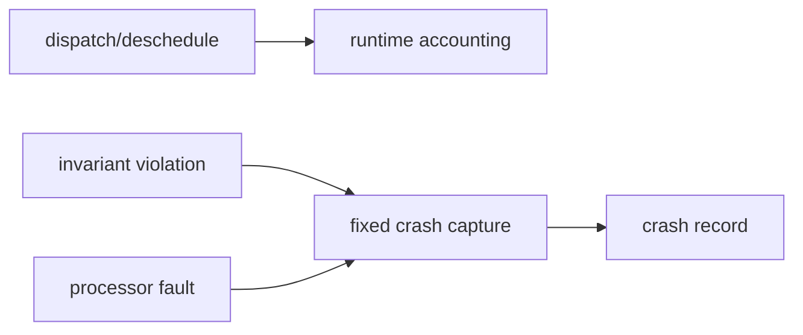

# Key goals

* Account task CPU usage at dispatch and deschedule boundaries.
* Record observed maximum execution duration and compact counters.
* Capture fatal scheduler/CPU context without allocation or formatted I/O.
* Keep normal-path overhead bounded.

# Internal submodules

* runtime accounting;
* policy-violation counters;
* invariant fault entry;
* CPU-fault record capture;
* crash-record integrity marker.

# Provides

[C5](../contracts/C5-fault-diagnostics.md).

# Requires

B1 state, platform clock, and processor exception information from B4.

# Dependencies

[P6](../../proof/P6-rms-schedulability.md), [P7](../../proof/P7-bounded-memory-and-work.md).

# Dangerous aspects

* Recursion in fault handling.
* Large counters breaking the SRAM target.
* Torn accounting updates.
* Treating observed maximum runtime as WCET.
* Calling transport or formatting code from a fatal path.

# Boundary specification

B5 captures binary evidence. It does not print, transmit, erase storage, or perform rich recovery.
