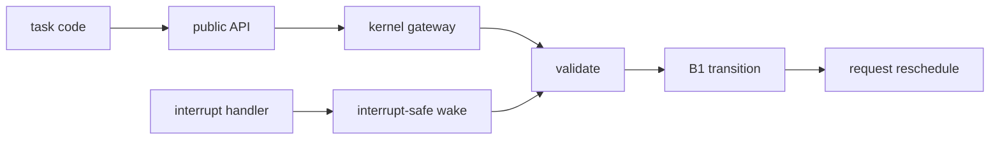

# Key goals

* Present a minimal, obvious C API.
* Distinguish task-context calls from interrupt-safe calls.
* Validate task IDs and call context cheaply.
* Move ownership-changing task requests onto MSP before state mutation.
* Keep public headers independent of private runtime structures.

# Provides

[C1](../contracts/C1-task-api-lifecycle.md) and the callable portion of [C2](../contracts/C2-wake.md).

# Requires

B1 state, B3 time services, and B4 processor boundary.

# Dependencies

[P1](../../proof/P1-task-state-invariants.md), [P3](../../proof/P3-wake-wait-race-freedom.md), [P7](../../proof/P7-bounded-memory-and-work.md).

# Dangerous aspects

* An API callable from the wrong execution context.
* Hidden blocking or long validation.
* Processor-specific calling details leaking into public headers.
* Returning errors after an operation whose semantics necessarily changed execution ownership.

# Boundary specification

B6 translates requests into kernel operations. It does not implement scheduling policy.
