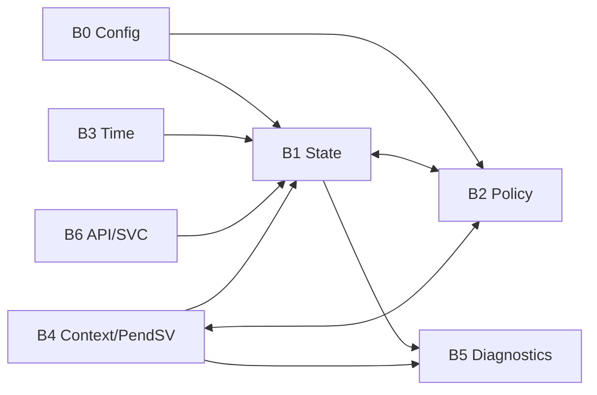

# Code blocks

* [B0 - Configuration](B0-configuration.md)
* [B1 - Runtime state](B1-runtime-state.md)
* [B2 - Scheduling policy](B2-scheduling-policy.md)
* [B3 - Time and release](B3-time-release.md)
* [B4 - Cortex-M23 context port](B4-context-port.md)
* [B5 - Diagnostics and fault capture](B5-diagnostics.md)
* [B6 - API and syscall gateway](B6-api-gateway.md)

