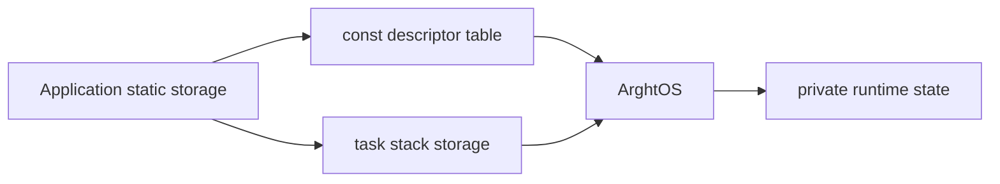

# Key goals

* Define every task and stack before `arghtos_start()`.
* Keep task descriptors immutable after initialization.
* Keep all task storage statically allocated.
* Make task ID equal to descriptor-table index.
* Keep immutable configuration eligible for placement in flash.

# Public task entry type

```c
typedef void (*arghtos_task_fn_t)(void);
```

Periodic entries execute exactly one bounded job and return.

Asynchronous entries are persistent workers and must not return during normal operation. Returning from an asynchronous entry is a task fault.

# Concrete task descriptor

```c
typedef struct {
    arghtos_task_fn_t entry;      /* immutable entry point */
    void             *stack_base; /* lowest address of static task stack */
    uint32_t          stack_size; /* bytes */

    arghtos_time_t    period;     /* periodic only, else 0 */
    arghtos_time_t    deadline;   /* periodic only, else 0 */
    arghtos_time_t    phase;      /* periodic only, else 0 */

    uint32_t          budget;     /* diagnostic runtime budget; 0 disables */
    uint16_t          flags;      /* reserved, must be 0 in v1 */
    uint8_t           task_class; /* arghtos_task_class_t */
    uint8_t           async_priority; /* async only */
} arghtos_task_config_t;
```

On a 32-bit Cortex-M ABI this descriptor is expected to occupy 32 bytes. That expectation is a build-time check, not a portability assumption.

Task ID is the zero-based array index:

```c
task_id == &tasks[task_id] - tasks
```

The descriptor therefore does not store a redundant task ID.

# Kernel configuration

```c
typedef struct {
    const arghtos_task_config_t *tasks;
    uint8_t                      task_count;
    uint8_t                      reserved0;
    uint16_t                     reserved1;
    struct arghtos_crash_record *crash_record; /* may be NULL */
} arghtos_config_t;
```

The caller must keep the configuration object and descriptor array valid for the lifetime of the scheduler.

# Configuration API

```c
arghtos_result_t arghtos_init(const arghtos_config_t *config);
void arghtos_start(void);
```

`arghtos_init()` is called once in privileged Thread mode before task scheduling begins.

`arghtos_start()` is called once after successful initialization and does not return during normal operation.

# Descriptor validity rules

For every descriptor:

* `entry != NULL`.
* `stack_base != NULL`.
* `stack_size` is at least the architecture minimum required for the initial context frame and required alignment.
* stack regions are pairwise non-overlapping.
* `flags == 0` in v1.
* `budget < ARGHTOS_TIME_HALF_RANGE` when nonzero.

For a periodic task:

* `task_class == ARGHTOS_TASK_PERIODIC`;
* `period > 0`;
* `period < ARGHTOS_TIME_HALF_RANGE`;
* `deadline > 0 && deadline <= period`;
* `phase < ARGHTOS_TIME_HALF_RANGE`;
* `async_priority == 0`.

For an asynchronous task:

* `task_class == ARGHTOS_TASK_ASYNC`;
* `period == 0`;
* `deadline == 0`;
* `phase == 0`;
* `async_priority < ARGHTOS_ASYNC_PRIORITY_LEVELS`.

# Initialization postconditions

Initialization sequence before `ARGHTOS_OK`:

1. validate the top-level pointer/count;
2. call `arghtos_port_init()`;
3. validate every descriptor including `arghtos_port_stack_valid()`;
4. perform pairwise stack-overlap checks;
5. initialize C8/C9 runtime state;
6. build every initial PSP frame through C4;
7. leave the platform scheduler timer disarmed until start.

On `ARGHTOS_OK`:

* the configuration is accepted as immutable;
* every runtime task slot corresponds to exactly one descriptor;
* all async tasks begin `DORMANT`;
* periodic tasks begin inactive and receive their first release at scheduler start plus `phase`;
* initial task frames are valid according to C4;
* no task has executed yet.

On error, no task is started and `arghtos_start()` is invalid until a successful re-initialization.

# Ownership



The application owns the bytes backing task stacks. ArghtOS owns PSP placement and stack use while a task executes.

# Atomicity

Configuration is immutable once scheduling starts. No runtime API modifies C0 data.

# Failure behavior

Bad configuration returns `ARGHTOS_ERR_BAD_CONFIG` or `ARGHTOS_ERR_BAD_ARGUMENT` from `arghtos_init()`.

Configuration corruption detected after scheduler start is a kernel invariant fault and enters C5 fatal handling.

# Dependencies

[C7 common types](C7-common-types-abi.md), [P0](../../proof/P0-static-configuration-validity.md), [P2](../../proof/P2-context-stack-integrity.md), [P6](../../proof/P6-rms-schedulability.md).

# Dangerous aspects

* Overlapping stacks.
* Stack sizes that cannot hold a first-run context.
* Mutable descriptor memory changed after initialization.
* Timing parameters at or beyond the half-range.
* Treating task activation as allocation.

# Boundary specification

C0 defines immutable application-supplied resources. ArghtOS validates and consumes them, but never creates, frees, resizes, or relocates them.
