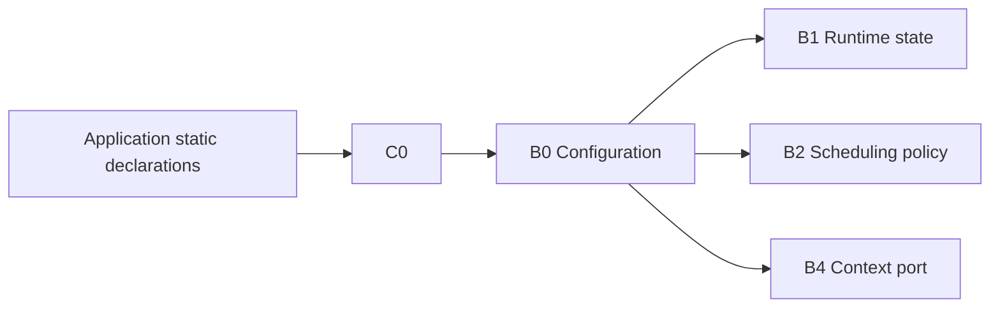

# Goal

Describe every task and its stack without dynamic allocation and make all scheduler resource bounds derivable at build time.

# Provided data

Each configured task has an immutable descriptor containing, directly or indirectly:

* stable task ID;
* entry function;
* stack base and stack size;
* task class: periodic or asynchronous;
* periodic parameters when applicable: period, relative deadline, phase;
* asynchronous base priority when applicable;
* optional runtime budget / diagnostic policy;
* optional human-readable debug name, preferably compiled out or kept in flash.

# Required invariants

* Task IDs are unique and in `[0, SCHED_MAX_TASKS)`.
* Stack regions are statically allocated and correctly aligned.
* Stack regions do not overlap.
* Periodic tasks have valid nonzero periods.
* Async priorities are representable only within the async domain.
* Configuration contains no writable pointers that permit the scheduler to resize a task stack.
* Task descriptors are immutable after initialization.

# Code blocks between this and other contracts

The [configuration block](../blocks/B0-configuration.md) validates and exposes descriptors to the scheduler core. The [runtime state block](../blocks/B1-runtime-state.md) owns mutable per-task data separately.

# Dependencies

[P0](../../proof/P0-static-configuration-validity.md), [P2](../../proof/P2-context-stack-integrity.md), and [P6](../../proof/P6-rms-schedulability.md).

# Dangerous aspects

* Overlapping stack regions.
* Descriptor/runtime-state aliasing.
* Period/deadline arithmetic exceeding clock half-range.
* Treating runtime activation as runtime allocation.
* Configuration silently exceeding the SRAM target.

# Boundary specification

The application owns storage declarations. ArghtOS owns validation and interpretation. ArghtOS never reallocates or frees configured resources.
