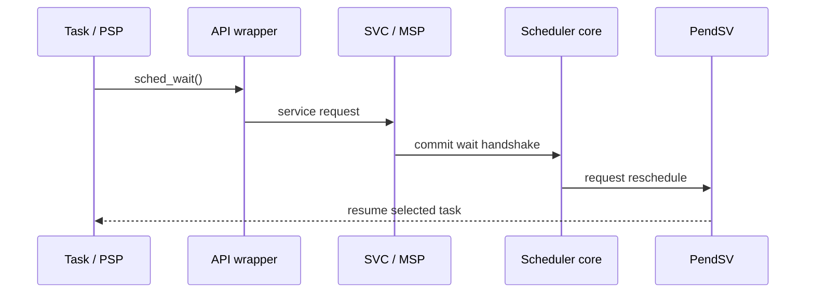

# Goal

Expose a minimal task API while ensuring execution ownership changes occur through scheduler-controlled Handler-mode paths.

# API semantics

Conceptually:

```c
void sched_yield(void);
void sched_wait(void);
void sched_sleep_until(sched_time_t absolute_time);
void sched_sleep_for(sched_duration_t delta);
bool sched_wake(task_id_t id);
```

Exact names and return types remain a code-contract decision.

* `yield`: RUNNING -> READY.
* `wait`: RUNNING -> WAITING, using the wake-safe handshake required by P3.
* `sleep_until`: RUNNING -> SLEEPING until an absolute release time.
* `sleep_for`: convenience wrapper producing an absolute release time.
* `wake`: idempotently makes a waiting/dormant asynchronous task eligible according to its lifecycle rule.
* Periodic task return means completion of one bounded job; it does not destroy the task descriptor.

# Handler-mode ownership

Task-facing calls that can change scheduler ownership enter SVC or an equivalent Handler-mode gateway before mutating scheduler state.



# Dependencies

[P1](../../proof/P1-task-state-invariants.md), [P3](../../proof/P3-wake-wait-race-freedom.md), [P4](../../proof/P4-time-release-correctness.md).

# Dangerous aspects

* Lost wake between work drain and wait commit.
* Calling blocking APIs from ISR context.
* Task return accidentally returning into invalid stack data.
* Relative sleep overflow.
* An API path mutating scheduling state on PSP rather than MSP.

# Boundary specification

Task code may request state transitions but cannot directly select the next task, write another task's runtime record, or manipulate context frames.
