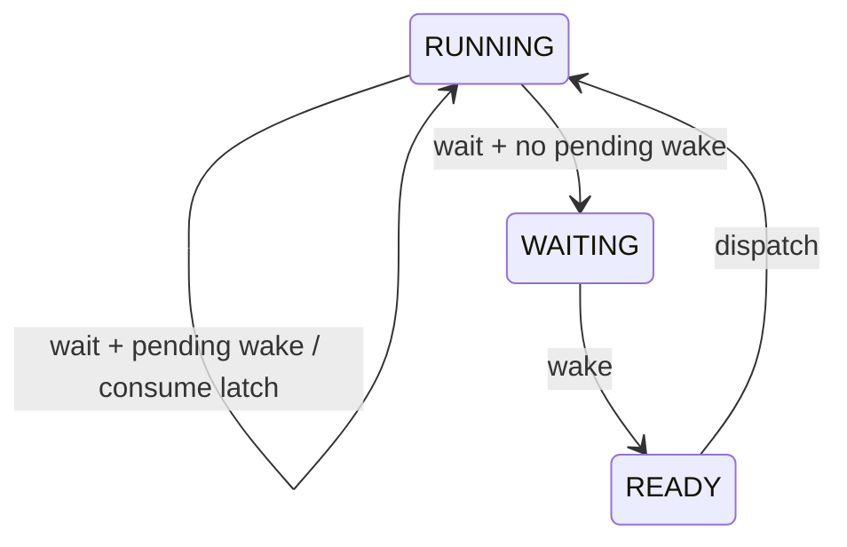

# Key goals

* Keep the public task API small.
* Make call-context legality explicit.
* Make every lifecycle transition deterministic.
* Prevent lost wakeups without counting repeated events.
* Keep periodic jobs compatible with fixed-priority response-time analysis.

# Public task-context API

```c
arghtos_result_t arghtos_yield(void);
arghtos_result_t arghtos_wait(void);
arghtos_result_t arghtos_sleep_until(arghtos_time_t absolute_time);
arghtos_result_t arghtos_sleep_for(arghtos_duration_t duration);
arghtos_result_t arghtos_wake(arghtos_task_id_t task_id);
```

All five functions are TASK-context functions. They are invalid from HANDLER context.

The interrupt-safe wake entry is specified by [C2](C2-wake.md).

# Periodic versus asynchronous lifecycle

Periodic tasks are bounded jobs:

```text
release -> READY -> RUNNING -> return -> inactive
```

Periodic tasks may be preempted and may call `arghtos_yield()`. They may not call `arghtos_wait()`, `arghtos_sleep_until()`, or `arghtos_sleep_for()`. Self-suspending periodic jobs are excluded from the v1 schedulability model.

Asynchronous tasks are persistent workers:

```text
DORMANT -> READY -> RUNNING <-> WAITING/SLEEPING
```

An async entry function must not return. Return is treated as a fatal task-contract violation.

# Yield

Precondition:

* caller is the current RUNNING task.

Operation:

```text
RUNNING -> READY
request dispatch
```

Postcondition:

* when the function eventually returns, the caller is RUNNING again.

`arghtos_yield()` is valid for both task classes.

# Wait

`arghtos_wait()` is valid only for an asynchronous task.

Each async runtime record contains one boolean `wake_pending` latch. This is not an event counter.

Atomic semantics:

```text
if wake_pending:
    wake_pending = false
    return immediately
else:
    RUNNING -> WAITING
    request dispatch
    resume only after wake causes WAITING -> READY -> RUNNING
```

A wake arriving while the task is RUNNING sets `wake_pending=true`. Any number of such wakes collapse into the same single bit.

This gives the scheduler exactly enough memory to close the final-drain-to-wait race without claiming event multiplicity.



# Sleep

`arghtos_sleep_until()` and `arghtos_sleep_for()` are valid only for asynchronous tasks.

For a future legal deadline:

```text
RUNNING -> SLEEPING
request timer update
request dispatch
timer due -> READY
```

If `absolute_time` is already due according to C7 wrap-safe comparison, `arghtos_sleep_until()` returns immediately.

`arghtos_sleep_for(0)` returns immediately.

A nonzero relative duration must be less than `ARGHTOS_TIME_HALF_RANGE`.

Wake does not terminate sleep early. A wake received while SLEEPING may set the one-bit `wake_pending` latch so that the event indication survives until the worker next reaches `wait()`.

# Task-context wake

`arghtos_wake(task_id)` targets only an asynchronous task.

State effects:

| Target state | Effect |
|---|---|
| DORMANT | READY; `age_credit=0` |
| WAITING | READY; `age_credit=0` |
| READY | no state change |
| RUNNING | set `wake_pending=true`; state unchanged |
| SLEEPING | set `wake_pending=true`; remain SLEEPING |
| FAULTED | error, no state change |

Repeated calls are idempotent with respect to scheduler work instances.

# Return values

For lifecycle calls:

* `ARGHTOS_OK`: operation accepted.
* `ARGHTOS_ERR_BAD_CONTEXT`: wrong execution context.
* `ARGHTOS_ERR_BAD_TASK_CLASS`: operation incompatible with current/target class.
* `ARGHTOS_ERR_BAD_TASK_ID`: invalid wake target.
* `ARGHTOS_ERR_BAD_STATE`: target is FAULTED or caller state violates the contract.
* `ARGHTOS_ERR_BAD_TIME`: illegal sleep interval/horizon.

Debug builds may additionally route programmer misuse to the diagnostic assertion path, but release behavior must still be deterministic.

# Atomicity

The following are linearizable scheduler operations:

* testing/consuming `wake_pending` and committing RUNNING -> WAITING;
* changing a target from WAITING/DORMANT to READY;
* setting `wake_pending`;
* RUNNING -> READY for yield;
* RUNNING -> SLEEPING and insertion into timed eligibility.

The implementation may use a short global interrupt-masked critical section. No application callback or timer wait may occur inside it.

# Task start and return trampolines

A task never begins directly at the application entry pointer.

The initial context begins at a kernel task-start trampoline that reads the immutable C0 entry for the current task.

Conceptually:

```c
_Noreturn void arghtos_task_start_trampoline(void)
{
    arghtos_task_id_t id = current_task();

    if (task[id].period != 0u) {
        for (;;) {
            task[id].entry();       /* exactly one bounded job */
            arghtos_port_service_call(ARGHTOS_SERVICE_TASK_RETURN, 0u);
            /* resumes here only at a later periodic release */
        }
    }

    task[id].entry();               /* persistent async worker */
    arghtos_fatal(ARGHTOS_FAULT_ASYNC_RETURNED, NULL, 0u);
}
```

For a periodic task, `ARGHTOS_SERVICE_TASK_RETURN` atomically marks the task DORMANT/inactive and requests dispatch through the selected port's service-call mechanism. The opaque saved context remains inside the trampoline. At the next periodic release, dispatch resumes the service call, the loop iterates, and the application entry is called again with a fresh unwound C job frame.

This avoids rebuilding a task context every period and prevents stack growth across releases.

For an async task, application entry return is fatal.

The initial frame LR points to a separate fatal return guard so an impossible return from the kernel trampoline is diagnosed.

# Dependencies

[C7](C7-common-types-abi.md), [C2](C2-wake.md), [C3](C3-time-timer.md), [C4](C4-context-switch-port.md), [P1](../../proof/P1-task-state-invariants.md), [P3](../../proof/P3-wake-wait-race-freedom.md), [P4](../../proof/P4-time-release-correctness.md).

# Dangerous aspects

* Losing a wake between final work drain and wait.
* Treating `wake_pending` as an event count.
* Allowing periodic self-suspension without changing P6.
* Returning from an async worker.
* Using sleep as an interruptible wait when its contract is timer-only.

# Boundary specification

C1 changes scheduler lifecycle state only. It does not define device-event storage, task selection policy, timer hardware, or CPU context mechanics.

# R3 minimum-footprint production profile

The generic/debug profile retains the documented context, class, and sleep-range error returns.

For the R3 production profile, valid-use semantics are unchanged, but selected misuse checks become preconditions:

## R3a

* task APIs are called only from TASK context.

## R3b

* WAIT and SLEEP are called only by async tasks;
* TASK_RETURN is generated only for periodic tasks;
* task wake IDs identify configured async tasks.

## R3c

* `sleep_for(dt)` receives `dt < ARGHTOS_TIME_HALF_RANGE`;
* future `sleep_until(t)` deadlines lie within the legal half-range horizon.

Violating these preconditions in the R3c production profile is outside the supported runtime contract. The generic/debug profile remains the verification surface for those misuse cases.

Wake/wait race semantics, sleep timer-only behavior, and all valid lifecycle transitions are unchanged.

# R6e task-service serialization refinement

In the trusted R6e Cortex-M23 profile, the C1 task-service transaction executes
inside SVC, and SVC belongs to C4's generated non-preempting
scheduler-exception class.

Therefore lifecycle state mutation remains one indivisible scheduler
transaction even when `arghtos_kernel_service()` omits its local PRIMASK
enter/exit pair. Timer and interrupt-wake handlers cannot preempt the SVC
transaction, and PendSV remains less urgent.

All public task-service semantics are unchanged. The generic profile retains
the explicit C4 critical section.

# R6f closed private service domain

For the trusted generated minimum-size profile, each legal C1 lifecycle
operation maps to one fixed private service ID through the generated target
veneer, and periodic task return maps to the fixed TASK_RETURN service through
the kernel trampoline.

No supported application path supplies an arbitrary service ID. Therefore the
set of service IDs reaching the kernel service dispatcher is exactly the
defined lifecycle-service set. Removing the unknown-service runtime branch from
that generated profile does not change any legal C1 transition or return value.

# R6j proven non-faulted wake-state domain

The trusted generated minimum-size profile may specialize wake handling when
`ARGHTOS_R5AC_TERMINAL_NO_FAULT_STATE=1`.

In that profile, fatal handling is terminal and does not store
`ARGHTOS_TASK_FAULTED` into scheduler state. Combined with P1's legal
lifecycle transitions and pristine generated initialization, every wake target
observable during supported normal execution is in exactly one of:

```text
DORMANT, READY, RUNNING, WAITING, SLEEPING
```

Therefore the minimum-profile wake helper need not retain runtime handling for
FAULTED or corrupt/unknown state encodings. The generic/debug profile retains
the documented FAULTED -> BAD_STATE behavior and invariant-fault diagnostic.

This refinement does not make FAULTED a legal normal state in the minimum
profile; it proves that the terminal-fault profile never resumes scheduler
execution after a condition that would require that state.

# R6n OK-only trusted service outcome

The trusted generated minimum-size profile may specialize the private service
dispatcher when all prior generated preconditions are active:

* R6f closes the service-ID domain to the five defined lifecycle services;
* generated API ownership ensures WAIT/SLEEP target the async worker,
  TASK_RETURN is emitted only by the periodic trampoline, and WAKE targets the
  generated async task;
* minimal validation makes invalid time arguments outside the supported
  production contract;
* R6j proves wake cannot observe FAULTED or an unknown task state.

Under those conditions, every reachable call to
`arghtos_kernel_service()` returns `ARGHTOS_OK`. The only remaining internal
service outcome is whether the operation requests dispatch.

The generated minimum profile may therefore carry a dispatch-only internal
outcome and return `ARGHTOS_OK` directly. Generic/debug profiles retain the
full public result domain and all misuse/error reporting.

# R6ab singleton wake API refinement

For the trusted single-async generated profile, the only legal target of the
public task-context wake API is the sole generated async worker.

The API signature remains unchanged for source compatibility, but the minimum
target implementation may ignore the runtime argument because C2 proves it is
always equal to the generated `WAKE_ID` on admitted executions.

The externally observable wake transition, return value, pending-wake latch,
and dispatch intent are unchanged.

# R6ae dispatch-owned YIELD transition

The trusted Cortex-M23 minimum profile may defer the physical
`RUNNING -> READY` write for YIELD from `arghtos_kernel_service()` to the
already-required PendSV dispatcher.

The public YIELD semantics remain:

```text
RUNNING -> READY
request dispatch
resume only when selected RUNNING again
```

The refinement is valid only when C4 guarantees that a YIELD service request
cannot resume Thread mode before the pended PendSV dispatch executes.

Generic ports and profiles retain the service-side READY write.

# R6ag timer-owned elapsed-time release during sleep

In the trusted unit-period single-async minimum profile, a successful future
\`SLEEP_UNTIL\` request may stop invoking the general time engine from SVC.

The service still:

* reads \`now\`;
* rejects an already-due deadline as the ordinary no-op case;
* stores the future absolute deadline;
* transitions the sole async worker RUNNING -> SLEEPING;
* requests dispatch.

Elapsed periodic-release catch-up and async sleep expiry remain owned by the
scheduler timer interrupt.

This changes only when already-due periodic releases are opportunistically
noticed by SVC. Their required release remains governed by C3's timer-delivery
jitter bound.

# R6ah default-dispatch generated service control flow

The trusted R6ad/R6ae/R6ag minimum profile has exactly two legal service
outcomes that do not require a dispatch request:

1. WAIT observes \`wake_pending=1\`, clears the latch, and leaves the caller
   RUNNING.
2. SLEEP_UNTIL observes an already-due deadline and returns without changing
   scheduler state.

Every other admitted service requests dispatch:

* YIELD;
* WAIT with no pending wake;
* future SLEEP_UNTIL;
* WAKE under R6ad;
* TASK_RETURN.

R6ah may therefore represent dispatch as the common service epilogue rather
than a per-call boolean. The two no-dispatch cases return \`ARGHTOS_OK\`
directly after completing their ordinary checks/mutation.

This is a control-flow representation refinement only. Public return values,
task-state transitions, wake-latch semantics, and dispatch-request cardinality
are unchanged.

# R6ai generated trampoline class test

The trusted R5p generated-order profile may classify the task-start trampoline
by task ID instead of reloading the compact schedule field.

C0 already proves:

~~~text
id < ARGHTOS_R5P_PERIODIC_COUNT  <=> periodic task
id >= ARGHTOS_R5P_PERIODIC_COUNT <=> async task
~~~

R6ai therefore uses that generated boundary to choose between the periodic
bounded-job loop and the asynchronous persistent-worker path.

The application entry, periodic TASK_RETURN service, async-return fatal rule,
and all lifecycle transitions are unchanged.

# R6aj generated direct async entry

R6aj refines the minimum generated task-start rule.

Periodic tasks still begin in the kernel periodic trampoline. The trampoline
calls one bounded application job, performs TASK_RETURN, and resumes only on a
later periodic release.

The sole generated async task begins directly at its application entry from its
prebuilt initial context. Its stacked LR is the kernel async-return guard. If
the async application entry returns, control therefore enters that guard and
calls:

~~~c
arghtos_fatal(ARGHTOS_FAULT_ASYNC_RETURNED, NULL);
~~~

No runtime task-class branch is needed in the shared trampoline.

Generic/runtime-built contexts continue to begin in the ordinary class-aware
trampoline.

# R6ak generated R4 periodic trampoline

R6ak is a Cortex-M23 target specialization layered on the accepted R6aj
generated-context lifecycle.

For each generated periodic task, the prebuilt context places the immutable
application entry pointer in saved R4. The target periodic trampoline then
executes:

~~~text
loop:
    call application entry through R4
    invoke TASK_RETURN service
    repeat after the task is released and dispatched again
~~~

The sole async task remains on R6aj's direct-entry path and never enters this
trampoline.

TASK_RETURN still marks the current periodic task DORMANT and requests
dispatch. Application-visible periodic lifecycle semantics are unchanged.
