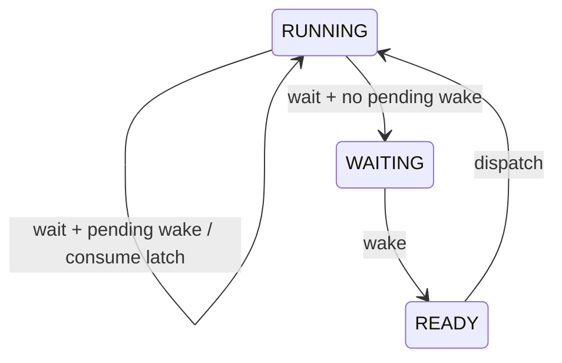

# Key goals

* Keep the public task API small.
* Make call-context legality explicit.
* Make every lifecycle transition deterministic.
* Prevent lost wakeups without counting repeated events.
* Keep periodic jobs compatible with fixed-priority response-time analysis.

# Public task-context API

```c
arghtos_result_t arghtos_yield(void);
arghtos_result_t arghtos_wait(void);
arghtos_result_t arghtos_sleep_until(arghtos_time_t absolute_time);
arghtos_result_t arghtos_sleep_for(arghtos_duration_t duration);
arghtos_result_t arghtos_wake(arghtos_task_id_t task_id);
```

All five functions are TASK-context functions. They are invalid from HANDLER context.

The interrupt-safe wake entry is specified by [C2](C2-wake.md).

# Periodic versus asynchronous lifecycle

Periodic tasks are bounded jobs:

```text
release -> READY -> RUNNING -> return -> inactive
```

Periodic tasks may be preempted and may call `arghtos_yield()`. They may not call `arghtos_wait()`, `arghtos_sleep_until()`, or `arghtos_sleep_for()`. Self-suspending periodic jobs are excluded from the v1 schedulability model.

Asynchronous tasks are persistent workers:

```text
DORMANT -> READY -> RUNNING <-> WAITING/SLEEPING
```

An async entry function must not return. Return is treated as a fatal task-contract violation.

# Yield

Precondition:

* caller is the current RUNNING task.

Operation:

```text
RUNNING -> READY
request dispatch
```

Postcondition:

* when the function eventually returns, the caller is RUNNING again.

`arghtos_yield()` is valid for both task classes.

# Wait

`arghtos_wait()` is valid only for an asynchronous task.

Each async runtime record contains one boolean `wake_pending` latch. This is not an event counter.

Atomic semantics:

```text
if wake_pending:
    wake_pending = false
    return immediately
else:
    RUNNING -> WAITING
    request dispatch
    resume only after wake causes WAITING -> READY -> RUNNING
```

A wake arriving while the task is RUNNING sets `wake_pending=true`. Any number of such wakes collapse into the same single bit.

This gives the scheduler exactly enough memory to close the final-drain-to-wait race without claiming event multiplicity.



# Sleep

`arghtos_sleep_until()` and `arghtos_sleep_for()` are valid only for asynchronous tasks.

For a future legal deadline:

```text
RUNNING -> SLEEPING
request timer update
request dispatch
timer due -> READY
```

If `absolute_time` is already due according to C7 wrap-safe comparison, `arghtos_sleep_until()` returns immediately.

`arghtos_sleep_for(0)` returns immediately.

A nonzero relative duration must be less than `ARGHTOS_TIME_HALF_RANGE`.

Wake does not terminate sleep early. A wake received while SLEEPING may set the one-bit `wake_pending` latch so that the event indication survives until the worker next reaches `wait()`.

# Task-context wake

`arghtos_wake(task_id)` targets only an asynchronous task.

State effects:

| Target state | Effect |
|---|---|
| DORMANT | READY; `age_credit=0` |
| WAITING | READY; `age_credit=0` |
| READY | no state change |
| RUNNING | set `wake_pending=true`; state unchanged |
| SLEEPING | set `wake_pending=true`; remain SLEEPING |
| FAULTED | error, no state change |

Repeated calls are idempotent with respect to scheduler work instances.

# Return values

For lifecycle calls:

* `ARGHTOS_OK`: operation accepted.
* `ARGHTOS_ERR_BAD_CONTEXT`: wrong execution context.
* `ARGHTOS_ERR_BAD_TASK_CLASS`: operation incompatible with current/target class.
* `ARGHTOS_ERR_BAD_TASK_ID`: invalid wake target.
* `ARGHTOS_ERR_BAD_STATE`: target is FAULTED or caller state violates the contract.
* `ARGHTOS_ERR_BAD_TIME`: illegal sleep interval/horizon.

Debug builds may additionally route programmer misuse to the diagnostic assertion path, but release behavior must still be deterministic.

# Atomicity

The following are linearizable scheduler operations:

* testing/consuming `wake_pending` and committing RUNNING -> WAITING;
* changing a target from WAITING/DORMANT to READY;
* setting `wake_pending`;
* RUNNING -> READY for yield;
* RUNNING -> SLEEPING and insertion into timed eligibility.

The implementation may use a short global interrupt-masked critical section. No application callback or timer wait may occur inside it.

# Task start and return trampolines

A task never begins directly at the application entry pointer.

The initial context begins at a kernel task-start trampoline that reads the immutable C0 entry for the current task.

Conceptually:

```c
_Noreturn void arghtos_task_start_trampoline(void)
{
    arghtos_task_id_t id = current_task();

    if (task[id].period != 0u) {
        for (;;) {
            task[id].entry();       /* exactly one bounded job */
            arghtos_port_service_call(ARGHTOS_SERVICE_TASK_RETURN, 0u);
            /* resumes here only at a later periodic release */
        }
    }

    task[id].entry();               /* persistent async worker */
    arghtos_fatal(ARGHTOS_FAULT_ASYNC_RETURNED, NULL, 0u);
}
```

For a periodic task, `ARGHTOS_SERVICE_TASK_RETURN` atomically marks the task DORMANT/inactive and requests dispatch through the selected port's service-call mechanism. The opaque saved context remains inside the trampoline. At the next periodic release, dispatch resumes the service call, the loop iterates, and the application entry is called again with a fresh unwound C job frame.

This avoids rebuilding a task context every period and prevents stack growth across releases.

For an async task, application entry return is fatal.

The initial frame LR points to a separate fatal return guard so an impossible return from the kernel trampoline is diagnosed.

# Dependencies

[C7](C7-common-types-abi.md), [C2](C2-wake.md), [C3](C3-time-timer.md), [C4](C4-context-switch-port.md), [P1](../../proof/P1-task-state-invariants.md), [P3](../../proof/P3-wake-wait-race-freedom.md), [P4](../../proof/P4-time-release-correctness.md).

# Dangerous aspects

* Losing a wake between final work drain and wait.
* Treating `wake_pending` as an event count.
* Allowing periodic self-suspension without changing P6.
* Returning from an async worker.
* Using sleep as an interruptible wait when its contract is timer-only.

# Boundary specification

C1 changes scheduler lifecycle state only. It does not define device-event storage, task selection policy, timer hardware, or CPU context mechanics.

# R3 minimum-footprint production profile

The generic/debug profile retains the documented context, class, and sleep-range error returns.

For the R3 production profile, valid-use semantics are unchanged, but selected misuse checks become preconditions:

## R3a

* task APIs are called only from TASK context.

## R3b

* WAIT and SLEEP are called only by async tasks;
* TASK_RETURN is generated only for periodic tasks;
* task wake IDs identify configured async tasks.

## R3c

* `sleep_for(dt)` receives `dt < ARGHTOS_TIME_HALF_RANGE`;
* future `sleep_until(t)` deadlines lie within the legal half-range horizon.

Violating these preconditions in the R3c production profile is outside the supported runtime contract. The generic/debug profile remains the verification surface for those misuse cases.

Wake/wait race semantics, sleep timer-only behavior, and all valid lifecycle transitions are unchanged.

# R6e task-service serialization refinement

In the trusted R6e Cortex-M23 profile, the C1 task-service transaction executes
inside SVC, and SVC belongs to C4's generated non-preempting
scheduler-exception class.

Therefore lifecycle state mutation remains one indivisible scheduler
transaction even when `arghtos_kernel_service()` omits its local PRIMASK
enter/exit pair. Timer and interrupt-wake handlers cannot preempt the SVC
transaction, and PendSV remains less urgent.

All public task-service semantics are unchanged. The generic profile retains
the explicit C4 critical section.

# R6f closed private service domain

For the trusted generated minimum-size profile, each legal C1 lifecycle
operation maps to one fixed private service ID through the generated target
veneer, and periodic task return maps to the fixed TASK_RETURN service through
the kernel trampoline.

No supported application path supplies an arbitrary service ID. Therefore the
set of service IDs reaching the kernel service dispatcher is exactly the
defined lifecycle-service set. Removing the unknown-service runtime branch from
that generated profile does not change any legal C1 transition or return value.

# R6j proven non-faulted wake-state domain

The trusted generated minimum-size profile may specialize wake handling when
`ARGHTOS_R5AC_TERMINAL_NO_FAULT_STATE=1`.

In that profile, fatal handling is terminal and does not store
`ARGHTOS_TASK_FAULTED` into scheduler state. Combined with P1's legal
lifecycle transitions and pristine generated initialization, every wake target
observable during supported normal execution is in exactly one of:

```text
DORMANT, READY, RUNNING, WAITING, SLEEPING
```

Therefore the minimum-profile wake helper need not retain runtime handling for
FAULTED or corrupt/unknown state encodings. The generic/debug profile retains
the documented FAULTED -> BAD_STATE behavior and invariant-fault diagnostic.

This refinement does not make FAULTED a legal normal state in the minimum
profile; it proves that the terminal-fault profile never resumes scheduler
execution after a condition that would require that state.
