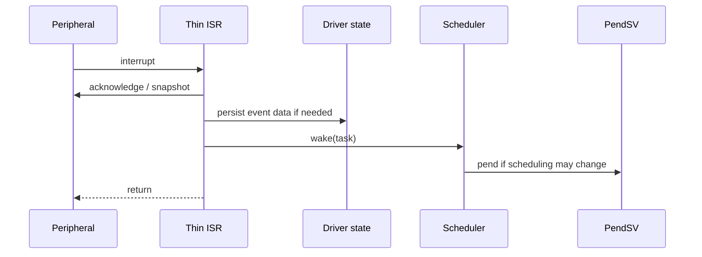

# Goal

Keep hardware interrupt service short while reliably transferring deferred work to statically configured tasks.

# Contract

A hardware ISR may:

1. acknowledge/clear or snapshot the minimum hardware state required by the peripheral;
2. update driver-owned persistent state if required;
3. call the ISR-safe wake primitive for a predeclared task;
4. request rescheduling if the wake changes dispatch eligibility; and
5. return.

A hardware ISR must not execute the deferred application workload.

# Wake semantics

Wake is **idempotent**. Repeated wakes while a task is already READY or RUNNING do not create queued task instances.

# Event multiplicity

If a peripheral can produce multiple meaningful events before the worker runs, the driver owns their persistence through a FIFO, DMA buffer, counter, bitmap, or other static mechanism.

The scheduler only preserves the proposition "this worker may have work."

# Dependencies

[P3](../../proof/P3-wake-wait-race-freedom.md), [P5](../../proof/P5-priority-domain-isolation.md), [P7](../../proof/P7-bounded-memory-and-work.md).

# Dangerous aspects

* Clearing hardware before preserving data that would otherwise be lost.
* Assuming the scheduler counts interrupts.
* Excessive ISR work.
* A wake implementation that races with `wait()`.
* Immediate direct context switch inside the device ISR instead of centralized PendSV dispatch.

# Boundary specification

The ISR owns peripheral acknowledgment. The driver owns event data. The scheduler owns task eligibility and dispatch.
