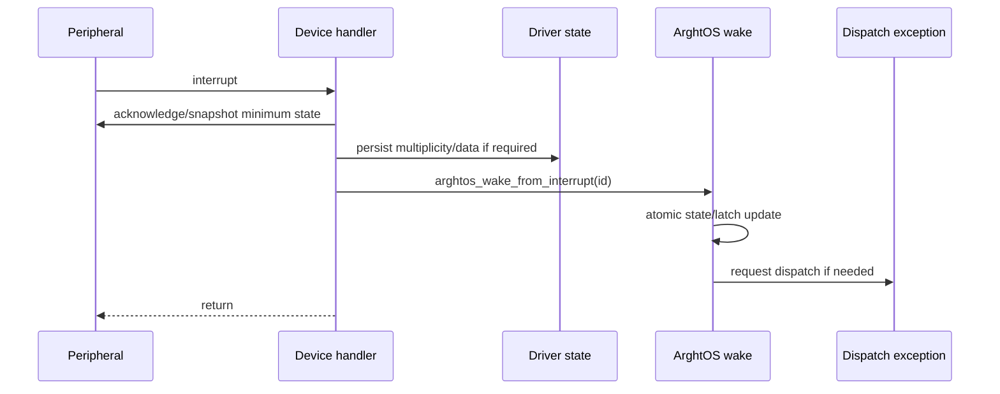

# Key goals

* Keep device handlers short.
* Allow hardware events to activate statically configured async workers.
* Never allocate, queue task instances, or preserve event multiplicity inside the scheduler.
* Make interrupt-triggered scheduling converge on the same dispatch path as task-triggered scheduling.

# Public interrupt-safe API

```c
arghtos_result_t arghtos_wake_from_interrupt(arghtos_task_id_t task_id);
```

This function is valid only from a maskable HANDLER context that participates in the scheduler's critical-section model.

It is invalid from TASK context, NMI, or fatal-fault handling.

# Preconditions

* the scheduler has completed `arghtos_start()` and C9 STARTED is set;
* `task_id` names a configured asynchronous task.

An interrupt wake received after init but before scheduler start returns `ARGHTOS_ERR_BAD_STATE` and performs no task-state mutation.

The device handler has already done whatever minimum hardware acknowledgment or data preservation is required to prevent loss at the peripheral boundary.

# State semantics

The target-state effects are identical to task-context `arghtos_wake()`:

| Target state | Effect |
|---|---|
| DORMANT | READY |
| WAITING | READY |
| READY | no state change |
| RUNNING | set `wake_pending=true` |
| SLEEPING | set `wake_pending=true`; remain SLEEPING |
| FAULTED | error, no state change |

No event count is incremented.

Repeated calls while the same scheduling indication is already represented collapse together.

# Dispatch request

If the operation changes task eligibility or sets a pending-wake condition that can alter the next dispatch decision, the kernel calls:

```c
void arghtos_port_request_dispatch(void);
```

The port implementation makes the scheduler dispatch exception pending.

The device handler itself never performs a direct task switch.



# Return values

* `ARGHTOS_OK`: valid target; wake indication accepted or already represented.
* `ARGHTOS_ERR_BAD_TASK_ID`: ID out of range.
* `ARGHTOS_ERR_BAD_TASK_CLASS`: target is periodic.
* `ARGHTOS_ERR_BAD_STATE`: scheduler has not started, or target is FAULTED.
* `ARGHTOS_ERR_BAD_CONTEXT`: caller is not a supported maskable handler.

The function must not fail due to memory or queue exhaustion.

# Event-data ownership

ArghtOS owns only the one-bit proposition:

```text
"this worker is runnable, or a wake must survive until its next wait"
```

The driver/application owns all actual event information, including:

* hardware FIFO contents;
* DMA descriptors or producer indices;
* packet/message queues;
* event counters;
* edge multiplicity;
* sampled register values that disappear when acknowledged.

# Handler execution bound

`arghtos_wake_from_interrupt()` must execute in bounded time independent of event history.

It may perform:

* task-ID/class validation;
* one short scheduler critical section;
* one runtime-state update;
* one dispatch-pending write.

It must not:

* scan arbitrary driver data;
* call application code;
* wait for hardware;
* print/log through a transport;
* allocate memory.

# Atomicity

The state/latch update is linearizable with C1 `arghtos_wait()`.

The concrete critical-section primitive is specified by C4.

# Dependencies

[C1](C1-task-api-lifecycle.md), [C4](C4-context-switch-port.md), [C7](C7-common-types-abi.md), [P3](../../proof/P3-wake-wait-race-freedom.md), [P5](../../proof/P5-priority-domain-isolation.md), [P7](../../proof/P7-bounded-memory-and-work.md).

# Dangerous aspects

* Clearing a peripheral before preserving required event data.
* Calling the task-context wake API from a handler.
* Calling this API from NMI/fatal-fault context.
* Treating a wake as one-for-one with a hardware event.
* Directly switching tasks in a device handler.

# Boundary specification

The device/driver owns hardware acknowledgment and event persistence. C2 owns only worker eligibility and the request to reconsider scheduling.

# R3 minimum-footprint production profile

The generic/debug profile retains BAD_CONTEXT, BAD_TASK_ID, BAD_TASK_CLASS, and pre-start BAD_STATE validation.

The R3 production profile assumes:

* interrupt wake is called only from a supported HANDLER context;
* the scheduler has already started;
* the wake ID is a generated valid async task ID.

The FAULTED-state check and wake/wait handshake remain active.

These assumptions are intended for generated driver integration where wake targets are compile-time constants.

# R6d serialized interrupt-wake refinement

For the trusted serialized-handler profile defined by C4, the atomic wake
state/latch update remains linearizable without a handler-local PRIMASK pair
because no other scheduler-mutating handler may preempt the active wake
handler. Task/SVC mutation remains protected by the ordinary C4 critical
section and therefore masks the wake handler while the wait transition is
being committed.

The public wake semantics and the one-bit pending-wake handshake are unchanged.
The generic profile retains the explicit handler-side critical section.
