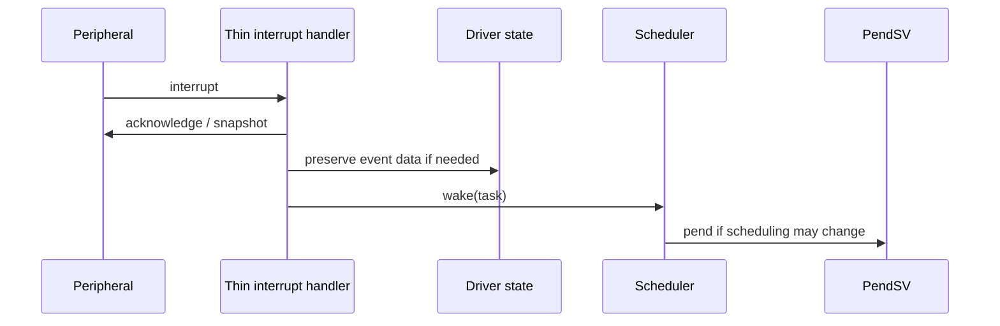

# Goal

Keep hardware interrupt service short while reliably transferring deferred work to statically configured tasks.

# Contract

A device interrupt handler may acknowledge or snapshot only the minimum hardware state, preserve driver-owned event data when needed, wake a predeclared task, request rescheduling if eligibility changes, and return. It does not execute deferred application work.

Wake is idempotent. Repeated wakes while a task is already READY or RUNNING do not create queued task instances.

# Event multiplicity

If multiple events matter individually, the driver owns their persistence through a FIFO, DMA buffer, counter, bitmap, or other static mechanism. The scheduler preserves only that the worker may have work.

# Dependencies

[P3](../../proof/P3-wake-wait-race-freedom.md), [P5](../../proof/P5-priority-domain-isolation.md), [P7](../../proof/P7-bounded-memory-and-work.md).

# Dangerous aspects

* Clearing hardware before preserving required data.
* Assuming the scheduler counts interrupts.
* Excessive handler work.
* Racing with `wait()`.
* Creating a second context-switch path outside PendSV.

# Boundary specification

The interrupt handler owns peripheral acknowledgment. The driver owns event data. The scheduler owns task eligibility and dispatch.
