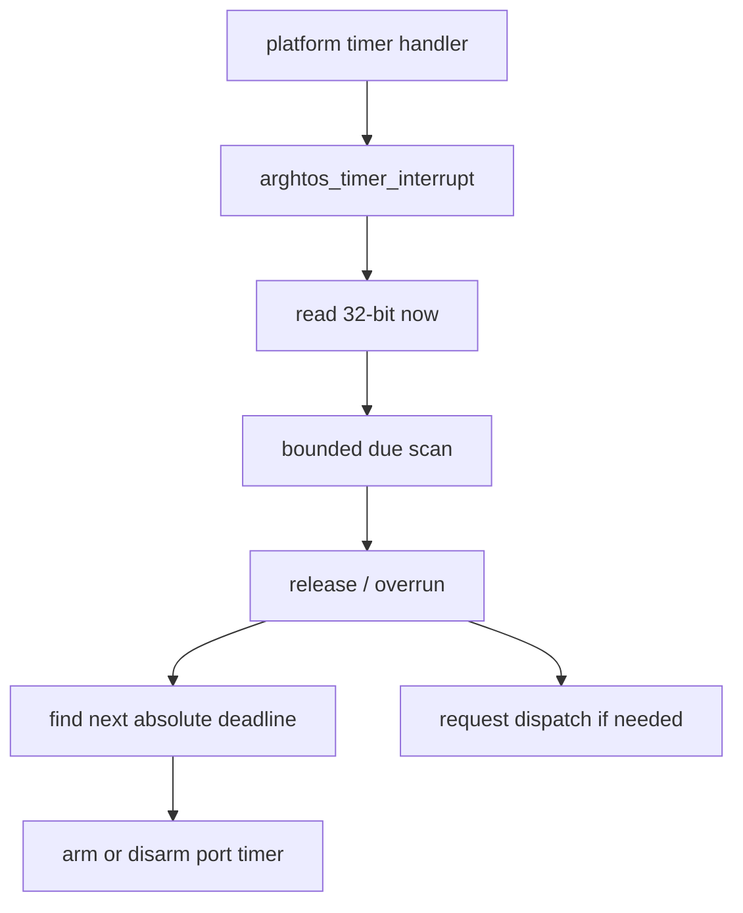

# Key goals

* Give the scheduler one stable time domain.
* Keep scheduler timing independent of the physical timer width.
* Support tickless absolute releases, sleep, aging, and runtime accounting.
* Expose timer jitter as an explicit schedulability input.

# Required compile-time constants

The platform must define:

```c
#define ARGHTOS_TIME_HZ              /* scheduler ticks per second, > 0 */
#define ARGHTOS_TIMER_JITTER_TICKS   /* conservative maximum late delivery */
```

`ARGHTOS_TIME_HZ` is constant for a running scheduler instance.

If the underlying hardware clock changes frequency, the port must compensate so that the scheduler-visible tick rate does not change.

# Platform-provided functions

```c
arghtos_time_t arghtos_port_time_now(void);
void arghtos_port_timer_arm(arghtos_time_t absolute_deadline);
void arghtos_port_timer_disarm(void);
```

These functions are part of the required Cortex-M23 platform port.

# Kernel timer entry

The platform timer handler calls:

```c
void arghtos_timer_interrupt(void);
```

This is a HANDLER-context kernel entry. It is not an application API.

# port_time_now

Postconditions:

* returns a modulo-2^32 monotonic scheduler timestamp;
* successive observations advance according to `ARGHTOS_TIME_HZ`;
* wrap from `UINT32_MAX` to zero is legal;
* read latency is bounded and included in kernel timing measurements.

The port may extend a narrower hardware counter in software.

# port_timer_arm

Preconditions:

* called only from KERNEL context;
* `absolute_deadline` is either already due or lies less than half-range in the future.

Postconditions:

* the platform arranges for `arghtos_timer_interrupt()` to run no earlier than the requested deadline;
* lateness beyond the deadline is conservatively bounded by `ARGHTOS_TIMER_JITTER_TICKS` plus explicitly modeled higher-priority interrupt interference;
* re-arming replaces the prior scheduler timer target.

If the hardware timer cannot represent the full scheduler horizon, the port owns intermediate wakeups/reprogramming. Those intermediate events must not be exposed as application task releases.

# port_timer_disarm

Cancels any future scheduler timer event when no timed scheduler event exists.

A hardware event already pending at the time of disarm may still enter `arghtos_timer_interrupt()`; the kernel must tolerate a spurious timer entry by finding no due tasks.

# Timer interrupt kernel behavior

At one timer entry:

1. read `now = arghtos_port_time_now()`;
2. examine configured timed tasks using bounded work;
3. release every periodic/sleeping task for which `arghtos_time_due(now, release_time)` is true;
4. record periodic overrun if a prior periodic job remains active;
5. calculate the earliest next timed event;
6. arm or disarm the platform timer;
7. request dispatch if READY eligibility changed.



# Periodic phase and release epoch

For periodic task `i`:

```text
release_i(k) = scheduler_start_time + phase_i + k * period_i
```

The next periodic release is derived from the previous release epoch, not from the handler arrival time. Therefore timer lateness does not accumulate as period drift.

# Sleep deadline

`arghtos_sleep_for(dt)` computes:

```text
deadline = now + dt    modulo 2^32
```

only after validating `dt < ARGHTOS_TIME_HALF_RANGE`.

# Profiling clock

The same scheduler clock is the default profiling clock.

All runtime quantities in C5 are therefore expressed in scheduler ticks and converted using `ARGHTOS_TIME_HZ`.

A platform-specific higher-resolution profiler may be added later only through a new explicit contract.

# Atomicity and call context

`port_timer_arm()` and `port_timer_disarm()` are called only by kernel code while scheduler timer state is serialized.

`arghtos_timer_interrupt()` may be preempted by unrelated higher-priority interrupts, but no such interrupt may directly mutate scheduler state except through C2 under the C4 critical-section rules.

# Failure behavior

The timer port has no runtime error return. Inability to honor the configured timebase or timer horizon is a platform integration error and must be caught before `arghtos_start()` or treated as a fatal kernel fault.

# Dependencies

[C7](C7-common-types-abi.md), [C4](C4-context-switch-port.md), [P4](../../proof/P4-time-release-correctness.md), [P6](../../proof/P6-rms-schedulability.md), [P7](../../proof/P7-bounded-memory-and-work.md).

# Dangerous aspects

* Letting physical timer width leak into scheduler semantics.
* Accumulating release drift from delayed timer handling.
* Hiding timer jitter from response-time analysis.
* Changing the scheduler-visible clock rate at runtime.
* Using absolute timestamps farther than half-range into the future.

# Boundary specification

C3 owns the scheduler-visible meaning of time. The platform owns how that timebase and one-shot deadline are realized in hardware.
