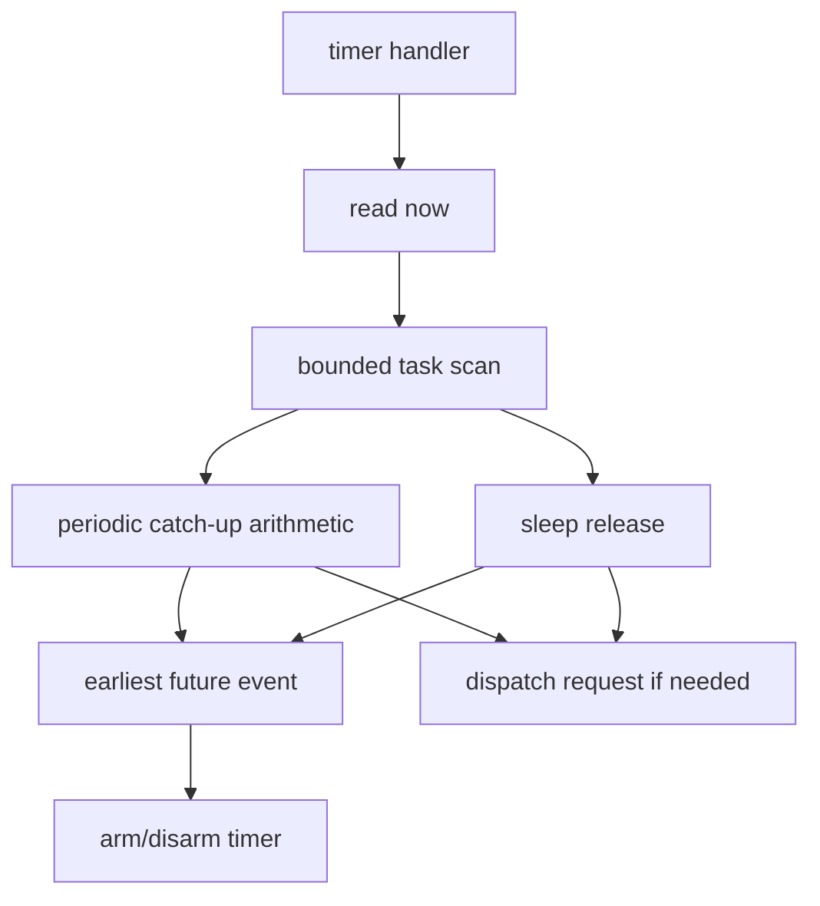

# Key goals

* Give the scheduler one stable 32-bit time domain.
* Keep physical timer width below the scheduler boundary.
* Support tickless periodic release and async sleep.
* Advance delayed periodic releases with bounded arithmetic.
* Expose timer/release jitter to P6.

# Required platform constants

```c
#define ARGHTOS_TIME_HZ
#define ARGHTOS_TIMER_JITTER_TICKS
```

Both are compile-time constants for a scheduler build.

# Platform functions

```c
arghtos_time_t arghtos_port_time_now(void);
void arghtos_port_timer_arm(arghtos_time_t absolute_deadline);
void arghtos_port_timer_disarm(void);
```

# Kernel timer entry

```c
void arghtos_timer_interrupt(void);
```

The selected platform timer handler calls this HANDLER-context entry.

# Timebase contract

`arghtos_port_time_now()` returns a modulo-2^32 monotonic scheduler timestamp.

The scheduler-visible rate is fixed at `ARGHTOS_TIME_HZ`.

If the hardware timer is narrower than 32 bits, the port extends/adapts it without exposing that mechanism to scheduler policy.

# One-shot deadline contract

`arghtos_port_timer_arm(t)` replaces the prior scheduler timer target.

The platform must arrange service at or after `t`, with lateness bounded by:

* `ARGHTOS_TIMER_JITTER_TICKS`; plus
* explicitly modeled higher-priority handler interference.

The timer service for any armed scheduler deadline must occur before lateness reaches `ARGHTOS_TIME_HALF_RANGE`.

# Periodic release model

All v1 periodic tasks are synchronous:

```text
release_i(k) = start_time + k*period_i
D_i = T_i
```

There is no per-task phase field in v1.

At scheduler start, every periodic task's first release is due at `start_time`.

After processing a release, C8 `next_time` contains the next ideal release epoch.

# Bounded catch-up for delayed timer service

For a periodic task whose `next_time` is due:

```c
uint32_t late = now - next_time;
uint32_t releases_due = 1u + (late / period);
next_time += releases_due * period; /* modulo 2^32 */
```

No loop over `releases_due` is permitted.

If the task was DORMANT:

* release one job;
* add `releases_due - 1` to its saturating missed-release counter.

If it was already active:

* release no additional instance;
* add `releases_due` to the saturating missed-release counter.

# Sleep release

For async sleep:

* one absolute deadline is stored in `next_time`;
* when due, SLEEPING -> READY;
* `age_credit=0`;
* any C1 pending-wake bit remains available for the worker's later wait.

# Timer handler behavior

At one entry:

1. read `now`;
2. scan at most `task_count` descriptors/controls;
3. process each due periodic task using the bounded catch-up formula;
4. release each due sleeping async task;
5. track the earliest future `next_time`;
6. arm or disarm the platform timer;
7. request dispatch if eligibility changed.



# Profiling clock

C5 uses the same clock for `run_start`, cumulative CPU time, and observed maximum run.

# Failure behavior

The port has no runtime allocation or queue failure.

Inability to satisfy the timebase, timer horizon, or half-range service requirement is a platform integration failure and must prevent a valid scheduler claim.

# Dependencies

[C0](C0-static-task-configuration.md), [C7](C7-common-types-abi.md), [C8](C8-task-control-record.md), [P4](../../proof/P4-time-release-correctness.md), [P6](../../proof/P6-rms-schedulability.md), [P7](../../proof/P7-bounded-memory-and-work.md).

# Dangerous aspects

* Release drift from using `now + period`.
* Looping once per missed period.
* Hiding timer jitter from schedulability analysis.
* Letting a due deadline become more than half-range late.
* Treating a narrow physical timer as the scheduler clock.

# Boundary specification

C3 owns scheduler-visible time and timed eligibility. The platform owns hardware realization of that timebase and deadline.
