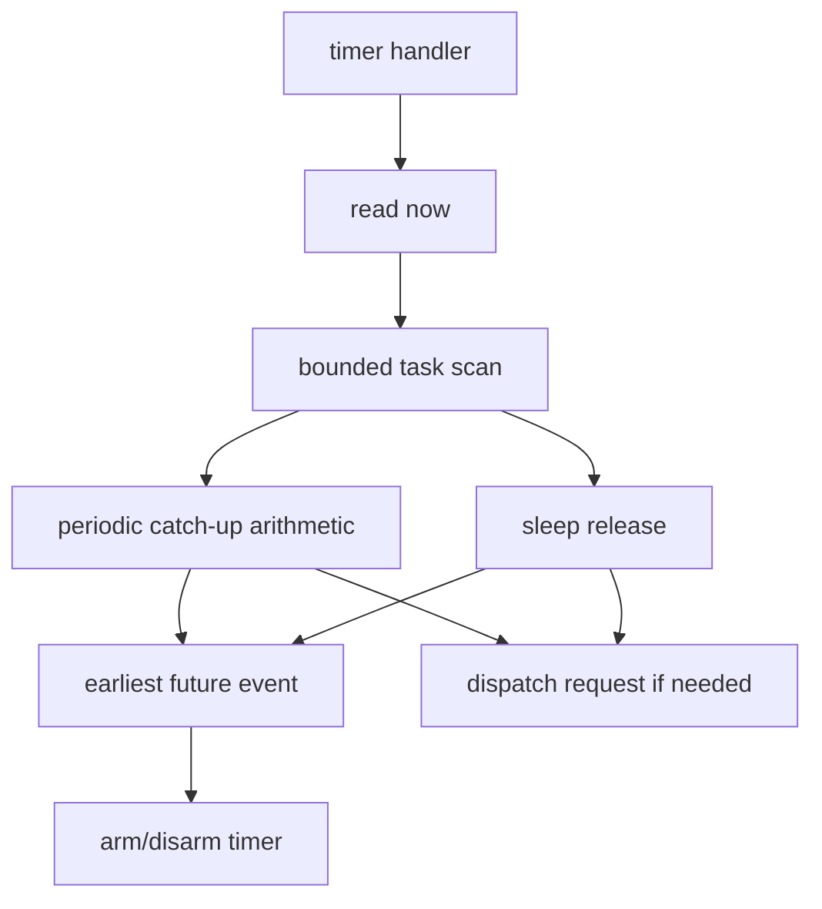

# Key goals

* Give the scheduler one stable 32-bit time domain.
* Keep physical timer width below the scheduler boundary.
* Support tickless periodic release and async sleep.
* Advance delayed periodic releases with bounded arithmetic.
* Expose timer/release jitter to P6.

# Required platform constants

```c
#define ARGHTOS_TIME_HZ
#define ARGHTOS_TIMER_JITTER_TICKS
```

Both are compile-time constants for a scheduler build.

# Platform functions

```c
arghtos_time_t arghtos_port_time_now(void);
void arghtos_port_timer_arm(arghtos_time_t absolute_deadline);
void arghtos_port_timer_disarm(void);
```

# Kernel timer entry

```c
void arghtos_timer_interrupt(void);
```

The selected platform timer handler calls this HANDLER-context entry.

# Timebase contract

`arghtos_port_time_now()` returns a modulo-2^32 monotonic scheduler timestamp.

The scheduler-visible rate is fixed at `ARGHTOS_TIME_HZ`.

If the hardware timer is narrower than 32 bits, the port extends/adapts it without exposing that mechanism to scheduler policy.

# Time-read call contexts

`arghtos_port_time_now()` is a read-only bounded operation that is safe from TASK, supported HANDLER, and KERNEL contexts.

It performs no scheduler-state mutation and may be used by the public `arghtos_sleep_for()` wrapper to form an absolute deadline before entering the SVC ownership-changing path.

If a narrow hardware timer requires software extension, the port must make this read safe in those contexts without introducing unbounded retry.

# One-shot deadline contract

`arghtos_port_timer_arm(t)` replaces the prior scheduler timer target.

The platform must arrange service at or after `t`, with lateness bounded by:

* `ARGHTOS_TIMER_JITTER_TICKS`; plus
* explicitly modeled higher-priority handler interference.

The timer service for any armed scheduler deadline must occur before lateness reaches `ARGHTOS_TIME_HALF_RANGE`.

# Periodic release model

All v1 periodic tasks are synchronous:

```text
release_i(k) = start_time + k*period_i
D_i = T_i
```

There is no per-task phase field in v1.

At scheduler start, every periodic task's first release is due at `start_time`.

After processing a release, C8 `next_time` contains the next ideal release epoch.

# Bounded catch-up for delayed timer service

For a periodic task whose `next_time` is due:

```c
uint32_t late = now - next_time;
uint32_t releases_due = 1u + (late / period);
next_time += releases_due * period; /* modulo 2^32 */
```

No loop over `releases_due` is permitted.

If the task was DORMANT:

* release one job;
* add `releases_due - 1` to its saturating missed-release counter.

If it was already active:

* release no additional instance;
* add `releases_due` to the saturating missed-release counter.

# Sleep release

For async sleep:

* one absolute deadline is stored in `next_time`;
* when due, SLEEPING -> READY;
* `age_credit=0`;
* any C1 pending-wake bit remains available for the worker's later wait.

# Timer handler behavior

At one entry:

1. read `now`;
2. scan at most `task_count` descriptors/controls;
3. process each due periodic task using the bounded catch-up formula;
4. release each due sleeping async task;
5. track the earliest future `next_time`;
6. arm or disarm the platform timer;
7. request dispatch if eligibility changed.



# Profiling clock

C5 uses the same clock for `run_start`, cumulative CPU time, and observed maximum run.

# Failure behavior

The port has no runtime allocation or queue failure.

Inability to satisfy the timebase, timer horizon, or half-range service requirement is a platform integration failure and must prevent a valid scheduler claim.

# Dependencies

[C0](C0-static-task-configuration.md), [C7](C7-common-types-abi.md), [C8](C8-task-control-record.md), [P4](../../proof/P4-time-release-correctness.md), [P6](../../proof/P6-rms-schedulability.md), [P7](../../proof/P7-bounded-memory-and-work.md).

# Dangerous aspects

* Release drift from using `now + period`.
* Looping once per missed period.
* Hiding timer jitter from schedulability analysis.
* Letting a due deadline become more than half-range late.
* Treating a narrow physical timer as the scheduler clock.

# Boundary specification

C3 owns scheduler-visible time and timed eligibility. The platform owns hardware realization of that timebase and deadline.

# R5q generated class-partition time scan

When C0's R5p generated ordering is enabled, the trusted minimum-size timer
engine may use two bounded contiguous scans instead of decoding task class for
every slot:

```text
for id in [0, P):
    process periodic release/catch-up
    consider next periodic release for timer

for id in [P, N):
    if async state is SLEEPING:
        process/consider its sleep deadline
```

The two scan ranges are disjoint and cover exactly the same generated task set
as the ordinary single mixed-class scan. Periodic catch-up arithmetic, async
sleep release semantics, earliest-deadline selection, and dispatch-request
behavior are unchanged.

Total task inspections remain bounded by `N`.

# R6b generated timer-entry precondition

The trusted generated minimum-size profile may elide the defensive
`ARGHTOS_KF_STARTED` test in `arghtos_timer_interrupt()` only when all of
these integration conditions are part of the selected port/profile contract:

1. `arghtos_init()` leaves the scheduler timer disarmed;
2. `arghtos_start()` sets `ARGHTOS_KF_STARTED` before it arms the first
   scheduler deadline;
3. a disarmed scheduler timer cannot call `arghtos_timer_interrupt()`;
4. no unrelated interrupt source calls `arghtos_timer_interrupt()`; and
5. once armed, the timer callback is delivered only according to the ordinary
   C3 one-shot timer contract.

Under those conditions every reachable timer entry occurs after STARTED is
committed. The generic profile retains the defensive pre-start guard.

# R6h single-async timer-suffix specialization

The trusted generated minimum-size profile may replace the async suffix loop in
the partitioned time scan with one direct slot operation when generated
configuration proves:

```text
ARGHTOS_STATIC_TASK_COUNT - ARGHTOS_R5P_PERIODIC_COUNT == 1
```

and the generated ordering contract places that sole async task at
`ARGHTOS_R5P_PERIODIC_COUNT`.

The direct operation performs exactly the same SLEEPING due test, SLEEPING to
READY transition, pending timer consideration, and dispatch-change reporting as
the one-iteration loop. The periodic prefix scan is unchanged.

The generic and multi-async profiles retain the loop.

# R6s physical-board delta-only timer selection

The trusted generated minimum profile may retain only the smallest unsigned
deadline delta while scanning timer candidates instead of retaining both the
winning absolute deadline and its delta.

For each candidate absolute deadline `t` at sampled time `now`:

```text
delta = t - now
```

The winner is selected by the same unsigned delta comparison used by the
ordinary always-armed implementation. After the scan, the port is armed with:

```text
now + best_delta
```

Unsigned scheduler-time arithmetic gives:

```text
now + (t - now) == t   modulo 2^32
```

so the reconstructed absolute deadline is exactly the same bit pattern as the
winning candidate.

This refinement changes only temporary representation inside the bounded timer
scan. Due testing, half-range legality, periodic catch-up, async sleep release,
and the one-shot timer ABI are unchanged.

# R6t unit-period timer dominance

The trusted generated minimum profile may omit all earliest-deadline candidate
tracking when its generated RMS prefix contains a periodic task with period
exactly one scheduler tick and generated ordering places that task at ID 0.

For task 0, after the periodic release/catch-up update at sampled time `now`:

```text
next_time[0] = now + 1
```

If task 0 was due, this follows algebraically from period = 1:

```text
releases = 1 + (now - old_next)
new_next = old_next + releases
         = now + 1
```

If task 0 was not due, the previous invariant already gives the same first
future unit-tick boundary.

Any legal future async sleep deadline has positive integer unsigned delta from
`now`, so its delta is at least one tick. Therefore no async sleep deadline,
and no longer-period periodic deadline, can precede task 0's `now+1`
deadline. Ties are harmless because the timer is armed to the same absolute
tick.

The timer scan may therefore ignore candidate deadlines and arm directly with
`next_time[0]` after processing all due state transitions.

This is valid only for the generated profile with:

* generated RMS ordering;
* at least one periodic task;
* minimum generated period exactly 1;
* task 0 being that period-1 task;
* ordinary wrap-safe half-range timing rules.

Generic profiles retain normal earliest-deadline selection.

# R6u singleton async release under unit-period dominance

R6u composes the already-proved singleton-async suffix refinement with R6t.

When the generated profile has exactly one async task at
`ARGHTOS_R5P_PERIODIC_COUNT`, and R6t has eliminated all async timer-candidate
tracking, the async suffix of the time engine has only one remaining purpose:
test that single task for SLEEPING and release it to READY when due.

Replacing the one-iteration loop with one direct slot operation visits the same
singleton task exactly once. R6t's dominant period-1 timer arm remains
unchanged.

# R6v unconditional unit-tick dispatch request

The trusted R6t/R6u minimum profile may request scheduler dispatch after every
scheduler-timer interrupt, rather than only when the time engine changed task
eligibility.

This is a size/runtime trade permitted only when:

* the generated unit-period timer profile is active;
* runtime profiling is disabled;
* async age-reset side effects are already elided;
* dispatcher invariants are proved by R5n.

When a timer tick changes eligibility, the dispatch request is already required.
When it changes no eligibility, the extra PendSV is redundant: the current
RUNNING task was the selector winner at the preceding dispatch boundary, and
with no eligibility change it remains the winner after the dispatcher
temporarily materializes RUNNING -> READY for preemption. The same saved context
is therefore selected again unless another independent scheduling indication
was already pending, in which case a dispatch was required anyway.

The extra dispatch changes bounded execution cost, not the legal task-state
result. Its cost must be included in P6 kernel overhead.
