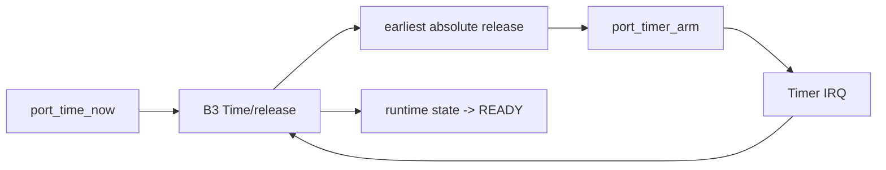

# Goal

Decouple scheduling semantics from any specific MCU timer while supporting absolute releases, sleeping, profiling, and wrap-safe comparisons.

# Required platform services

Conceptually:

```c
sched_time_t port_time_now(void);
void port_timer_arm(sched_time_t absolute_deadline);
void port_timer_disarm(void);
```

The concrete port may adapt a shorter hardware timer so long as the scheduler-visible contract remains monotonic and satisfies the legal horizon.

# Scheduler semantics

* All release times are absolute.
* Legal intervals are less than half the scheduler clock range.
* The next timer interrupt targets the earliest known timed release or a safe intermediate horizon required by hardware limits.
* The timer ISR releases all tasks due at the observed current time and requests rescheduling if eligibility changed.



# Profiling use

Dispatch and deschedule timestamps use the same monotonic domain or a separately declared profiling clock with a known conversion.

# Dependencies

[P4](../../proof/P4-time-release-correctness.md), [P6](../../proof/P6-rms-schedulability.md), [P7](../../proof/P7-bounded-memory-and-work.md).

# Dangerous aspects

* Ambiguous wrap comparisons.
* Programming a hardware deadline beyond its representable horizon.
* Clock frequency changes not reflected in the contract.
* Mixing relative and absolute timestamps.
* Profiling reads with unexpectedly high latency.

# Boundary specification

The platform port provides time observation and one-shot interrupt programming. The kernel decides what time matters and which tasks become READY.
