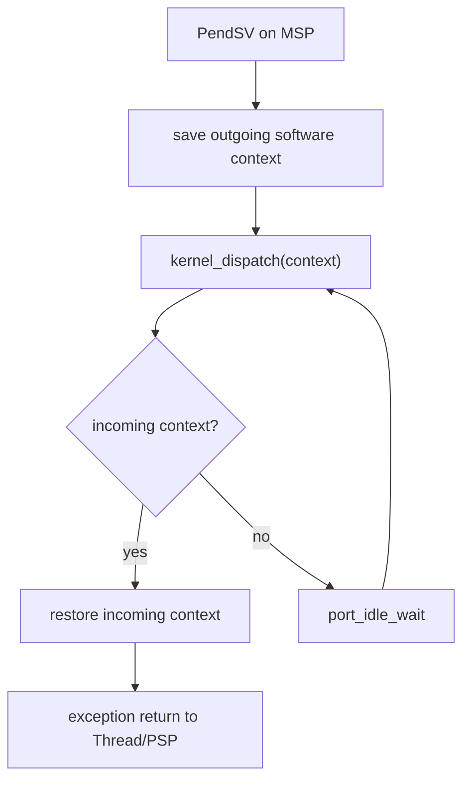

# Architecture-neutral port ABI

The portable kernel sees an opaque continuation token:

```c
typedef uintptr_t arghtos_context_t;
#define ARGHTOS_CONTEXT_NONE ((arghtos_context_t)0)
```

The portable kernel may use only the abstract operations declared by `arghtos_port.h`: port initialization and stack validation; scheduler serialization; task/handler context queries; task service calls; dispatch request/start/idle; initial-context construction; crash payload capture/terminal handoff; and time/timer operations.

The portable kernel must not know how context switching, system calls, interrupt masking, low-power wait, crash-register capture, or timer hardware are implemented.

# Cortex-M23 reference profile

The remainder of C4 describes the Cortex-M23 realization of that architecture-neutral ABI.

# Key goals

* Keep all processor-specific mechanics behind one port.
* Run tasks in Thread mode on PSP.
* Run kernel/exception work on MSP.
* Make PendSV the only task-context handoff point.
* Define the exact saved task frame used by initialization and switching.
* Give C1/C2 one bounded atomicity primitive.

# Port-provided functions

```c
arghtos_result_t arghtos_port_init(void);
bool arghtos_port_stack_valid(void *stack_base, uint32_t stack_size);

arghtos_irq_key_t arghtos_port_critical_enter(void);
void arghtos_port_critical_exit(arghtos_irq_key_t key);

bool arghtos_port_is_task_context(void);
bool arghtos_port_is_handler_context(void);

arghtos_result_t arghtos_port_service_call(
    uint8_t service_id,
    uint32_t arg0);

void arghtos_port_request_dispatch(void);
void arghtos_port_start(void);
void arghtos_port_idle_wait(void);

arghtos_context_t arghtos_port_build_initial_context(
    void *stack_base,
    uint32_t stack_size,
    void (*thread_start)(void),
    void (*return_guard)(void));

void arghtos_port_crash_fill(
    arghtos_crash_record_t *record,
    const void *port_fault_context);
```

The port also owns the vector-table implementations for SVC and PendSV.

# Port initialization

`arghtos_port_init()` is called exactly once by `arghtos_init()` before initial task frames are built.

On `ARGHTOS_OK`, it guarantees:

* the scheduler-visible timebase is ready;
* the scheduler timer source is disarmed;
* any stale pending scheduler-dispatch exception is cleared;
* PendSV is configured at the least urgent scheduler-relevant exception priority;
* SVC/PendSV integration is usable;
* no scheduler task has been started.

It may return `ARGHTOS_ERR_BAD_CONFIG` if the target integration cannot satisfy the contract.

# Stack validation

`arghtos_port_stack_valid(base,size)` is a pure/bounded configuration check used by C0.

It returns true only if the region can hold the scheduler's worst-case saved-context overhead under the target ABI, including required alignment. V1 reserves 68 bytes of context overhead: 32 bytes for R4-R11, 32 bytes for the basic hardware frame, and up to one 4-byte hardware alignment word.

It does not inspect overlap with other task stacks; C0 owns pairwise overlap validation.


# Critical section contract

`arghtos_port_critical_enter()` returns the prior mask state and prevents every maskable handler that is permitted to call ArghtOS from entering scheduler-state mutation.

Nested use must restore the exact prior state:

```c
arghtos_irq_key_t key = arghtos_port_critical_enter();
/* bounded scheduler mutation */
arghtos_port_critical_exit(key);
```

NMI and fatal fault exceptions are not masked and may not call normal scheduler APIs.

Critical sections must not contain:

* application callbacks;
* busy-waits for hardware;
* unbounded loops;
* formatted logging;
* sleep instructions.

# Context-query contract

`arghtos_port_is_task_context()` is true only when execution is Thread mode on a scheduler task PSP after scheduler start.

`arghtos_port_is_handler_context()` is true for supported maskable Handler-mode execution.

They are mutually exclusive for valid normal API calls.

# Dispatch request

`arghtos_port_request_dispatch()` makes PendSV pending.

It does not directly transfer execution and is safe to call repeatedly. Multiple requests collapse naturally into one pending PendSV.

PendSV must execute at the least urgent scheduler-relevant exception priority so device/timer handlers can complete before dispatch selection.

# Kernel dispatch callback

PendSV calls the C kernel through:

```c
arghtos_context_t arghtos_kernel_dispatch(arghtos_context_t outgoing_context);
```

Argument semantics:

* nonzero: opaque context token for the task that was executing before this dispatch;
* zero: no outgoing task context, used for first dispatch and idle re-selection.

Return semantics:

* nonzero: opaque context token for the selected task;
* zero: no task is READY.

If zero is returned, the port calls `arghtos_port_idle_wait()` and then calls `arghtos_kernel_dispatch(0)` again.



# Race-free idle wait

The no-READY decision and entry to WFI must form one race-free protocol.

PendSV SHALL:

1. disable maskable interrupts with PRIMASK before the serialized call to `arghtos_kernel_dispatch()`;
2. if a task is returned, restore the normal interrupt mask state before exception return;
3. if zero is returned, keep PRIMASK set while entering `arghtos_port_idle_wait()`.

`arghtos_port_idle_wait()` therefore has the precondition:

```text
called from the PendSV idle loop
PRIMASK = 1
the immediately preceding selector observed no READY task
without unmasking interrupts in between
```

The Cortex-M23 idle protocol is:

```text
WFI while PRIMASK=1
restore/enable normal mask state so any pending higher-priority handler runs
after that handler returns, mask again
return to the PendSV loop
kernel_dispatch(0) re-checks readiness while masked
```

Armv8-M WFI wakeup recognition ignores PRIMASK for an asynchronous exception that would otherwise preempt the active exception. Therefore an interrupt that becomes pending in the masked check-to-WFI window wakes/prevents sleep; it is serviced when the port restores the normal mask state.

The WFI must remain inside a loop because WFI may complete for reasons that do not create READY work.

This protocol eliminates the check-then-sleep race without allocating an idle task or idle PSP stack.

# Cortex-M23 task-service realization

The portable task API calls the abstract port function:

```c
arghtos_result_t arghtos_port_service_call(
    uint8_t service_id,
    uint32_t arg0);
```

The Cortex-M23 port realizes this with one fixed `SVC #0` instruction. The call ABI is:

```text
R0 = service_id
R1 = arg0
SVC #0
result returned in R0
```

The SVC handler reads the service ID from stacked R0 and arg0 from stacked R1, calls `arghtos_kernel_service(service_id,arg0)`, writes the result into stacked R0, and returns or tail-chains to PendSV.

The handler does not decode an SVC immediate from the instruction stream. Only the target port knows that Cortex-M23 uses SVC; the portable kernel knows only the abstract service-call operation.

# Saved task frame

Cortex-M23 basic exception entry provides the hardware frame:

```text
higher address
+-----------------+
| xPSR            |
| PC              |
| LR              |
| R12             |
| R3              |
| R2              |
| R1              |
| R0              |
+-----------------+  <- PSP after hardware stacking
```

The PendSV port additionally saves R4-R11 below that frame:

```text
higher address
| hardware frame  |  8 words
+-----------------+
| R11             |
| R10             |
| R9              |
| R8              |
| R7              |
| R6              |
| R5              |
| R4              |
+-----------------+  <- saved_psp
lower address
```

The deliberately synthesized dormant context is 16 words = 64 bytes because the initial stack top is 8-byte aligned.

During ordinary task execution, exception entry may add one 4-byte alignment word when the interrupted PSP was only 4-byte aligned. The worst scheduler context overhead is therefore 68 bytes before ordinary task stack use.

The stacked xPSR alignment indicator governs hardware unstacking; the software R4-R11 save/restore remains symmetric around the hardware frame.

# Initial context

`arghtos_port_build_initial_context()`:

1. computes the highest 8-byte-aligned address within the provided stack;
2. verifies the configured stack satisfies the 68-byte worst-case scheduler context reserve, even though the synthesized initial frame itself uses 64 bytes;
3. creates a frame equivalent to a preempted task;
4. sets R4-R12 and R0-R3 to zero;
5. sets stacked LR to `return_guard`;
6. sets stacked PC to `thread_start`;
7. sets stacked xPSR with the Thumb state bit set;
8. returns the saved PSP pointing at R4.

No task entry argument exists in v1.

C1 requires `thread_start` to be the kernel task-start trampoline, not the application task entry. The trampoline invokes the immutable C0 application entry according to task class.

The `return_guard` is a fatal kernel guard that must never return.

# Cortex-M23 crash-payload profile

The portable C5 crash record reserves ten 32-bit words for port-defined state.

The Cortex-M23 reference port uses one port-format identifier for this payload:

```text
word 0  MSP
word 1  PSP
word 2  EXC_RETURN
word 3  stacked R0
word 4  stacked R1
word 5  stacked R2
word 6  stacked R3
word 7  stacked LR
word 8  stacked PC
word 9  stacked xPSR
```

`arghtos_port_crash_fill()` owns extraction of those values from the opaque `port_fault_context` or current processor state. The portable kernel only zeroes the payload, calls the port, and commits the record.

# First start

`arghtos_port_start()`:

* is called once after successful C0 initialization/start-state commit;
* takes ownership of the scheduler's normal interrupt/event-enable state because the call never returns;
* ensures scheduler-relevant maskable events can be serviced;
* switches kernel execution into the dispatch mechanism;
* invokes `arghtos_kernel_dispatch(0)` through the target dispatch path;
* never returns during normal operation.

# Privilege model and trusted-task restriction

All v1 tasks run privileged in Thread mode.

ArghtOS v1 does not depend on an MPU, MMU, or TrustZone security state separation. Unprivileged task execution is outside the v1 contract.

Because tasks are privileged, correctness depends on a trusted-application rule: scheduled task code must not directly modify scheduler-owned processor control state, including PRIMASK, PSP/MSP selection, PendSV/SVC configuration, or scheduler exception priorities. Device-driver interrupt configuration is allowed only when it preserves the integration priority and masking rules.

A task that directly changes these registers is outside the supported scheduler contract; ArghtOS cannot contain that misuse without privilege isolation.

# PSP/MSP ownership


| Situation | Stack |
|---|---|
| application startup before scheduler start | MSP |
| task Thread mode | PSP |
| SVC | MSP |
| PendSV | MSP |
| timer/device handlers | MSP |
| fatal handlers | MSP |
| idle wait in scheduler | MSP / port-owned kernel execution |

# Failure behavior

Invalid context-frame metadata, impossible PSP alignment/range in diagnostic builds, unknown SVC number, or impossible dispatch return enters C5 fatal handling.

# Dependencies

[C7](C7-common-types-abi.md), [C5](C5-fault-diagnostics.md), [P2](../../proof/P2-context-stack-integrity.md), [P7](../../proof/P7-bounded-memory-and-work.md).

# Dangerous aspects

* Save/restore asymmetry.
* Incorrect initial frame.
* SVC changing task ownership directly instead of deferring to PendSV.
* PendSV priority configured above device/timer handlers.
* Critical-section restore failing to preserve prior mask state.
* Idle wait preventing scheduler-relevant interrupts from running.

# Boundary specification

C4 owns processor execution mechanics, special-register/exception handling, and critical sections. The kernel owns task state and scheduling policy.

# Minimum-size initial task argument

The minimum-size Cortex-M23 profile may use the entry/next-time overlay defined
by R4u.

That profile extends initial-context construction with one architecture-neutral
private trampoline argument:

```c
arghtos_context_t arghtos_port_build_initial_context_top_arg(
    void *stack_top,
    void (*thread_start)(arghtos_task_fn_t),
    void (*return_guard)(void),
    arghtos_task_fn_t initial_arg);
```

The argument exists only to bootstrap the private task trampoline. It does not
change the public application task signature.

For Cortex-M23, the port places `initial_arg` in stacked hardware R0 of the
synthesized initial frame. The ordinary saved-frame layout is unchanged:

```text
software R4-R11  8 words
hardware R0-R3,R12,LR,PC,xPSR  8 words
total initial frame 16 words / 64 B
```

No additional context word or PSP reserve is required. On first exception
return, normal AAPCS argument delivery presents the entry pointer in R0.

The generic/debug and non-overlay profiles retain the ordinary no-argument
initial-context API.

# R5l prebuilt initial-context equivalence

The trusted generated minimum-size profile may enter C4 with an initial saved
context already present in each application-owned task stack.

For Cortex-M23, that generated context must be exactly equivalent to the
ordinary synthesized 16-word frame:

```text
software R4-R11                 8 zero words
hardware R0                     private task-entry pointer
hardware R1-R3,R12              zero
hardware LR                     task return guard
hardware PC                     task-start trampoline, Thumb bit cleared
hardware xPSR                   Thumb state bit set
```

The saved context token still points at software-saved R4. The 64-byte initial
frame and 68-byte worst-case scheduler context reserve are unchanged.

This is a build-time realization of the existing C4 frame contract, not a new
context ABI. PendSV save/restore, PSP ownership, exception return, and runtime
alignment handling are unchanged.

# R5n trusted dispatch-entry refinement

For the trusted generated minimum-size profile, the C4 handoff protocol is a
precondition strong enough to discharge several portable dispatcher assertions:

* `arghtos_port_start()` invokes first dispatch only after STARTED is committed;
* PendSV supplies a nonzero outgoing context only for a task that was previously
  selected by the dispatcher;
* the PendSV no-task/idle path supplies a zero context only while
  `current_task` is INVALID;
* a generated saved context token is nonzero and valid for every configured
  task.

The generic/debug profile continues to check these combinations at runtime.
R5n may compile those redundant checks out of the minimum-size image without
changing the context ABI or legal scheduler behavior.


# R5ad compact target service veneers

The trusted minimum-size target profile may provide the public task-context
service veneers in target assembly instead of the portable C translation unit.

This specialization is permitted only when the veneer is ABI-equivalent to the
portable wrapper:

* `arghtos_yield()` invokes `ARGHTOS_SERVICE_YIELD`;
* `arghtos_wait()` invokes `ARGHTOS_SERVICE_WAIT`;
* `arghtos_sleep_until(t)` invokes `ARGHTOS_SERVICE_SLEEP_UNTIL` with
  `arg0=t`;
* `arghtos_wake(id)` invokes `ARGHTOS_SERVICE_WAKE` with `arg0=id`;
* each veneer returns the service result in R0 using the ordinary public C ABI.

For YIELD and WAIT, the kernel service cases do not inspect `arg0`. Therefore
the target veneer need not initialize R1 before SVC. This is an internal
calling-convention optimization only; the public functions remain no-argument
operations.

The generic/debug and non-specialized builds retain the portable C veneers.
The portable scheduler core remains target-independent C11.

# R6d serialized scheduler-handler profile

A trusted generated Cortex-M23 profile may elide handler-local
`arghtos_port_critical_enter/exit()` around scheduler mutation in
`arghtos_timer_interrupt()` and `arghtos_wake_from_interrupt()` only when
the board integration guarantees all of the following:

1. every maskable handler that may call a scheduler-mutating ArghtOS handler
   entry executes at one non-preempting scheduler-handler priority class;
2. no member of that class can preempt another member while it is active;
3. PendSV remains strictly less urgent than that class;
4. NMI and fatal-fault handlers never call normal scheduler APIs; and
5. task-context scheduler mutation still enters the ordinary C4 critical
   section, so a scheduler-mutating handler cannot interleave with an SVC
   mutation.

Under those conditions Handler-mode execution itself is the serialization
mechanism between timer/wake callbacks. The generic profile retains PRIMASK
enter/exit in each handler-facing API.

This specialization is an integration property, not a portable-kernel
assumption. A generated build must not enable it unless the exception-priority
configuration is fixed and verified.

# R6e unified scheduler-exception serialization

The trusted generated Cortex-M23 profile may extend the R6d non-preempting
scheduler-handler class to SVC.

When enabled, all normal scheduler-state mutation performed from Handler mode
uses one generated non-preempting exception-priority class:

* SVC task-service handling;
* scheduler timer handling;
* device handlers permitted to call `arghtos_wake_from_interrupt()`.

The profile is valid only when:

1. SVC and every scheduler-mutating maskable device/timer handler execute at
   one priority level or otherwise at priorities that cannot preempt one
   another;
2. PendSV is strictly less urgent than every member of that class;
3. NMI and fatal-fault handlers never call normal scheduler APIs;
4. no scheduler-state mutation is performed from any other preempting handler
   class; and
5. the generated exception-priority configuration is fixed before
   `arghtos_start()` and is not modified by application tasks.

Under these conditions, Handler-mode exception execution itself serializes
`arghtos_kernel_service()`, `arghtos_timer_interrupt()`, and interrupt wake.
The minimum profile may therefore omit the PRIMASK enter/exit pair inside
`arghtos_kernel_service()`.

The generic profile retains the explicit critical section. This is a
Cortex-M23 integration specialization, not a portable scheduler assumption.

# R6f trusted service-ID domain

The trusted generated minimum-size Cortex-M23 profile may additionally treat the
private service-ID domain entering `arghtos_kernel_service()` as closed.

This refinement is valid only when:

1. task code reaches scheduler lifecycle services only through the public
   ArghtOS task APIs and the generated task-return trampoline;
2. the selected Cortex-M23 service veneers emit only the five defined private
   IDs: YIELD, WAIT, SLEEP_UNTIL, WAKE, and TASK_RETURN;
3. application code does not call the private port service gateway directly;
4. no generated veneer accepts a runtime-selected service ID; and
5. the SVC handler forwards the veneer-supplied ID unchanged.

Under those conditions an unknown service ID is unreachable in the generated
profile, so the minimum `arghtos_kernel_service()` implementation need not
carry a runtime BAD_SERVICE default branch. The generic/debug profile retains
the fatal unknown-service check.

This specialization does not use an unreachable compiler intrinsic and does
not introduce undefined C behavior. If the generated-profile precondition is
violated, behavior is outside that profile contract rather than relying on
undefined execution.

# R6i known-unmasked PendSV entry

The trusted generated Cortex-M23 minimum profile may treat the normal mask state
at every supported PendSV entry as known:

```text
PRIMASK = 0
```

This refinement is valid only when:

1. trusted application tasks never modify PRIMASK;
2. scheduler startup restores/enables normal mask state before the first
   PendSV dispatch;
3. R6d/R6e scheduler-mutating SVC, timer, and device handlers do not leave
   PRIMASK set when they pend or tail-chain to PendSV;
4. any other handler permitted to request scheduler dispatch also preserves
   the normal unmasked state on exception return; and
5. the PendSV idle loop itself keeps PRIMASK masked only internally and restores
   the known normal unmasked state immediately before returning to Thread mode.

Under those conditions PendSV need not read and save the incoming PRIMASK
value. It may execute `cpsid i` before scheduler dispatch/idle and restore the
known normal state with `cpsie i` before exception return.

The generic Cortex-M23 profile retains exact prior-PRIMASK save/restore.

# R6l pre-serialized scheduler start entry

The trusted generated Cortex-M23 minimum profile may enter
`arghtos_start()` with scheduler mutation already serialized by integration.

For the Cortex-M23 realization, R6l requires:

```text
Thread mode on MSP
PRIMASK = 1
scheduler timer disarmed
no PendSV dispatch active
```

and the caller must not restore PRIMASK after transferring control to
`arghtos_start()`.

Under this profile, `arghtos_start()` need not call
`arghtos_port_critical_enter/exit()`. It performs the same start transaction
while the inherited mask remains active. The terminal call to
`arghtos_port_start()` then takes ownership and restores normal interrupt
eligibility as already required by C4.

This specialization is valid only when the generated startup path establishes
the masked entry condition before calling ArghtOS. Generic integration retains
the ordinary nested critical-section pair.

# R6p infallible generated Cortex-M23 port initialization

The trusted generated minimum-size Cortex-M23 profile may strengthen the
selected-port initialization contract to:

```text
arghtos_port_init() always returns ARGHTOS_OK
```

for the fixed reference integration.

The selected implementation performs only bounded register configuration,
clears stale PendSV state, disarms the scheduler timer, and returns OK. There is
no runtime allocation, device discovery, or fallible resource acquisition.

This is a selected-port specialization only. The generic port ABI continues to
permit `ARGHTOS_ERR_BAD_CONFIG` for other integrations.

# R6z selected crash-payload range

The trusted generated Cortex-M23 minimum profile may strengthen the crash-fill
contract for the selected reference port:

```text
1 <= port_words <= 10
```

The current Cortex-M23 implementation emits exactly:

* 2 words when no fault context is supplied;
* 3 words when a fault context exists without a basic frame;
* 10 words when a basic frame is present.

The host verification port emits exactly 1 word.

Therefore, for these selected ports, a successful
`arghtos_port_crash_fill()` invocation never produces zero words and never
exceeds the ten-word public crash-record payload.

Generic ports retain the ordinary defensive range checks.

# R6ac fixed selected-port crash format

The selected trusted minimum-profile port has one compile-time crash payload
format identifier for the lifetime of the generated image.

For Cortex-M23:

```text
port_format = ARGHTOS_M23_CRASH_FORMAT = 0x4D23
```

For the host verification port:

```text
port_format = 0x484F
```

The generated crash record may therefore contain the selected port format
before runtime begins, and `arghtos_port_crash_fill()` need not rewrite that
field on each capture.

Generic ports and profiles that do not prove one fixed format retain the
runtime write.

# R6ae YIELD SVC-to-PendSV ownership

For the trusted Cortex-M23 service path, SVC calls
`arghtos_kernel_service()`. YIELD pends PendSV before SVC exception return.

PendSV is less urgent than SVC but remains pending at the exception-return
boundary. Thread mode cannot resume through the YIELD call before the pending
PendSV scheduling exception executes.

Therefore R6ae may leave the current task physically RUNNING inside the SVC
service body and let `arghtos_kernel_dispatch(outgoing_context)` perform its
ordinary RUNNING -> READY outgoing-task transition.

No application instruction executes between the logical YIELD operation and
that transition. Generic ports without this exception-order guarantee retain
the service-side transition.

# R6aj class-specialized prebuilt Cortex-M23 frame

For the trusted generated single-async prebuilt profile, C4 permits two
equivalent initial hardware-frame shapes.

Periodic task:

~~~text
stacked R0 = application entry
stacked LR = return guard
stacked PC = periodic task-start trampoline
~~~

Async task:

~~~text
stacked R0 = 0 / unused
stacked LR = async-return guard
stacked PC = application async entry
~~~

Both use the same software-saved R4-R11 area, basic hardware-frame layout,
8-byte initial alignment, xPSR Thumb bit, and saved-context token.

The async direct-entry frame is valid because its \`void(void)\` application
entry consumes no argument and its return destination is explicitly
non-returning fatal code.

# R6ak Cortex-M23 assembly periodic trampoline

R6ak may provide \`arghtos_task_start_trampoline\` in Cortex-M23 assembly for
the trusted generated R6aj profile.

The generated periodic initial context places:

~~~text
saved R4  = application entry pointer
stacked LR = return guard
stacked PC = assembly periodic trampoline
~~~

R4 is part of the ordinary software-saved R4-R11 task context and therefore
survives every PendSV context switch.

The assembly trampoline is:

~~~asm
1:
    blx r4
    movs r0, #4      /* ARGHTOS_SERVICE_TASK_RETURN */
    svc #0
    b.n 1b
~~~

TASK_RETURN ignores arg0, so R1 need not be initialized. The SVC ABI and SVC
handler are otherwise unchanged.

The service ID value 4 is tied to the private kernel-port service enum and is
statically asserted by the matching C profile.

Generic/debug profiles retain the portable C trampoline.

# R6am aligned first-dispatch MSP specialization

The trusted generated Cortex-M23 minimum profile may strengthen the first
PendSV entry contract when all of the following are build/integration evidence:

1. portable C calls the selected externally linked \`arghtos_port_start()\`
   using the Cortex-M23 AAPCS public-interface rule \`SP mod 8 = 0\`;
2. the selected \`arghtos_port_start()\` has zero static stack usage;
3. it does not modify MSP in inline assembly before enabling the first pending
   scheduler exception; and
4. any higher-priority handler that runs before PendSV returns or tail-chains
   with the original Thread-mode exception frame still resident on MSP.

Under those conditions the first exception from startup Thread mode is stacked
from an 8-byte-aligned MSP. The 32-byte basic frame preserves that alignment, so
hardware does not insert the optional four-byte alignment word and stacked
xPSR[9] is known clear.

The R6am PendSV first-dispatch path may therefore reclaim exactly 32 bytes from
the observed frame base without loading or testing stacked xPSR.

Generic/debug profiles retain xPSR[9] decoding and support both 32-byte and
36-byte startup-frame occupancy.
