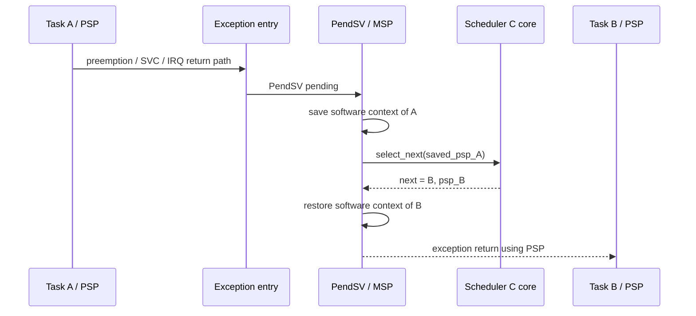

# Goal

Contain architecture-specific register and exception mechanics behind a narrow port so scheduler policy remains ordinary C.

# Required behavior

* Thread-mode tasks execute using PSP.
* Scheduler and exception handlers execute using MSP.
* PendSV is the single context-switch point.
* SVC is the task-to-kernel gateway for ownership-changing task APIs.
* The outgoing task continuation is saved before its runtime record stops representing the executing context.
* The selected task continuation is restored only after policy has selected a READY task.
* Initial task context is synthesized so first dispatch and resumed dispatch converge on the same task-entry/return path.

# Context flow

# Dependencies

[P2](../../proof/P2-context-stack-integrity.md), [P7](../../proof/P7-bounded-memory-and-work.md).

# Dangerous aspects

* Incorrect exception-return value.
* Stack alignment failure.
* Save/restore asymmetry.
* Corrupt PSP accepted without validation in diagnostic builds.
* Scheduler code unexpectedly running on PSP.
* Nesting assumptions violated by interrupt priorities.
* Context code depending on compiler-generated stack frames in ways not captured by the port contract.

# Boundary specification

The port owns exception entry/exit, special registers, and register save/restore. The scheduler core owns task state and selection policy. Neither side may duplicate the other's responsibility.
