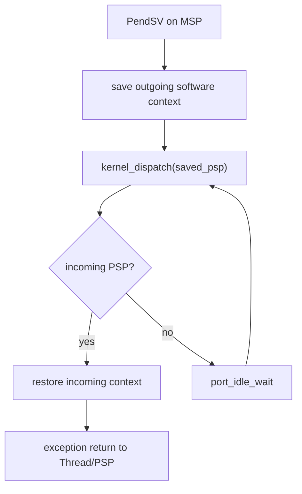

# Key goals

* Keep all processor-specific mechanics behind one port.
* Run tasks in Thread mode on PSP.
* Run kernel/exception work on MSP.
* Make PendSV the only task-context handoff point.
* Define the exact saved task frame used by initialization and switching.
* Give C1/C2 one bounded atomicity primitive.

# Port-provided functions

```c
arghtos_result_t arghtos_port_init(void);
bool arghtos_port_stack_valid(void *stack_base, uint32_t stack_size);

arghtos_irq_key_t arghtos_port_critical_enter(void);
void arghtos_port_critical_exit(arghtos_irq_key_t key);

bool arghtos_port_is_task_context(void);
bool arghtos_port_is_handler_context(void);

void arghtos_port_request_dispatch(void);
void arghtos_port_start(void);
void arghtos_port_idle_wait(void);

uintptr_t arghtos_port_build_initial_psp(
    void *stack_base,
    uint32_t stack_size,
    void (*thread_start)(void),
    void (*return_guard)(void));
```

The port also owns the vector-table implementations for SVC and PendSV.

# Port initialization

`arghtos_port_init()` is called exactly once by `arghtos_init()` before initial task frames are built.

On `ARGHTOS_OK`, it guarantees:

* the scheduler-visible timebase is ready;
* the scheduler timer source is disarmed;
* PendSV is configured at the least urgent scheduler-relevant exception priority;
* SVC/PendSV integration is usable;
* no scheduler task has been started.

It may return `ARGHTOS_ERR_BAD_CONFIG` if the target integration cannot satisfy the contract.

# Stack validation

`arghtos_port_stack_valid(base,size)` is a pure/bounded configuration check used by C0.

It returns true only if the region can hold the scheduler's worst-case saved-context overhead under the target ABI, including required alignment. V1 reserves 68 bytes of context overhead: 32 bytes for R4-R11, 32 bytes for the basic hardware frame, and up to one 4-byte hardware alignment word.

It does not inspect overlap with other task stacks; C0 owns pairwise overlap validation.


# Critical section contract

`arghtos_port_critical_enter()` returns the prior mask state and prevents every maskable handler that is permitted to call ArghtOS from entering scheduler-state mutation.

Nested use must restore the exact prior state:

```c
arghtos_irq_key_t key = arghtos_port_critical_enter();
/* bounded scheduler mutation */
arghtos_port_critical_exit(key);
```

NMI and fatal fault exceptions are not masked and may not call normal scheduler APIs.

Critical sections must not contain:

* application callbacks;
* busy-waits for hardware;
* unbounded loops;
* formatted logging;
* sleep instructions.

# Context-query contract

`arghtos_port_is_task_context()` is true only when execution is Thread mode on a scheduler task PSP after scheduler start.

`arghtos_port_is_handler_context()` is true for supported maskable Handler-mode execution.

They are mutually exclusive for valid normal API calls.

# Dispatch request

`arghtos_port_request_dispatch()` makes PendSV pending.

It does not directly transfer execution and is safe to call repeatedly. Multiple requests collapse naturally into one pending PendSV.

PendSV must execute at the least urgent scheduler-relevant exception priority so device/timer handlers can complete before dispatch selection.

# Kernel dispatch callback

PendSV calls the C kernel through:

```c
uintptr_t arghtos_kernel_dispatch(uintptr_t outgoing_saved_psp);
```

Argument semantics:

* nonzero: saved PSP of the task that was executing before this dispatch;
* zero: no new outgoing context to save, used for first dispatch and re-selection after idle.

Return semantics:

* nonzero: saved PSP of the task selected to run;
* zero: no task is READY.

If zero is returned, the port calls `arghtos_port_idle_wait()` and then calls `arghtos_kernel_dispatch(0)` again.



# Race-free idle wait

The no-READY decision and entry to WFI must form one race-free protocol.

PendSV SHALL:

1. disable maskable interrupts with PRIMASK before the serialized call to `arghtos_kernel_dispatch()`;
2. if a task is returned, restore the normal interrupt mask state before exception return;
3. if zero is returned, keep PRIMASK set while entering `arghtos_port_idle_wait()`.

`arghtos_port_idle_wait()` therefore has the precondition:

```text
called from the PendSV idle loop
PRIMASK = 1
the immediately preceding selector observed no READY task
without unmasking interrupts in between
```

The Cortex-M23 idle protocol is:

```text
WFI while PRIMASK=1
restore/enable normal mask state so any pending higher-priority handler runs
after that handler returns, mask again
return to the PendSV loop
kernel_dispatch(0) re-checks readiness while masked
```

Armv8-M WFI wakeup recognition ignores PRIMASK for an asynchronous exception that would otherwise preempt the active exception. Therefore an interrupt that becomes pending in the masked check-to-WFI window wakes/prevents sleep; it is serviced when the port restores the normal mask state.

The WFI must remain inside a loop because WFI may complete for reasons that do not create READY work.

This protocol eliminates the check-then-sleep race without allocating an idle task or idle PSP stack.

# SVC ABI

Task-context ownership-changing calls use SVC.

The v1 service numbers are:

```c
typedef uint8_t arghtos_svc_id_t;

enum {
    ARGHTOS_SVC_YIELD       = 0u,
    ARGHTOS_SVC_WAIT        = 1u,
    ARGHTOS_SVC_SLEEP_UNTIL = 2u,
    ARGHTOS_SVC_WAKE        = 3u,
    ARGHTOS_SVC_TASK_RETURN = 4u
};
```

For services with one scalar argument, the argument is passed in R0 according to the Cortex-M C ABI. The result code is returned in R0 when the calling task later resumes.

The SVC handler validates the service number and forwards it to the kernel API gateway. It never selects or restores a task directly; it requests PendSV when a dispatch decision is needed.

# Saved task frame

Cortex-M23 basic exception entry provides the hardware frame:

```text
higher address
+-----------------+
| xPSR            |
| PC              |
| LR              |
| R12             |
| R3              |
| R2              |
| R1              |
| R0              |
+-----------------+  <- PSP after hardware stacking
```

The PendSV port additionally saves R4-R11 below that frame:

```text
higher address
| hardware frame  |  8 words
+-----------------+
| R11             |
| R10             |
| R9              |
| R8              |
| R7              |
| R6              |
| R5              |
| R4              |
+-----------------+  <- saved_psp
lower address
```

The deliberately synthesized dormant context is 16 words = 64 bytes because the initial stack top is 8-byte aligned.

During ordinary task execution, exception entry may add one 4-byte alignment word when the interrupted PSP was only 4-byte aligned. The worst scheduler context overhead is therefore 68 bytes before ordinary task stack use.

The stacked xPSR alignment indicator governs hardware unstacking; the software R4-R11 save/restore remains symmetric around the hardware frame.

# Initial context

`arghtos_port_build_initial_psp()`:

1. computes the highest 8-byte-aligned address within the provided stack;
2. verifies the configured stack satisfies the 68-byte worst-case scheduler context reserve, even though the synthesized initial frame itself uses 64 bytes;
3. creates a frame equivalent to a preempted task;
4. sets R4-R12 and R0-R3 to zero;
5. sets stacked LR to `return_guard`;
6. sets stacked PC to `thread_start`;
7. sets stacked xPSR with the Thumb state bit set;
8. returns the saved PSP pointing at R4.

No task entry argument exists in v1.

C1 requires `thread_start` to be the kernel task-start trampoline, not the application task entry. The trampoline invokes the immutable C0 application entry according to task class.

The `return_guard` is a fatal kernel guard that must never return.

# First start

`arghtos_port_start()`:

* is called once after successful C0 initialization;
* switches kernel execution into the dispatch mechanism;
* invokes `arghtos_kernel_dispatch(0)`;
* never returns during normal operation.

# Privilege model and trusted-task restriction

All v1 tasks run privileged in Thread mode.

ArghtOS v1 does not depend on an MPU, MMU, or TrustZone security state separation. Unprivileged task execution is outside the v1 contract.

Because tasks are privileged, correctness depends on a trusted-application rule: scheduled task code must not directly modify scheduler-owned processor control state, including PRIMASK, PSP/MSP selection, PendSV/SVC configuration, or scheduler exception priorities. Device-driver interrupt configuration is allowed only when it preserves the integration priority and masking rules.

A task that directly changes these registers is outside the supported scheduler contract; ArghtOS cannot contain that misuse without privilege isolation.

# PSP/MSP ownership


| Situation | Stack |
|---|---|
| application startup before scheduler start | MSP |
| task Thread mode | PSP |
| SVC | MSP |
| PendSV | MSP |
| timer/device handlers | MSP |
| fatal handlers | MSP |
| idle wait in scheduler | MSP / port-owned kernel execution |

# Failure behavior

Invalid context-frame metadata, impossible PSP alignment/range in diagnostic builds, unknown SVC number, or impossible dispatch return enters C5 fatal handling.

# Dependencies

[C7](C7-common-types-abi.md), [C5](C5-fault-diagnostics.md), [P2](../../proof/P2-context-stack-integrity.md), [P7](../../proof/P7-bounded-memory-and-work.md).

# Dangerous aspects

* Save/restore asymmetry.
* Incorrect initial frame.
* SVC changing task ownership directly instead of deferring to PendSV.
* PendSV priority configured above device/timer handlers.
* Critical-section restore failing to preserve prior mask state.
* Idle wait preventing scheduler-relevant interrupts from running.

# Boundary specification

C4 owns processor execution mechanics, special-register/exception handling, and critical sections. The kernel owns task state and scheduling policy.
