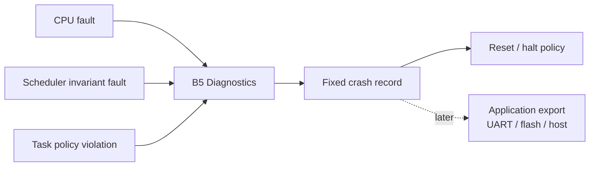

# Goal

Preserve enough information to diagnose scheduler/task failure without making logging part of the real-time kernel.

# Runtime profiling

Per-task runtime state may contain:

* last observed execution duration;
* maximum observed execution duration;
* cumulative CPU time;
* dispatch/activation count;
* preemption count;
* deadline/overrun count.

The exact field widths are chosen during data-layout design and must satisfy the SRAM budget.

Observed maximum execution time is diagnostic evidence, not a WCET proof.

# Fault capture

A fixed crash record should contain, when available:

* magic/version;
* fault reason;
* active task ID;
* scheduler timestamp;
* PSP and MSP;
* stacked PC, LR, xPSR;
* selected architectural fault/status data available on the target;
* compact scheduler state useful for reconstruction.

# Dependencies

[P6](../../proof/P6-rms-schedulability.md) and [P7](../../proof/P7-bounded-memory-and-work.md).

# Dangerous aspects

* Calling printf or transport code from a fatal fault path.
* Depending on the failed task's stack.
* Treating observed max runtime as WCET.
* Large diagnostic counters breaking the SRAM target.
* Fault recursion while writing the crash record.

# Boundary specification

The kernel captures fixed binary evidence. Persistence/export is application/platform policy. The fault path must remain finite and allocator-free.
