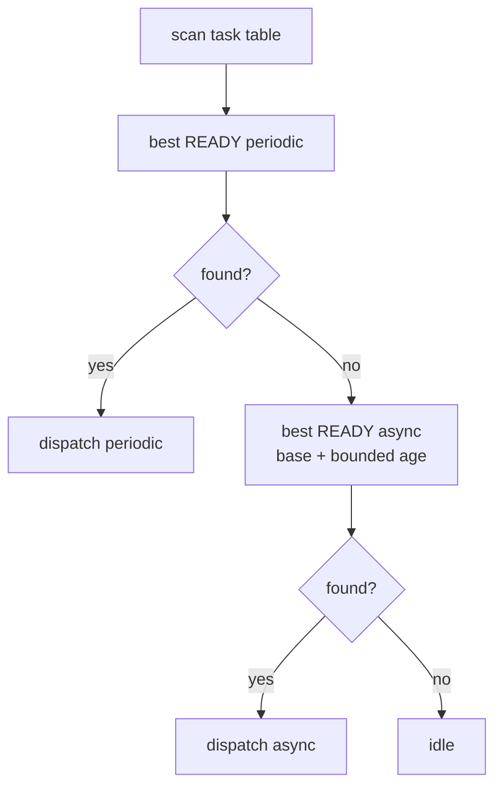

# Goal

Choose the next task deterministically while preserving the periodic schedulability proof and preventing starvation among asynchronous work when residual CPU capacity exists.

# Policy order

1. Choose the highest-priority READY periodic task if one exists.
2. Otherwise choose the highest effective-priority READY asynchronous task.
3. Otherwise enter the idle path.

Periodic priority is compile-time fixed by rate-monotonic ordering. Asynchronous aging saturates at the asynchronous ceiling and never crosses into the periodic domain.

# Dependencies

[P1](../../proof/P1-task-state-invariants.md), [P5](../../proof/P5-priority-domain-isolation.md), [P6](../../proof/P6-rms-schedulability.md), [P7](../../proof/P7-bounded-memory-and-work.md).

# Dangerous aspects

* Aging crossing the domain ceiling.
* Runtime modification of periodic priority.
* Selecting WAITING or SLEEPING tasks.
* Omitting bounded scan cost from timing analysis.
* Non-deterministic priority ties.

# Boundary specification

This contract selects among tasks already declared READY. It does not release tasks, handle hardware, manipulate stacks, or preserve application event data.
