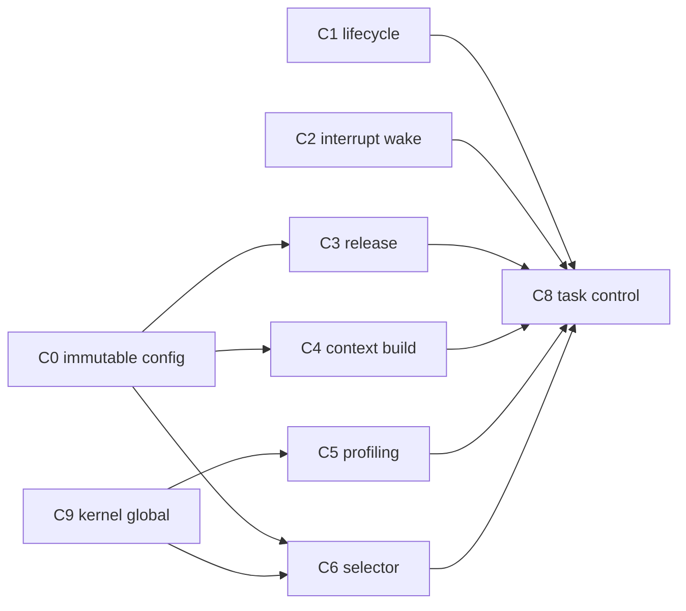

# Public API matrix

| Symbol | Valid context | State effect | May reschedule | Failure form |
|---|---|---|---|---|
| `arghtos_init(config)` | startup Thread/MSP before start | initializes all runtime state | no | result code |
| `arghtos_start()` | startup Thread/MSP after init | starts scheduling | yes, permanent handoff | fatal on impossible state |
| `arghtos_yield()` | TASK | RUNNING -> READY | yes | result code |
| `arghtos_wait()` | TASK async only | RUNNING -> WAITING, or consume wake latch | yes if blocked | result code |
| `arghtos_sleep_until(t)` | TASK async only | RUNNING -> SLEEPING | yes if future | result code |
| `arghtos_sleep_for(dt)` | TASK async only | RUNNING -> SLEEPING | yes if nonzero | result code |
| `arghtos_wake(id)` | TASK | async target eligibility/latch | maybe | result code |
| `arghtos_wake_from_interrupt(id)` | maskable HANDLER | async target eligibility/latch | requests PendSV | result code |
| `arghtos_profile_get(id,out)` | TASK | none, bounded snapshot | no | result code |

# Port API matrix

| Symbol | Implemented by | Called by | Requirement |
|---|---|---|---|
| `arghtos_port_init()` | platform | `arghtos_init` | configure/validate scheduler port before frame creation |
| `arghtos_port_stack_valid(base,size)` | Cortex port | `arghtos_init` | bounded port-specific stack check |
| `arghtos_port_time_now()` | platform | kernel | bounded 32-bit monotonic read |
| `arghtos_port_timer_arm(t)` | platform | kernel | absolute one-shot deadline |
| `arghtos_port_timer_disarm()` | platform | kernel | cancel scheduler timer target |
| `arghtos_port_critical_enter()` | Cortex port | kernel | mask all scheduler-mutating handlers |
| `arghtos_port_critical_exit(key)` | Cortex port | kernel | exact prior-mask restore |
| `arghtos_port_is_task_context()` | Cortex port | API validation | true only Thread/PSP task |
| `arghtos_port_is_handler_context()` | Cortex port | API validation | true only supported maskable handler |
| `arghtos_port_request_dispatch()` | Cortex port | kernel | pend PendSV, idempotent |
| `arghtos_port_start()` | Cortex port | startup | first scheduler handoff, no normal return |
| `arghtos_port_idle_wait()` | Cortex port | dispatch path | no READY task, no scheduler mutation |
| `arghtos_port_build_initial_psp(...)` | Cortex port | initialization | synthesize 64-byte saved frame |
| `arghtos_port_fault_terminal()` | platform | fatal path | reset/halt, never return |

# Kernel-private matrix

| Symbol/object | Owner | Purpose |
|---|---|---|
| `arghtos_task_control_t controls[]` | B1 runtime state | 28-byte mutable state per task |
| `arghtos_kernel_state_t kernel` | top-level kernel | 12-byte global scheduler truth |
| `arghtos_select_next(now)` | B2 policy | pure bounded READY selector |
| `arghtos_kernel_dispatch(psp)` | top-level/B2/B4 boundary | save outgoing, select, mark incoming RUNNING |
| `arghtos_timer_interrupt()` | B3 time/release | release due work and re-arm timer |
| `arghtos_fatal(...)` | B5 diagnostics | fixed crash capture and terminal policy |

# State transition ownership

| Transition | Owning contract |
|---|---|
| DORMANT -> READY by async activation | C1/C2 |
| DORMANT -> READY by periodic release | C3 |
| READY -> RUNNING | C6 dispatch |
| RUNNING -> READY by preemption | C6 dispatch |
| RUNNING -> READY by yield | C1 |
| RUNNING -> WAITING | C1 |
| WAITING -> READY | C1/C2 |
| RUNNING -> SLEEPING | C1 |
| SLEEPING -> READY | C3 |
| periodic RUNNING -> DORMANT on return | C1/C4 trampoline |
| async return -> fatal | C1/C5 |
| any valid state -> FAULTED/fatal policy | C5 |

# Mutable field ownership



# Proof traceability

| Contract | Primary proof obligations |
|---|---|
| C0 | P0, P2, P6 |
| C1 | P1, P3, P4 |
| C2 | P3, P5, P7 |
| C3 | P4, P6, P7 |
| C4 | P2, P7 |
| C5 | P6, P7 |
| C6 | P1, P5, P6, P7 |
| C7 | P0, P4, P7 |
| C8 | P0, P1, P7 |
| C9 | P0, P7 |
| C10 | architecture boundary enforcement |

# Memory summary at default configuration

```text
task controls:      32 * 28 B = 896 B
kernel global:                  12 B
                                 -----
mandatory state:                908 B

optional crash record:          64 B
                                 -----
state + crash:                  972 B

soft target:                   1536 B
remaining for MSP +
port-specific mutable state:    564 B
```

The 564-byte remainder is not a promise that MSP must fit in 564 bytes. It is the budget pressure exposed by the current architecture. Target qualification must determine whether the soft target is feasible with real interrupt nesting and compiler-generated stack use.

# Boundary specification

This matrix is normative only where it summarizes C0-C10. If it conflicts with an owning contract, the owning contract must be corrected and this matrix updated in the same change.
