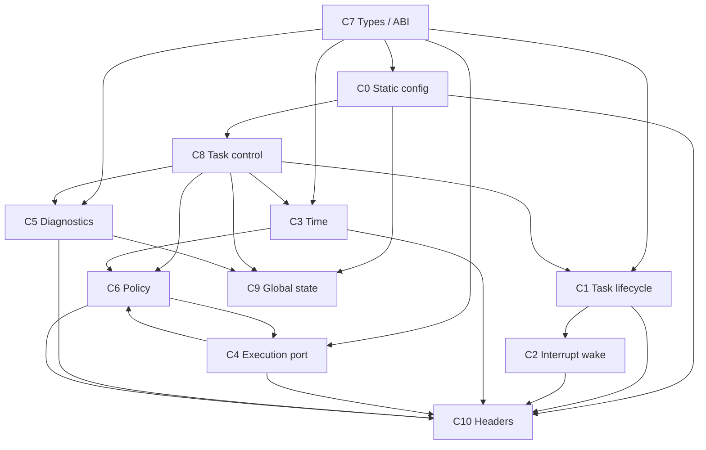

# ArghtOS concrete contracts

The contracts below form the architecture-to-code boundary. They are concrete enough to generate C headers, internal structs, contract tests, and the module design.

* [C0 - Static task configuration](C0-static-task-configuration.md) - task descriptors, kernel configuration, initialization and start.
* [C1 - Task API and lifecycle](C1-task-api-lifecycle.md) - yield, wait, sleep, task-context wake, return semantics.
* [C2 - Interrupt wake](C2-wake.md) - interrupt-safe deferred-work activation.
* [C3 - Time and timer](C3-time-timer.md) - 32-bit scheduler clock and absolute one-shot timer port.
* [C4 - Cortex-M23 execution/context port](C4-context-switch-port.md) - MSP/PSP, SVC, PendSV, critical sections, initial frames.
* [C5 - Fault and diagnostics](C5-fault-diagnostics.md) - profiling snapshots, accounting, crash record, fatal path.
* [C6 - Scheduling and dispatch policy](C6-scheduling-policy.md) - RMS, async aging, ties, preemption, dispatch transaction.
* [C7 - Common types and ABI](C7-common-types-abi.md) - fixed-width types, result codes, time rules, compile-time limits.
* [C8 - Task control record](C8-task-control-record.md) - 28-byte per-task mutable command/control object.
* [C9 - Kernel global state and SRAM](C9-kernel-global-state.md) - 12-byte global state and memory accounting.
* [C10 - Header and symbol boundaries](C10-header-and-symbol-boundaries.md) - public, port, and private header split.
* [Contract matrix](contract-matrix.md) - one-page call-context, ownership, and state-effect reference.

## Frozen v1 architectural choices

* Default task capacity: 32, compile-time adjustable, maximum 254.
* Task ID: 8-bit descriptor-table index; 0xFF invalid.
* Scheduler time: unsigned 32-bit modulo clock.
* Periodic scheduling: fixed RMS, shorter period wins.
* Async scheduling: base priority plus READY-time aging, bounded entirely inside async domain.
* Repeated async wake: no count/queue; one pending-wake bit only to close the wait race.
* Periodic task: bounded job, no wait/sleep self-suspension.
* Async task: persistent worker, return is a fault.
* Task context: privileged Thread mode on PSP.
* Kernel/handler context: MSP.
* Task handoff: PendSV only.
* Task syscall gateway: SVC.
* Dynamic allocation: none.
* Mutable task control: 28 bytes/task, 896 bytes at 32 tasks.
* Kernel global state: 12 bytes.
* Crash record: optional 64 bytes.
