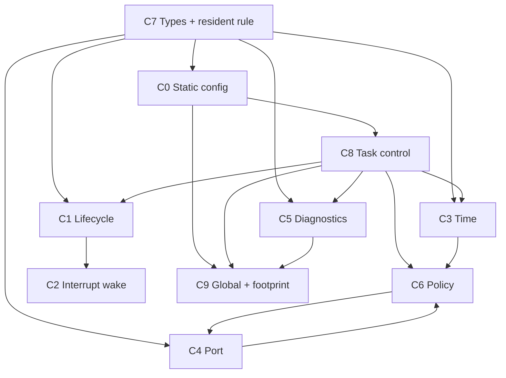

# ArghtOS concrete contracts

The contracts below form the architecture-to-code boundary.

* [C0 - Static task configuration](C0-static-task-configuration.md) - 16-byte descriptors, initialization, synchronous D=T periodic model.
* [C1 - Task API and lifecycle](C1-task-api-lifecycle.md) - yield, wait, sleep, task-context wake, return semantics.
* [C2 - Interrupt wake](C2-wake.md) - interrupt-safe deferred-work activation.
* [C3 - Time and timer](C3-time-timer.md) - 32-bit clock, bounded periodic catch-up, one-shot timer port.
* [C4 - Cortex-M23 execution/context port](C4-context-switch-port.md) - MSP/PSP, SVC, PendSV, critical sections, initial frames.
* [C5 - Fault and diagnostics](C5-fault-diagnostics.md) - 12-byte profile snapshot, runtime accounting, 64-byte crash record.
* [C6 - Scheduling and dispatch policy](C6-scheduling-policy.md) - RMS plus opportunity-based async aging.
* [C7 - Common types and ABI](C7-common-types-abi.md) - fixed-width types, wrap-safe time, resident-memory rule.
* [C8 - Task control record](C8-task-control-record.md) - 20-byte per-task mutable control object.
* [C9 - Kernel global state and footprint](C9-kernel-global-state.md) - 20-byte global state and complete SRAM-resident accounting.
* [C10 - Header and symbol boundaries](C10-header-and-symbol-boundaries.md) - public, port, and private header split.
* [Contract matrix](contract-matrix.md) - compact context, ownership, proof, and footprint reference.

## Frozen v1 architectural choices

* Default capacity 32 tasks; compile-time adjustable; maximum 254.
* 8-bit task ID; 0xFF invalid.
* 32-bit modular scheduler time.
* Periodic tasks are synchronous, phase 0, `D=T`, RMS ordered by period.
* Async tasks use base priority plus dispatch-opportunity age credit.
* Async aging is independent of clock wrap.
* Repeated wake requests are not counted; one pending-wake bit closes the wait race.
* Periodic task: bounded job, no wait/sleep self-suspension.
* Async task: persistent worker; return is fatal.
* Task execution: privileged Thread mode on PSP.
* Kernel/handlers: MSP.
* Task handoff: PendSV only.
* Task syscall gateway: SVC.
* Dynamic allocation: none.
* C0 descriptor: 16 B/task.
* C8 task control: 20 B/task.
* C9 kernel global: 20 B.
* Optional crash record: 64 B.
* All ArghtOS-resident bytes count, including `.text`, `.rodata`, literals, data, metadata, and MSP.
* Application task stacks and task bodies are excluded from the ArghtOS-overhead subtotal but included in total system SRAM.
