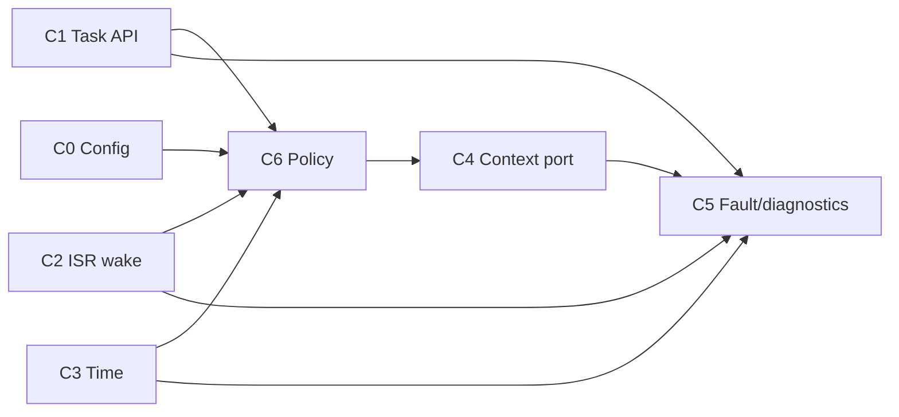

# Architecture contracts

* [C0 - Static task configuration](C0-static-task-configuration.md)
* [C1 - Task API and lifecycle](C1-task-api-lifecycle.md)
* [C2 - ISR wake contract](C2-isr-wake.md)
* [C3 - Time and timer contract](C3-time-timer.md)
* [C4 - Context-switch port contract](C4-context-switch-port.md)
* [C5 - Fault and diagnostics contract](C5-fault-diagnostics.md)
* [C6 - Scheduling policy contract](C6-scheduling-policy.md)

