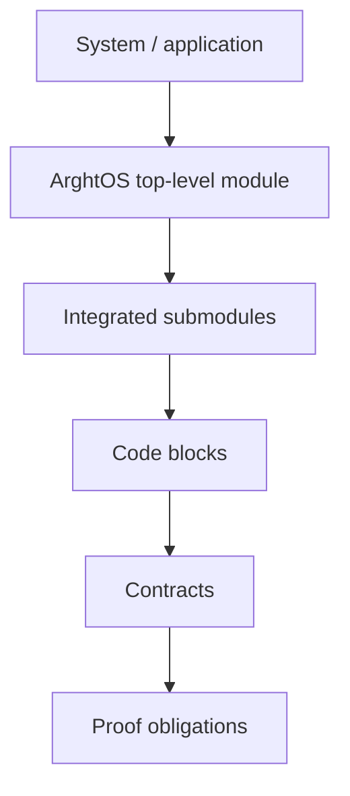

# ArghtOS architecture

This directory defines the architecture that must satisfy the proof obligations in [../proof/](../proof/).

## Views

* [A0 - Architecture overview](A0-architecture-overview.md) - Architectural rules, scheduling domains, ownership, and major flows.
* [A1 - Pre-module consistency audit](A1-consistency-audit.md) - Cross-check of proofs, contracts, footprint accounting, and remaining evidence before module design.
* [Contracts](contracts/) - Interfaces and behavioral boundaries between code blocks.
* [Code blocks](blocks/) - Independently understandable implementation units and the contracts each block provides or consumes.
* [Integrated submodules](submodules/) - Compositions of code blocks that implement larger scheduler behaviors.
* [T0 - Top-level kernel module](T0-top-level-kernel.md) - Integration of all internal blocks and contracts.
* [S0 - System integration view](S0-system-integration.md) - Boundary between ArghtOS and the MCU/application environment.

## Architectural dependency direction

Architecture may refine implementation detail, but it must not silently weaken a proof or contract.

## Next-stage implementation design

* [Code-module design elements](../design-elements/) - D00-D11 implementation-module designs derived from the audited architecture and contracts.
