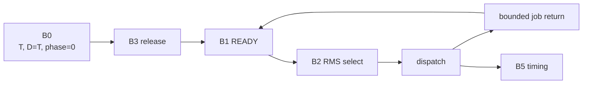

# Key goals

* Release synchronous periodic jobs from the scheduler start epoch with zero phase.
* Preserve fixed RMS ordering.
* Permit at most one active instance per periodic task.
* Record missed-release and deadline evidence.
* Provide the quantities required by P6.

# Integrated code blocks and contracts

B0 configuration + B1 runtime state + B2 policy + B3 time/release + B5 diagnostics.

Contracts C0, C3, C5, and C6.

# Dependencies

[P0](../../proof/P0-static-configuration-validity.md), [P1](../../proof/P1-task-state-invariants.md), [P4](../../proof/P4-time-release-correctness.md), [P5](../../proof/P5-priority-domain-isolation.md), [P6](../../proof/P6-rms-schedulability.md), [P7](../../proof/P7-bounded-memory-and-work.md).

# Dangerous aspects

* Release drift.
* Multiple instances of one job.
* Measured execution time substituted for WCET.
* Async policy influencing periodic priority.
* Missed-release behavior diverging from the proof model.

# Boundary specification

M0 owns scheduler semantics for periodic work. Application code owns the job body and its WCET evidence.
