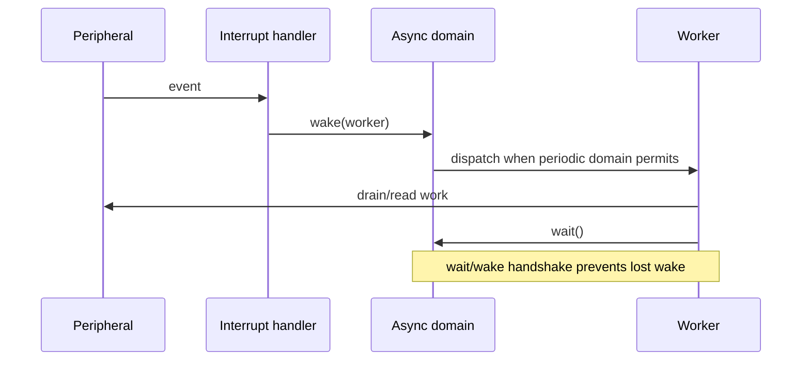

# Key goals

* Defer substantial hardware work out of interrupt handlers.
* Preserve no event multiplicity inside the scheduler.
* Avoid lost wakeups.
* Age READY async tasks without entering the periodic domain.
* Allow persistent workers to wait after draining work.

# Integrated code blocks and contracts

B1 runtime state + B2 policy + B6 API gateway, with B4 for the processor execution boundary.

Contracts C1, C2, and C6.

# Dependencies

[P1](../../proof/P1-task-state-invariants.md), [P3](../../proof/P3-wake-wait-race-freedom.md), [P5](../../proof/P5-priority-domain-isolation.md), [P7](../../proof/P7-bounded-memory-and-work.md).

# Dangerous aspects

* Driver failing to preserve data before clearing hardware.
* Worker assuming one wake equals one hardware event.
* Lost wake at the wait transition.
* Aging arithmetic crossing the async ceiling.

# Boundary specification

M1 schedules deferred work; it does not own peripheral event storage.
