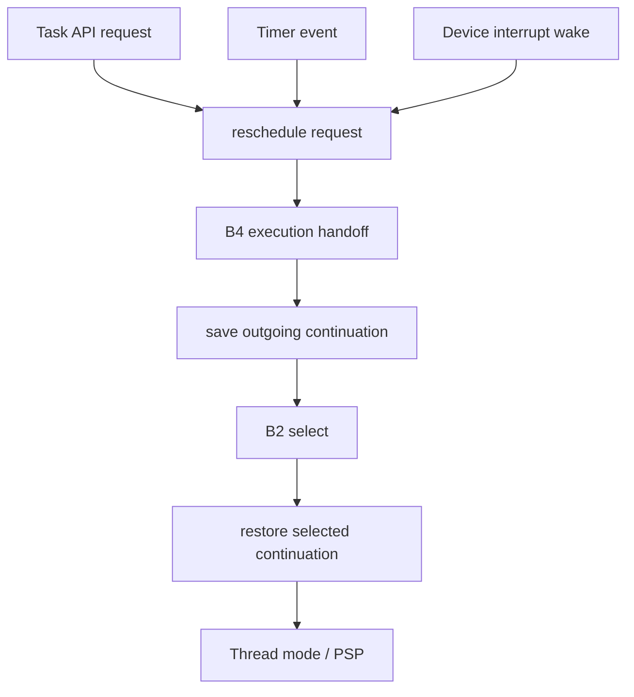

# Key goals

* Serialize task ownership changes.
* Keep scheduler-side execution on MSP.
* Save exactly one outgoing continuation and restore exactly one incoming continuation.
* Make all reschedule sources converge on one processor-facing handoff path.

# Integrated code blocks and contracts

B1 runtime state + B2 policy + B4 processor boundary + B6 API gateway.

Contracts C1, C2, C4, and C6.

# Dependencies

[P1](../../proof/P1-task-state-invariants.md), [P2](../../proof/P2-context-stack-integrity.md), [P7](../../proof/P7-bounded-memory-and-work.md).

# Dangerous aspects

* A second task-handoff path bypassing B4.
* Race between state mutation and saving outgoing continuation.
* Nested exceptions invalidating current-task identity.
* First launch behaving differently from later resumes.

# Boundary specification

M2 changes CPU execution ownership. It does not decide when timed releases are due or what peripheral events mean.
