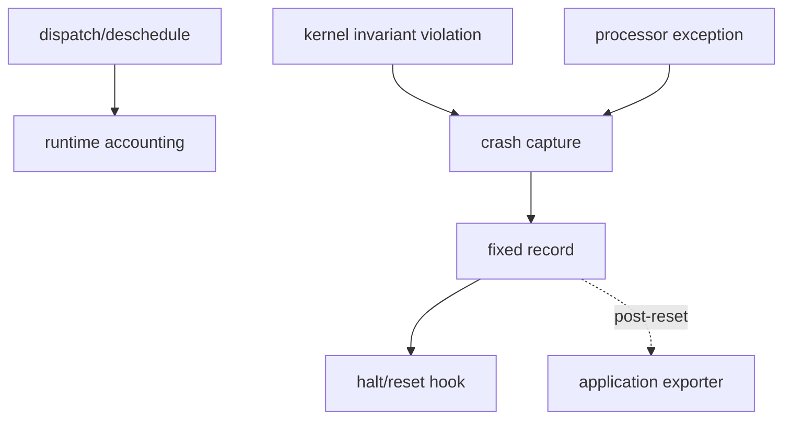

# Key goals

* Gather runtime evidence for scheduler overhead and observed task execution.
* Capture fatal state with minimal dependencies.
* Keep fault handling separate from transport and presentation.

# Integrated code blocks and contracts

B1 runtime state + B4 processor boundary + B5 diagnostics, implementing C5.

# Dependencies

[P2](../../proof/P2-context-stack-integrity.md), [P6](../../proof/P6-rms-schedulability.md), [P7](../../proof/P7-bounded-memory-and-work.md).

# Dangerous aspects

* Fault capture itself failing.
* Depending on corrupted PSP state.
* Export code entering the fatal path.
* Profiling overhead materially changing the quantity being measured.

# Boundary specification

M3 captures evidence and invokes a minimal terminal policy. Recovery and export beyond that point are outside the kernel.
