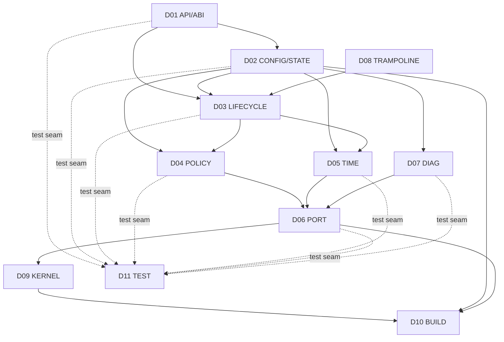
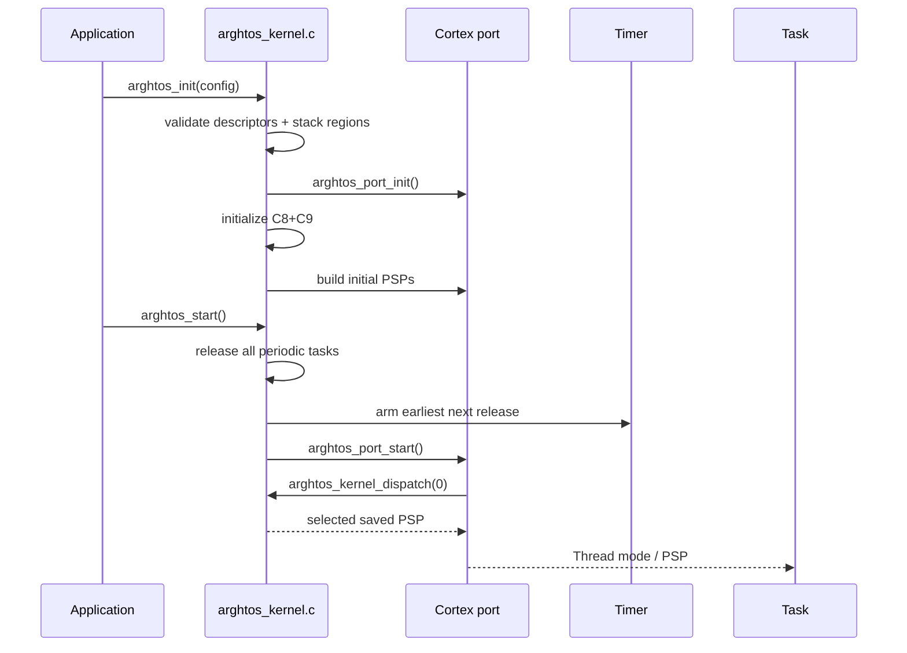

# Goal

Define exactly how the audited architecture becomes code without allowing implementation convenience to blur ownership, inflate resident SRAM silently, or create a second scheduling path.

# Design principle: logical modules, minimal physical translation units

The logical module boundaries in this directory are strict ownership boundaries.

The initial minimum-footprint implementation should physically use:

```text
include/
└── arghtos/
    ├── arghtos.h
    └── arghtos_port.h      # architecture-neutral port interface

src/
    ├── arghtos_internal.h
    ├── arghtos_kernel_port.h  # private callbacks visible to a port
    └── arghtos_kernel.c       # portable C11 only

port/
├── host/
│   └── arghtos_port.c      # verification/fake port
└── cortex_m23/
    ├── arghtos_port.c      # all Cortex-M23-specific C
    ├── arghtos_context.S   # Cortex-M23 exception/context assembly
    └── arghtos_port_private.h
```

`arghtos_kernel.c` contains **only portable scheduler logic**. It must compile unchanged for the host verification port and for every supported MCU/CPU port.

Reason:

* every instruction byte is SRAM-resident;
* cross-translation-unit wrappers, veneers, duplicated constants, and missed constant folding are dangerous at the current 300-byte post-metadata budget;
* a single portable kernel translation unit allows aggressive dead-code elimination and constant propagation even without relying on link-time optimization;
* logical ownership is preserved by internal sectioning, naming, and tests rather than requiring one translation unit per logical module.

If measurements later prove that multiple kernel C translation units do not increase total resident footprint, the physical layout may be split while preserving the logical interfaces below.

# Logical module set

| Design element | Logical module | Primary ownership |
|---|---|---|
| D01 | API/ABI | public declarations and call-context surface |
| D02 | CONFIG/STATE | descriptor validation, C8/C9 state, init/start |
| D03 | LIFECYCLE | yield/wait/sleep/wake/service decoding |
| D04 | POLICY | class-first RMS/async selection and age credit |
| D05 | TIME | timer service, periodic release, sleep release |
| D06 | PORT | MSP/PSP, SVC, PendSV, critical section, timer hooks |
| D07 | DIAG | CPU accounting, profile snapshot, crash capture |
| D08 | TRAMPOLINE | task start, periodic return/restart, async return fault |
| D09 | KERNEL | physical integration of portable modules |
| D10 | BUILD | linker/footprint enforcement |
| D11 | TEST | host seams, hardware seams, proof mapping |

# Dependency direction



There must be no dependency from PORT back into application semantics or from POLICY into device/timer hardware.

# Physical file ownership

## `include/arghtos/arghtos.h`

Owns only public types/configuration/API declarations.

Must not contain scheduler state definitions, port service IDs, or nontrivial inline implementation.

## `include/arghtos/arghtos_port.h`

Owns the **architecture-neutral port contract** seen by the portable kernel.

It declares abstract operations such as:

* time read / timer arm-disarm;
* scheduler serialization enter/exit;
* task/handler context predicates;
* dispatch request;
* first start;
* idle wait;
* initial saved-context construction;
* terminal fault handoff.

It must contain no Cortex register names, CMSIS/vendor headers, NVIC constants, PRIMASK/BASEPRI terminology, or target-specific frame layout.

Application code normally does not include this header.

## `src/arghtos_kernel_port.h`

Owns the architecture-neutral callbacks that a selected port may invoke back into the portable kernel: dispatch, service execution, timer interrupt entry, and fatal entry. It contains no target register/frame definitions.

## `src/arghtos_internal.h`

Owns:

* C8 task-control definition;
* C9 kernel-global definition;
* internal architecture-neutral service IDs;
* private helper declarations used only inside the portable kernel;
* compile-time assertions that bind concrete sizes.

It must not be included by application code.

## `src/arghtos_kernel.c`

Contains D02, D03, D04, D05, D07, D08, and D09.

This file is fully portable C11.

It must not:

* include CMSIS or vendor device headers;
* use inline assembly;
* read/write CPU special registers;
* know what PSP/MSP, SVC, PendSV, PRIMASK, NVIC, WFI, or a Cortex exception frame is;
* access timer peripheral registers;
* encode target exception priorities.

Functions that are not called by the abstract port or public API should be `static`.

## `port/cortex_m23/arghtos_port.c`

Contains **all nonportable Cortex-M23 C**:

* special-register and execution-context queries;
* serialization/masking implementation;
* PendSV/SVC priority/configuration;
* timer/time adaptation;
* race-free idle/WFI implementation;
* initial-frame realization support;
* startup integration;
* terminal fault handoff;
* any CMSIS/vendor includes required by the port.

No scheduler policy or lifecycle semantics live here.

## `port/cortex_m23/arghtos_context.S`

Contains only the code that materially benefits from explicit register/exception control:

* SVC handler entry;
* PendSV save/restore path;
* first execution handoff if assembly is required.

It should not contain scheduling policy or task-state mutation beyond passing values to/from the C kernel.

# Integration sequence



# Key goals

* One mutable authority for task state.
* One selector.
* One task handoff path.
* One timer-release engine.
* One fatal-capture path.
* No allocator.
* No dynamic registration.
* No hidden ready queue.
* No hidden per-task metadata outside C0/C8.
* No hidden resident lookup tables.

# Dependencies

* C0-C10.
* P0-P8.
* [A1 consistency audit](../architecture/A1-consistency-audit.md).

# Dangerous code sections

## 1. Duplicate state authority

**Bad example:** `arghtos_port.c` caches `current_task` in a private static because it is convenient for PendSV.

Why dangerous:

* C9 ceases to be single-source truth;
* a wake or fault can update one copy but not the other;
* crash records can report a different task from the context actually restored.

**Tester probes:**

* grep/map-symbol test for more than one writable symbol representing current task;
* instrument rapid alternating preemption and verify C9 current ID matches PSP owner every switch;
* fault exactly after outgoing save and confirm captured task ID is deterministic.

## 2. Second context-switch path

**Bad example:** timer handler decides a periodic task is higher priority and directly loads PSP instead of pending PendSV.

Why dangerous:

* outgoing context may not be saved symmetrically;
* P1/P2 assumptions are invalidated;
* handler nesting can cause two simultaneous switch mechanisms.

**Tester probes:**

* static search: only `arghtos_context.S` may write PSP for a task handoff;
* trigger timer while another device handler is active and verify the new task begins only after PendSV;
* hardware register-canary test across timer-driven and wake-driven switches.

## 3. Hidden footprint multiplication

**Bad example:** a logical module adds `static uint32_t debug_timestamp[ARGHTOS_MAX_TASKS]`.

At 32 tasks this silently costs 128 B, almost half the remaining pre-code budget.

**Tester probes:**

* linker-map diff on every code change;
* fail CI when a new writable array scales with `ARGHTOS_MAX_TASKS` unless explicitly approved in C8/C9;
* inspect `.rodata` too, not only `.bss`.

## 4. Module wrappers that survive linking

**Bad example:** each logical module gets public-looking wrapper functions that call one-line private helpers.

Why dangerous:

* every wrapper may cost instructions and literals;
* Cortex branch veneers may appear;
* function-address taking can block dead stripping.

**Tester probes:**

* symbol-size diff between single-TU and split-TU builds;
* compile with and without LTO and compare total resident bytes;
* disassemble to identify trivial one-call veneers.

# Boundary specification

D00 defines module ownership and physical layout only. It does not redefine behavior owned by C0-C10.

# Portability rule

The portable kernel may depend only on:

1. ISO C11;
2. public ArghtOS scalar/struct contracts; and
3. the abstract functions declared in `arghtos_port.h`.

A new CPU/MCU port must not require edits to `arghtos_kernel.c`.

If a proposed port requires a kernel edit, that is treated as evidence that the abstract port contract is incomplete; update the port contract/design first rather than adding target conditionals such as `#ifdef __ARM_ARCH...` to portable code.

# Portability acceptance check

CI should compile the same `src/arghtos_kernel.c` against at least:

* `port/host/arghtos_port.c`; and
* `port/cortex_m23/arghtos_port.c`.

The portable source must contain zero target preprocessor branches.
