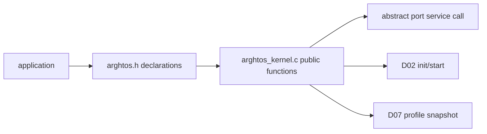

# Goal

Define the smallest public surface that exactly implements C0/C1/C2/C5 without exposing private scheduler state or generating hidden code in application translation units.

# Physical element

```text
include/arghtos/arghtos.h
```

The public header is declaration-oriented.

No nontrivial scheduler algorithm belongs in this header.

# Public types owned here

The header materializes the public portions of C0, C5, and C7:

```c
typedef uint8_t  arghtos_task_id_t;
typedef uint8_t  arghtos_priority_t;
typedef uint32_t arghtos_time_t;
typedef uint32_t arghtos_duration_t;
typedef uint8_t  arghtos_result_t;

typedef void (*arghtos_task_fn_t)(void);

typedef struct {
    arghtos_task_fn_t entry;
    void             *stack_base;
    arghtos_time_t    period;
    uint16_t          stack_size;
    uint8_t           async_priority;
    uint8_t           flags;
} arghtos_task_config_t;

typedef struct {
    const arghtos_task_config_t *tasks;
    struct arghtos_crash_record *crash_record;
    uint8_t                      task_count;
    uint8_t                      reserved[3];
} arghtos_config_t;

typedef struct {
    uint32_t total_cpu_ticks;
    uint32_t max_run_ticks;
    uint8_t  missed_release_count;
    uint8_t  age_credit;
    uint8_t  state;
    uint8_t  flags;
} arghtos_task_profile_t;
```

The 64-byte crash-record structure and validity constants are also public because the application provides its storage.

# Public functions

```c
arghtos_result_t arghtos_init(const arghtos_config_t *config);
void arghtos_start(void);

arghtos_result_t arghtos_yield(void);
arghtos_result_t arghtos_wait(void);
arghtos_result_t arghtos_sleep_until(arghtos_time_t absolute_time);
arghtos_result_t arghtos_sleep_for(arghtos_duration_t duration);

arghtos_result_t arghtos_wake(arghtos_task_id_t task_id);
arghtos_result_t arghtos_wake_from_interrupt(arghtos_task_id_t task_id);

arghtos_result_t arghtos_profile_get(
    arghtos_task_id_t task_id,
    arghtos_task_profile_t *out);
```

# API implementation placement

Declarations live in `arghtos.h`.

Public API implementations live in portable `arghtos_kernel.c`. Ownership-changing task APIs call the architecture-neutral `arghtos_port_service_call(service_id,arg0)` interface. The target-specific trap/SVC instruction lives entirely in the selected port.

The default design is:



# Validation ownership

Public functions perform only validation necessary to preserve their contract.

Validation must not be duplicated at several layers unless one check protects a different trust boundary.

Examples:

* `arghtos_init`: validates external configuration comprehensively.
* task lifecycle API: validates call context and current/target task class/state.
* internal selector: assumes its private C8/C9 state already satisfies invariants.
* port assembly: validates only architecture-level impossibilities where C cannot safely recover.

# Result-code rule

Normal programmer misuse returns the fixed C7 result code where the calling context can safely receive it.

Impossible private-state corruption enters C5 fatal handling instead of returning an ordinary public error.

Example distinction:

```text
wake(99) when task_count=4      -> ARGHTOS_ERR_BAD_TASK_ID
controls[current].state=0xA7    -> ARGHTOS_FAULT_KERNEL_INVARIANT
```

# Header footprint rules

The header SHOULD contain:

* typedefs;
* constants;
* struct declarations;
* extern function declarations;
* compile-time configuration defaults/constraints when needed by applications.

The header SHOULD NOT contain:

* selector code;
* time comparison functions that are used only internally;
* long `static inline` lifecycle wrappers;
* tables of strings;
* debug task names;
* default logging format strings.

Any header-emitted instructions/literals are ArghtOS-induced resident bytes and must be counted by D10.

# ABI assertions

The implementation compilation must assert:

```c
_Static_assert(sizeof(arghtos_task_config_t) == 16u, ...);
_Static_assert(sizeof(arghtos_config_t) == 12u, ...);
_Static_assert(sizeof(arghtos_task_profile_t) == 12u, ...);
_Static_assert(sizeof(arghtos_crash_record_t) == 64u, ...);
```

These assertions belong in kernel/private build code as well as being documented publicly. An application compiler setting must not silently change the ABI.

# Key goals

* One obvious API.
* Fixed-width ABI.
* No opaque allocator handles.
* No scheduler-state pointers exposed.
* No public helper that creates a second semantics path.
* Minimal header-generated machine code.

# Dependencies

* C0, C1, C2, C5, C7, C10.
* D02, D03, D07.

# Dangerous code sections and tester guidance

## 1. Target trap/SVC code leaks into the public header or portable kernel

**Bad implementation:**

```c
static inline arghtos_result_t arghtos_yield(void)
{
    __asm volatile("svc #0");
    ...
}
```

This couples the supposedly portable API to Cortex-M and may duplicate target instructions at application call sites.

**Tester should:**

* compile `src/arghtos_kernel.c` for the host fake port and require zero target assembly;
* grep/preprocess portable sources for Cortex register names and `svc`, `wfi`, `mrs`, `msr`, `cpsid`, `cpsie`;
* include `arghtos.h` from multiple application translation units and verify target-specific code is not emitted by the header;
* verify all task system-call mechanism code comes from the selected `port/<target>/` object.

## 2. Struct packing differs between application and kernel builds

**Failure example:** application is compiled with unusual packing flags and creates a 15-byte descriptor while kernel expects 16 bytes.

Possible result:

* `period` or `stack_size` read from the wrong offset;
* a periodic task may be classified async;
* a bogus stack pointer may be accepted.

**Tester should:**

* compile a dedicated ABI test translation unit with the same flags as application code;
* assert `sizeof` and `offsetof` every public field;
* deliberately build with a packing option and require a compile-time failure rather than silent ABI drift.

## 3. A public function validates after dereferencing

**Bad implementation:**

```c
if (g.tasks[id].period == 0 && id < g.task_count) ...
```

The invalid ID is dereferenced before it is checked.

**Tester should:**

* call wake/profile with IDs 0xFF, task_count, task_count+1;
* use ASan/UBSan in the host build;
* verify no private array access occurs before ID validation.

## 4. Public error path changes scheduler state

**Failure example:** `arghtos_wait()` called from a periodic task returns `BAD_TASK_CLASS` but clears a flag or pends dispatch first.

**Tester should:**

* snapshot C8/C9 before every invalid API call;
* assert state is bit-for-bit unchanged except documented diagnostic/fault state;
* run each invalid call from TASK and HANDLER model contexts.

## 5. Debug strings sneak into the resident image

**Failure example:** result codes get a `const char *` message table in the core library.

At this footprint scale, a few strings can exceed the remaining budget.

**Tester should:**

* scan linked symbols/strings for human-readable diagnostic text;
* fail the minimum-footprint profile if any unexpected string/literal table is attributed to ArghtOS.

# Test seam

A host build must include `arghtos.h` exactly as application code does and verify:

* type sizes/offsets;
* result values;
* invalid argument behavior;
* C++ linkage compatibility if supported;
* no accidental dependency on Cortex vendor headers.

# Boundary specification

D01 owns the public representation and callable surface only. State transitions are owned by D02/D03/D05/D06/D07.
