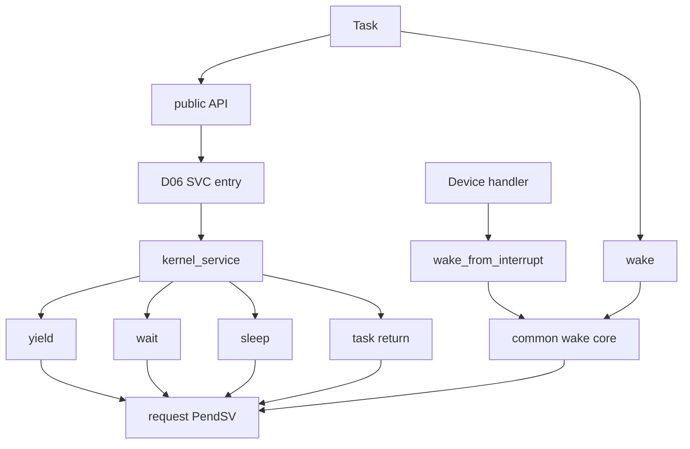

# Goal

Provide one serialized lifecycle engine for all task state transitions requested by tasks or interrupts, without allowing public APIs, handlers, or the port to mutate task state independently.

# Logical module

```text
LIFECYCLE_GATEWAY
```

# Physical implementation

Portable logic in:

```text
src/arghtos_kernel.c
```

SVC exception entry/argument extraction in:

```text
port/cortex_m23/arghtos_context.S
```

or, if smaller after measurement, a minimal assembly entry that calls a C SVC decoder in `arghtos_port.c`.

# Public entry points

```c
arghtos_result_t arghtos_yield(void);
arghtos_result_t arghtos_wait(void);
arghtos_result_t arghtos_sleep_until(arghtos_time_t t);
arghtos_result_t arghtos_sleep_for(arghtos_duration_t dt);
arghtos_result_t arghtos_wake(arghtos_task_id_t id);
arghtos_result_t arghtos_wake_from_interrupt(arghtos_task_id_t id);
```

# Kernel service entry

Proposed private interface:

```c
arghtos_result_t arghtos_kernel_service(
    uint8_t service_id,
    uint32_t arg0);
```

Only D06 SVC handling calls this for task-originating ownership-changing operations.

The service IDs are the C4 contract values:

```text
YIELD
WAIT
SLEEP_UNTIL
WAKE
TASK_RETURN
```

`sleep_for()` may be implemented as a task-side wrapper that obtains `now` and converts to absolute time before invoking SLEEP_UNTIL, or as a distinct private service if measurement proves smaller. The public semantics must remain unchanged.

# Core private helpers

Proposed logical helpers:

```c
static arghtos_result_t lifecycle_yield(arghtos_task_id_t self);
static arghtos_result_t lifecycle_wait(arghtos_task_id_t self);
static arghtos_result_t lifecycle_sleep_until(
    arghtos_task_id_t self,
    arghtos_time_t deadline);

static arghtos_result_t lifecycle_wake(
    arghtos_task_id_t target,
    bool from_interrupt);

static arghtos_result_t lifecycle_task_return(
    arghtos_task_id_t self);

static void request_dispatch_if_needed(bool needed);
```

# Serialization rule

Every transition that touches C8 state or `wake_pending` occurs inside one D06 critical-section transaction unless already executing inside an equivalent kernel-serialized exception context.

The implementation should not scatter `critical_enter/exit` calls around individual field writes.

Preferred pattern:

```text
enter serialization
    validate current/target state
    compute transition
    update all related fields
    decide whether dispatch must be requested
exit serialization
request dispatch if required
```

Where safe, the dispatch-pending write can occur after leaving the critical section because it is idempotent.

# Yield

For current RUNNING task:

```text
state = READY
if async:
    age_credit = 0
request dispatch
```

For a periodic task, yield does not make the task inactive. It remains the same active job.

# Wait

Async only.

Atomic algorithm:

```text
if WAKE_PENDING:
    clear WAKE_PENDING
    return OK without blocking
else:
    state = WAITING
    age_credit = 0
    request dispatch
```

No driver callback or device-state recheck occurs inside the scheduler.

The application/driver must drain its own persistent work source before calling wait.

# Sleep

Async only.

`sleep_until(t)`:

```text
now = port_time_now()

if due(now,t):
    return OK

validate t is within legal future horizon
control.next_time = t
control.state = SLEEPING
control.age_credit = 0
request timer reconsideration
request dispatch
```

D03 does not directly program the timer with ad hoc logic. It calls the D05 internal "recompute earliest timer" service or marks that D05 must do so inside the same serialized kernel path.

`sleep_for(0)` returns immediately.

# Wake

One common state machine serves task-context and interrupt-context wake.

```text
target must be async

DORMANT:
    state = READY
    age_credit = 0
    dispatch may change

WAITING:
    state = READY
    age_credit = 0
    dispatch may change

READY:
    no state change
    do not reset age_credit

RUNNING:
    set WAKE_PENDING
    no new task instance

SLEEPING:
    set WAKE_PENDING
    do not end sleep

FAULTED:
    BAD_STATE
```

Repeated wake calls collapse.

# Task return service

Periodic only.

```text
RUNNING -> DORMANT
request dispatch
```

The saved PSP remains in the task trampoline continuation and is reused on the next release.

Async task return never enters this normal service; D08 routes it to C5 fatal handling.

# Context checks

Public task APIs require D06 task context.

Interrupt wake requires D06 supported maskable handler context.

A task API called from a handler returns BAD_CONTEXT if a return path is meaningful; if invoked through an impossible private route, the kernel may fatal.

# Call graph



# Key goals

* One transition engine.
* One wake semantics.
* No event queue.
* No duplicated "task-context" versus "interrupt-context" state machine.
* No driver callbacks in kernel critical sections.

# Dependencies

* C1, C2, C4, C8.
* P1, P3, P7.
* D05, D06, D08.

# Dangerous code sections and tester guidance

## 1. Lost wake from split wait transaction

**Bad implementation:**

```c
if (!(flags & WAKE_PENDING)) {
    critical_exit();
    controls[self].state = WAITING;
}
```

A handler can wake in the gap. It sees RUNNING and sets WAKE_PENDING; then task stores WAITING and sleeps indefinitely.

**Tester should:**

* use a host interleaving hook after every logical line in wait;
* inject wake before flag test, after test, before state write, after state write;
* assert final state is RUNNING/READY or pending indication remains represented;
* repeat with 1, 2, and many wakes.

## 2. READY wake resets age credit

**Bad implementation:** common wake path blindly sets `age_credit=0`.

A noisy device can repeatedly wake a READY low-priority worker and starve it by erasing its accumulated credit.

**Tester should:**

* make an async task READY with nonzero credit;
* call wake repeatedly while it remains READY;
* assert credit is unchanged;
* run P8 liveness scenario with repeated redundant wakes.

## 3. Sleep wake incorrectly makes task READY

**Bad implementation:** wake common path maps SLEEPING -> READY.

That changes sleep from timer-only to event-or-timer semantics, contradicting C1 and potentially changing application timing.

**Tester should:**

* put task to sleep until T;
* wake it at T-100;
* assert it stays SLEEPING with WAKE_PENDING set;
* at T, assert it becomes READY;
* after it later calls wait, assert pending wake is consumed.

## 4. Yield accidentally clears periodic active job

**Failure example:** yield reuses the periodic-return helper and sets DORMANT.

The periodic job disappears until the next period.

**Tester should:**

* periodic job yields halfway through;
* verify state becomes READY, not DORMANT;
* verify same job resumes its saved PSP and completes before task-return service.

## 5. Dispatch request while state is half-updated

**Bad implementation:** PendSV is requested before `next_time` or state is fully committed.

If exception priority allows PendSV to run immediately after critical exit, selector/time logic can observe inconsistent fields.

**Tester should:**

* instrument every state-changing API with a hook that forces dispatch at the earliest legal point;
* assert no selector call observes state whose auxiliary fields are invalid;
* specifically test SLEEPING with stale next_time and READY async with stale age_credit.

## 6. Wake validates class after touching control state

**Bad implementation:** set WAKE_PENDING then discover target is periodic and return BAD_TASK_CLASS.

**Tester should:**

* call wake on every periodic state;
* verify C8 bytes remain unchanged;
* use host memory snapshots before/after invalid calls.

## 7. Nested critical-section restore bug

D03 depends on D06 restoring the exact prior mask state.

**Failure scenario:** a caller enters a critical section, invokes a helper that enters/exits another, and the inner exit unmasks interrupts prematurely.

**Tester should:**

* host-model nested keys;
* target-test nested critical calls from SVC/kernel paths;
* inspect PRIMASK before outer enter, inner enter/exit, outer exit.

# Test seam

D03 should compile in a host model with:

* fake context predicates;
* fake critical enter/exit;
* fake dispatch request counter;
* deterministic C8/C9 arrays.

Every state transition should be directly testable without executing SVC.

# Boundary specification

D03 owns lifecycle state transitions and wake semantics. It does not select the next task, manipulate PSP/MSP, or preserve device event multiplicity.
