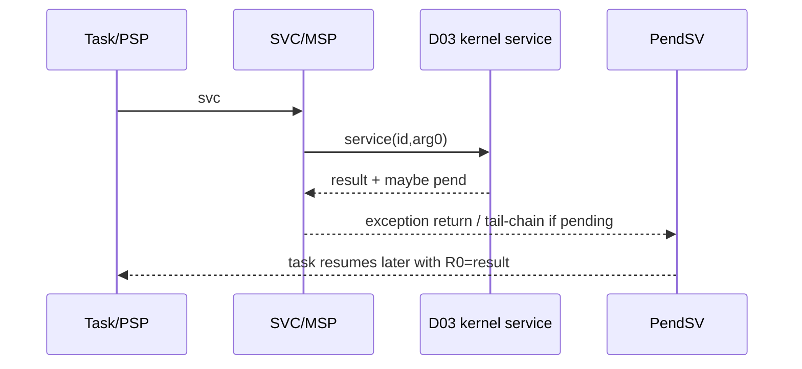

# Goal

Own every Cortex-M23-specific operation that can affect task execution ownership while keeping scheduling policy in portable C.

# Logical module

```text
CORTEX_M23_PORT
```

# Physical files

```text
include/arghtos/arghtos_port.h
port/cortex_m23/arghtos_port.c
port/cortex_m23/arghtos_context.S
```

The assembly file must stay small enough to review instruction-by-instruction.

# Submodules

## D06-A: serialization primitive

```c
arghtos_irq_key_t arghtos_port_critical_enter(void);
void arghtos_port_critical_exit(arghtos_irq_key_t key);
```

Cortex-M23 baseline uses PRIMASK for the v1 global scheduler critical section.

Logical semantics:

```text
critical_enter:
    old = PRIMASK
    disable maskable interrupts
    return old

critical_exit(old):
    restore PRIMASK exactly to old
```

Nesting is supported by restoring the caller's prior state.

NMI/fatal fault remain outside normal scheduler mutation.

## D06-B: context predicates

```c
bool arghtos_port_is_task_context(void);
bool arghtos_port_is_handler_context(void);
```

Task context should require:

* IPSR == 0;
* Thread mode is using PSP.

This naturally distinguishes application startup on MSP from scheduled task execution.

Supported handler context must exclude at least:

* NMI;
* HardFault/fatal handling;
* SVC;
* PendSV.

The board timer/device handler classes allowed to call interrupt wake must be documented by integration.

## D06-C: dispatch request

```c
void arghtos_port_request_dispatch(void);
```

This only pends PendSV.

It never directly changes PSP or calls the selector.

Repeated calls are idempotent.

## D06-D: SVC entry

Task API wrappers use fixed SVC numbers.

Hardware stacking preserves task R0-R3/R12/LR/PC/xPSR on PSP.

The handler:

1. obtains the stacked frame pointer;
2. decodes the SVC number from the instruction preceding stacked PC, or uses an equally compact fixed ABI;
3. reads arg0 from stacked R0 when needed;
4. calls `arghtos_kernel_service(service,arg0)` on MSP;
5. writes returned result into stacked R0;
6. returns from SVC.

If the service requested scheduling, PendSV is pending and tail-chains before Thread mode resumes.



## D06-E: PendSV context handoff

PendSV is the only task-switch point.

Logical flow:

```text
if outgoing task context exists:
    read PSP
    save R4-R11 below hardware frame
    outgoing_saved_psp = new low address
else:
    outgoing_saved_psp = 0

preserve handler EXC_RETURN on MSP
call arghtos_kernel_dispatch(outgoing_saved_psp)
restore handler EXC_RETURN

if returned saved_psp != 0:
    restore R4-R11
    write PSP to hardware-frame position
    exception-return to Thread/PSP
else:
    remain in kernel idle path and re-dispatch after wake
```

The exact Thumb instruction sequence is architecture-specific and belongs only in `arghtos_context.S`.

# Saved context layout

Initial synthetic frame:

```text
lower address
+-----------------+ <- saved_psp
| R4              |
| R5              |
| R6              |
| R7              |
| R8              |
| R9              |
| R10             |
| R11             |
+-----------------+
| R0              |
| R1              |
| R2              |
| R3              |
| R12             |
| LR              |
| PC              |
| xPSR            |
+-----------------+
higher address
```

The synthesized initial frame is 64 bytes.

Runtime exception entry may insert one additional 4-byte alignment word, so the configured task stack reserves at least 68 bytes of scheduler context overhead before application stack demand.

# High-register save implementation

Cortex-M23's baseline instruction set constrains direct high-register multi-register operations.

The assembly may use temporary low registers or individual moves/stores to preserve R8-R11.

Whatever instruction pattern is chosen must satisfy a register-canary test for all R4-R11 values.

The design does not prescribe a clever compact sequence before measurement.

# EXC_RETURN preservation

Handler LR contains the architectural exception-return token.

A normal BL to C overwrites LR.

Therefore PendSV/SVC code that calls C must preserve the exception-return value on MSP or another architecturally safe location and restore it before exception return.

This is a first-class correctness requirement.

# First task start

`arghtos_port_start()` enters the same logical dispatch path with:

```text
outgoing_saved_psp = 0
```

The first task should not use a separate bespoke restore algorithm if the normal restore path can be reused.

# Serialized dispatch and race-free idle path

PendSV masks normal scheduler-relevant interrupts before calling the portable dispatch transaction.

The mask remains set across the "no READY task" decision.

If dispatch returns a task:

1. restore the normal PRIMASK state;
2. restore the selected PSP context;
3. exception-return to Thread mode.

If dispatch returns 0:

```text
PRIMASK remains 1
DSB as required by the selected low-power sequence
WFI
restore normal PRIMASK so a pending higher-priority interrupt can run
after handler return, mask again
call kernel_dispatch(0)
repeat while no task is READY
```

This uses the Armv8-M rule that WFI wakeup determination ignores PRIMASK for an asynchronous exception that would otherwise preempt the active exception. A wake arriving before WFI therefore cannot disappear into the check-to-sleep gap.

No fake idle task and no idle PSP stack is allocated.

# Initial frame builder

```c
uintptr_t arghtos_port_build_initial_psp(
    void *stack_base,
    uint32_t stack_size,
    void (*thread_start)(void),
    void (*return_guard)(void));
```

Builder requirements:

* validate 68-byte scheduler context reserve;
* choose an 8-byte-aligned initial top;
* synthesize a 64-byte dormant frame;
* xPSR Thumb bit set;
* PC = D08 task-start trampoline;
* LR = D08 fatal return guard;
* general registers initialized deterministically, preferably zero;
* returned saved PSP points at saved R4.

# Time/timer platform hooks

D06 also owns/binds:

```c
arghtos_time_t arghtos_port_time_now(void);
void arghtos_port_timer_arm(arghtos_time_t deadline);
void arghtos_port_timer_disarm(void);
```

Because no MCU is selected yet, the Cortex core port should not bake in a vendor timer peripheral.

The eventual target integration may implement these in a board-specific source file that still belongs to the D06 port boundary.

# Key goals

* One PSP handoff mechanism.
* MSP-only kernel execution.
* Exact register preservation.
* Nested-safe PRIMASK serialization.
* No scheduling policy in assembly.
* No dedicated idle task/stack.

# Dependencies

* C3, C4, C7.
* P2, P7.
* D03, D09.

# Dangerous code sections and tester guidance

## 1. EXC_RETURN lost across BL

**Bad assembly pattern:**

```asm
PendSV_Handler:
    ...
    bl arghtos_kernel_dispatch
    bx lr
```

After `bl`, LR is a normal return address, not EXC_RETURN.

**Tester should:**

* disassemble and explicitly trace LR/EXC_RETURN lifetime;
* set a breakpoint immediately before exception return and inspect LR;
* run thousands of switches and assert Thread mode/PSP is restored, not a branch into handler code.

## 2. R8-R11 save/restore asymmetry

**Failure example:** save maps R8->temporary R4 but restore reverses two high registers.

Most C code may not expose the bug immediately.

**Tester should:**

* run a naked/assembly test task loading unique canaries into R4-R11;
* force switches via timer, yield, sleep, and interrupt wake;
* verify every register exactly after each resume;
* use multiple canary patterns including 0x00000000, 0xFFFFFFFF, alternating bits.

## 3. Initial frame order off by one word

**Failure example:** saved PSP points at R5 rather than R4.

The first restore shifts every register and eventually loads garbage PC/xPSR.

**Tester should:**

* unit-test frame builder in host memory and compare every 32-bit word against a golden frame;
* on target, first task should enter a known assembly stub and report all initial registers;
* test several stack-base alignments/sizes.

## 4. Alignment padding ignored at runtime

A task can be interrupted when PSP is only 4-byte aligned, causing hardware to insert an alignment word.

**Tester should:**

* deliberately create task code with stack use that produces the allowed alignment condition;
* force an exception at that point;
* verify return succeeds and xPSR alignment indication is respected;
* high-water test must include the 68-byte worst scheduler reserve.

## 5. PRIMASK nesting incorrectly unmasks

**Bad implementation:** critical_exit always executes `cpsie i`.

If the caller entered with interrupts already disabled, the inner helper unexpectedly enables them.

**Tester should:**

* enter critical twice;
* exit inner and verify PRIMASK remains disabled;
* exit outer and verify original state restored;
* run equivalent sequence from kernel paths that nest helpers.

## 6. PendSV priority not actually lowest

If a device interrupt can be preempted by PendSV, the task switch may occur before the device handler finishes updating driver state.

**Tester should:**

* read back configured exception priority registers at startup;
* trigger a device handler, pend PendSV inside it, and confirm PendSV runs only after handler completion;
* test timer and external interrupt nesting allowed by the integration.

## 7. SVC decoder trusts arbitrary PC

A corrupted stacked PC could cause the decoder to read an invalid instruction address when fetching the SVC immediate.

**Tester should:**

* host-test decoder bounds if modeled;
* fault-inject corrupted stacked PC in a synthetic exception frame;
* ensure impossible service decoding enters C5 fatal handling rather than executing a random service.

## 8. Idle WFI race

**Bad implementation:**

```text
enable interrupts
winner = select()
if winner == none:
    WFI
```

An interrupt can run after the selection, make work READY, return, and then the kernel executes WFI with no pending wake source.

**Required design:** the no-winner selection occurs with PRIMASK set, WFI executes while PRIMASK remains set, and only after WFI completes does the port restore normal masking so the pending handler can run before readiness is checked again. Armv8-M defines qualifying asynchronous exceptions as WFI wakeup events while ignoring PRIMASK.

**Tester should:**

* inject a wake immediately before no-winner return, after no-winner return, immediately before WFI, and while in WFI;
* verify WFI never leaves the system asleep while READY work exists;
* inspect PRIMASK at selector entry, WFI, handler execution, and the subsequent recheck;
* use rapid timer/device stress for millions of idle transitions.

## 9. Port C code silently allocates stack-heavy locals on MSP

A "small" helper with large local arrays can consume the entire MSP budget.

**Tester should:**

* compile with stack-usage reports;
* inspect every port/kernel function reachable on MSP;
* reject VLAs and large automatic objects;
* target high-water test nested handler paths.

# Test seam

Three levels:

1. **Host frame-builder tests** for memory layout.
2. **QEMU/emulator tests** for exception transitions where reliable.
3. **Target hardware tests** for register canaries, priority nesting, PSP/MSP high water, and timer/interrupt behavior.

# Trusted privileged-task boundary

Because v1 tasks are privileged, test/application code must not directly write PRIMASK, CONTROL stack-selection bits, PSP/MSP, PendSV/SVC configuration, or scheduler exception priorities. Such writes bypass D06 and invalidate the scheduler model.

Testers should include one negative integration test documenting that this is a trust assumption rather than a contained fault.

# Boundary specification

D06 owns processor execution mechanics and platform time/timer hooks. It never decides scheduling policy or device event semantics.
