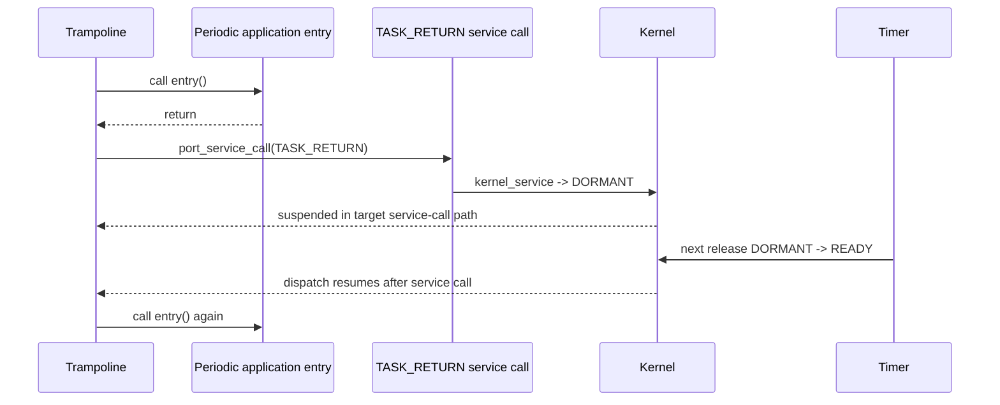

# Goal

Make first launch and later periodic releases use one stable saved continuation while ensuring each periodic application job begins as a fresh C function call.

# Logical module

```text
TASK_TRAMPOLINE
```

# Physical implementation

Portable functions in:

```text
src/arghtos_kernel.c
```

Initial PC/LR placement performed by D06.

# Private entry points

```c
_Noreturn void arghtos_task_start_trampoline(void);
_Noreturn void arghtos_task_return_guard(void);
```

These symbols are private but their addresses are used when D02 asks D06 to synthesize each initial frame.

# Task-start trampoline algorithm

Conceptual implementation:

```c
_Noreturn void arghtos_task_start_trampoline(void)
{
    arghtos_task_id_t id = kernel.current_task;
    const arghtos_task_config_t *d = &kernel.tasks[id];

    if (d->period != 0u) {
        for (;;) {
            d->entry();
            arghtos_port_service_call(ARGHTOS_SERVICE_TASK_RETURN, 0u);
        }
    }

    d->entry();
    arghtos_fatal(ARGHTOS_FAULT_ASYNC_RETURNED, NULL, 0u);
}
```

The production implementation may reload `id`/descriptor after each resume if that reduces assumptions about callee-saved locals. It must not trust a stale automatic variable across a service that can suspend the task for an arbitrary duration unless the normal C context preservation rules guarantee it.

# Periodic lifecycle



The first application's call frame has unwound before TASK_RETURN.

Therefore stack usage does not accumulate one job frame per period.

# Async lifecycle

Async entry is called once.

Normal design expectation:

```text
entry:
    for (;;) {
        wait()
        drain work
    }
```

If entry returns, D08 calls fatal handling with `ARGHTOS_FAULT_ASYNC_RETURNED`.

# Return guard

The initial hardware LR points to:

```c
_Noreturn void arghtos_task_return_guard(void);
```

If the trampoline itself ever returns because of compiler/logic corruption, this guard enters fatal handling.

It should be as small as practical.

# No task entry arguments

V1 task entry signature is:

```c
void task(void);
```

Application context must come from static/global application state.

Adding a `void *arg` per task would enlarge C0 or require another lookup mechanism and is not part of v1.

# Stack implications

Each task stack must accommodate:

* 68-byte worst-case scheduler context reserve;
* trampoline call frame;
* public API wrapper frames used by that task;
* application WCET stack use;
* target-specific interrupt/context-save overhead defined by the selected port.

Task stack sizing is application/system responsibility, but D08 must avoid unnecessary local objects.

# Key goals

* Fresh periodic job call every release.
* No context-frame rebuild every period.
* No stack growth across periodic releases.
* Async return is unmistakably fatal.

# Dependencies

* C0, C1, C4, C5.
* P1, P2.
* D02, D03, D06, D07.

# Dangerous code sections and tester guidance

## 1. Periodic entry is called before prior call frame unwinds

**Bad implementation:** TASK_RETURN service is invoked inside a wrapper that has not returned from the application job, then the next release recursively calls the job.

Stack grows every period.

**Tester should:**

* run tens of thousands of periodic releases;
* fill task stack with a high-water pattern;
* verify high-water mark stabilizes after early iterations;
* use a test job with known local stack consumption to make recursive growth obvious.

## 2. Async return falls into periodic loop

**Failure example:** class check uses a stale or corrupted field and an async task that returns later receives periodic restart behavior.

**Tester should:**

* configure period=0 task whose entry intentionally returns;
* assert crash reason ASYNC_RETURNED;
* verify task is never made DORMANT/READY as a periodic job.

## 3. Trampoline caches current_task across suspension incorrectly

If compiler/port ABI handling fails to preserve the trampoline's C state across the abstract service call, resume can reference the wrong descriptor.

**Tester should:**

* alternate equal-priority periodic tasks rapidly;
* after every release verify the trampoline calls the descriptor matching current_task;
* inspect generated target code and the port service-call ABI for descriptor/id lifetime across the suspension boundary.

## 4. Application entry tail-call optimization bypasses return service

An optimizer could theoretically transform code shape unexpectedly if the trampoline is written carelessly.

**Tester should:**

* inspect optimized disassembly;
* verify periodic entry returns to code that invokes the TASK_RETURN abstract service call;
* build at all supported optimization levels.

## 5. Return guard optimized away or shares wrong calling convention

**Tester should:**

* deliberately corrupt/simulate return from the trampoline in a host/unit form;
* confirm return guard is a real retained symbol in target ELF;
* confirm it is marked no-return and ends in D07 fatal path.

## 6. Large local variables in trampoline

A convenience local profile/debug buffer on every task stack increases every task's application stack requirement.

**Tester should:**

* compile stack-usage reports for trampoline;
* set an explicit tiny target for its automatic stack use;
* reject VLAs or arrays in D08.

# Test seam

Host model can invoke a factored trampoline decision helper, while target tests verify actual suspended/resumed C frames.

A long-duration target test must prove periodic stack high water does not grow with release count.

# Boundary specification

D08 owns task-entry wrapping and return semantics only. It does not determine release time, scheduling winner, or context-save instructions.
