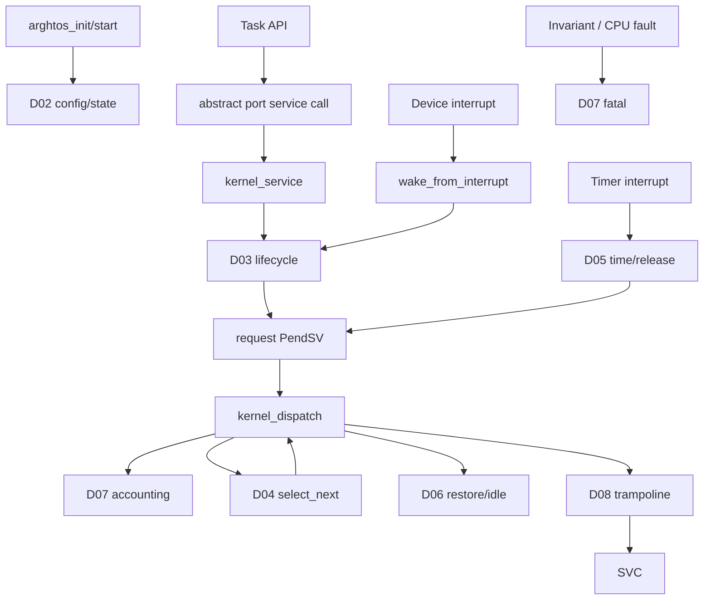

# Goal

Define the exact portable-kernel integration so module ownership remains clear even though footprint pressure intentionally places most logical modules in one C translation unit.

# Physical element

```text
src/arghtos_kernel.c
```

This file implements D02, D03, D04, D05, D07, D08, and the portable dispatch half of D09.

# Internal source organization

Recommended order:

```text
1. includes + compile-time assertions
2. C8/C9 resident objects
3. tiny scalar helpers
4. D07 fatal primitive required by later invariant checks
5. D02 config/init helpers
6. D05 time/release helpers
7. D04 selector
8. D03 lifecycle/service helpers
9. D07 profile snapshot/accounting
10. D09 kernel dispatch callback
11. D08 trampolines
12. public API wrappers that are not port assembly
```

The order is for review/readability. Production code should not rely on declaration order for semantics.

# Resident objects

Exactly:

```c
static arghtos_task_control_t
    controls[ARGHTOS_MAX_TASKS];

static arghtos_kernel_state_t kernel;
```

No module-specific writable singleton is allowed without first changing C8/C9 and the footprint proof.

# Port-callable private symbols

The port needs only a small number of C entry points.

Required:

```c
arghtos_context_t arghtos_kernel_dispatch(arghtos_context_t outgoing_context);

arghtos_result_t arghtos_kernel_service(
    uint8_t service_id,
    uint32_t arg0);

void arghtos_timer_interrupt(void);

_Noreturn void arghtos_task_start_trampoline(void);
_Noreturn void arghtos_task_return_guard(void);

_Noreturn void arghtos_fatal(
    arghtos_fault_reason_t reason,
    const void *port_fault_context);
```

Everything else should be `static` unless a measured port need proves otherwise.

# Kernel dispatch serialization precondition

D06 calls `arghtos_kernel_dispatch()` with normal scheduler-relevant interrupts masked by PRIMASK.

D09 therefore assumes C8/C9 mutation is serialized for the entire dispatch transaction and does not independently open a second critical section.

If dispatch returns no winner, D06 keeps that serialization across the transition into the race-free WFI protocol described in C4/D06.

# Kernel dispatch algorithm

This is the critical integration transaction.

Reference semantics:

```text
now = port_time_now()

if outgoing_context != 0:
    if current_task == INVALID:
        fatal BAD_DISPATCH

    current = controls[current_task]
    current.context = outgoing_context

    elapsed = now - kernel.run_start
    current.total_cpu_ticks += elapsed
    current.max_run_ticks = max(current.max_run_ticks, elapsed)

    if current.state == RUNNING:
        # scheduling reconsideration/preemption;
        # no lifecycle API already changed the state
        current.state = READY

        if current is async:
            current.age_credit = 0

else:
    if current_task != INVALID:
        # outgoing_context=0 is legal only for first dispatch / idle re-entry
        fatal BAD_DISPATCH

next = select_next()

if next == INVALID:
    kernel.current_task = INVALID
    return 0

if controls[next].state != READY:
    fatal BAD_DISPATCH

controls[next].state = RUNNING

if next is async:
    controls[next].age_credit = 0

kernel.current_task = next
kernel.run_start = now

return controls[next].context
```

# Why outgoing state is checked after accounting

D03 may already have changed the current task:

* yield -> READY;
* wait -> WAITING;
* sleep -> SLEEPING;
* periodic return -> DORMANT.

D09 must still save PSP/account elapsed runtime for that task, but it must not overwrite those lifecycle states with READY.

Only a task still marked RUNNING is normalized to READY by dispatch reconsideration/preemption.

# Same-task reselect

A RUNNING async or periodic task can be preempted into PendSV and then remain the best winner.

Sequence:

```text
RUNNING -> READY
select same ID
READY -> RUNNING
```

This is legal.

It closes and starts a new profiling residency.

# No-winner / idle path

If selector returns INVALID:

```text
kernel.current_task = INVALID
return 0
```

D06 remains on MSP and performs its idle wait protocol.

When it later re-enters dispatch:

```text
arghtos_kernel_dispatch(0)
```

Current task must still be INVALID.

# Kernel service dispatch

D09 exposes one C service entry to SVC.

Suggested structure:

```text
validate TASK context / current task

service ID:
    YIELD       -> D03 yield
    WAIT        -> D03 wait
    SLEEP_UNTIL -> D03 sleep
    WAKE        -> D03 task-context wake
    TASK_RETURN -> D03 periodic return
    other       -> fatal BAD_SERVICE
```

Unknown service ID is not an ordinary application error because only ArghtOS wrappers/ports are supposed to issue private kernel service IDs. It indicates corrupted private ABI state and enters fatal handling.

# Interrupt wake path

`arghtos_wake_from_interrupt()` does not route through SVC.

It:

1. validates D06 handler context;
2. invokes D03 common wake logic under serialization;
3. pends dispatch if eligibility changed.

# Timer path

D06 timer vector/adapter invokes D05 `arghtos_timer_interrupt()`.

Timer processing does not call the selector directly.

It only makes state READY, rearms time, and requests PendSV.

# Call graph



# Internal helper policy

At this footprint scale, helper abstraction must be measured.

Preferred rules:

* use `static` helpers when they remove duplicated logic;
* do not add wrappers only to make the file look layered;
* avoid function-pointer dispatch tables;
* avoid const string tables;
* inspect compiler output for switch jump tables;
* use simple branches when smaller.

Logical module comments should mark ownership, for example:

```c
/* D04 POLICY ------------------------------------------------------- */
```

This gives reviewers boundaries without requiring separate object files.

# Compile-time invariants

The translation unit should assert:

* C0/C5/C8/C9 struct sizes;
* `ARGHTOS_MAX_TASKS <= 254`;
* crash record size 64;
* uintptr_t 32-bit;
* reserved flag masks do not overlap defined bits.

# Key goals

* One portable state authority.
* One dispatch transaction.
* One service decoder.
* One timer entry.
* One fatal path.
* No hidden module globals.

# Dependencies

All design elements D01-D08 and contracts C0-C10.

# Dangerous code sections and tester guidance

## 1. outgoing_context and current_task disagree

**Failure scenario A:**

```text
outgoing_context != 0
current_task == INVALID
```

Saving that PSP into a guessed slot corrupts an unrelated task.

**Failure scenario B:**

```text
outgoing_context == 0
current_task != INVALID
```

The kernel could lose the current task continuation.

**Tester should:**

* directly call the host dispatch model with both impossible combinations;
* require BAD_DISPATCH fatal reason;
* confirm no control slot is modified before the invariant check.

## 2. Lifecycle state overwritten by dispatch normalization

**Bad implementation:**

```c
current.state = READY;  // unconditional
```

After `wait()`, PendSV turns WAITING back into READY and the task never blocks.

**Tester should:**

* for yield/wait/sleep/periodic-return, run service then dispatch;
* assert dispatch preserves READY/WAITING/SLEEPING/DORMANT exactly;
* separately test a true preemption where RUNNING becomes READY.

## 3. Selector evaluated before outgoing task normalization

A preempted RUNNING task may not be considered READY and can lose unfairly.

**Tester should:**

* periodic task A RUNNING, lower-priority B READY, dispatch requested for irrelevant reason;
* after normalization selector must still choose A;
* repeat for async same-task reselect and verify credit reset semantics.

## 4. Selector evaluated twice

D04 aging mutates credit.

**Tester should:**

* count internal selector calls with host instrumentation;
* exactly one per kernel dispatch;
* disassembly/review should show no debug "peek" call in production path.

## 5. `now` sampled at inconsistent points

If accounting uses one clock read and `run_start` another, a same-task reselect can create gaps/double time.

**Tester should:**

* fake clock increments on every read;
* assert one dispatch transaction uses one captured `now` for outgoing elapsed and incoming `run_start`;
* verify total elapsed across repeated switches equals golden time.

## 6. Unknown SVC returns BAD_ARGUMENT instead of fatal

An unknown private service means execution did not come from a valid public wrapper or code is corrupted.

**Tester should:**

* inject all 256 service IDs in host SVC decoder;
* known IDs follow contract;
* every unknown ID yields `ARGHTOS_FAULT_BAD_SERVICE`.

## 7. Function-pointer table added for service dispatch

A five-entry table may create resident rodata and indirect-call overhead.

**Tester should:**

* inspect map/disassembly for service jump tables/function-pointer arrays;
* compare simple branch/switch code size;
* choose measured smaller form, not stylistic preference.

## 8. Dispatch called without D06 serialization

If a timer/device handler can preempt D09 while it is normalizing state or running the mutating async selector, C8 can be modified concurrently.

**Tester should:**

* instrument the target/host port to assert PRIMASK/serialization state at every `arghtos_kernel_dispatch()` entry;
* deliberately attempt a handler wake during each dispatch phase in the host model;
* require that the wake is deferred until after the serialized transaction.

## 9. Cross-module static helper accidentally becomes external

External linkage can prevent optimizations and expands symbol/API surface.

**Tester should:**

* inspect ELF global symbol list;
* only public API symbols, generic port ABI symbols, and the few `arghtos_kernel_port.h` callbacks should be globally visible;
* fail a visibility test for unexpected `arghtos_` globals.

# Test seam

The entire portable kernel should compile on the host against a fake D06 port.

This lets tests invoke:

* init/start model;
* lifecycle services;
* timer events;
* dispatch;
* profiling/fault paths;

against a non-Cortex host port without any target-specific instructions.

# Boundary specification

D09 defines how the logical modules compose in code. It does not change their contracts.

# Portable-source prohibition

`src/arghtos_kernel.c` must not include vendor/CMSIS headers, inline assembly, or target register/exception names.

A source-level portability test should compile this exact file against both the host port and Cortex-M23 port without preprocessing branches that select the target.
