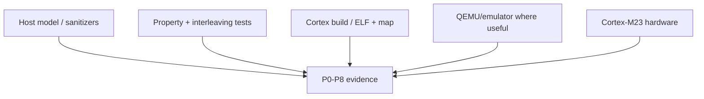

# Goal

Define how testers can attack the dangerous code paths without needing to reverse-engineer module boundaries after implementation.

# Verification layers



# Host fake-port seam

Portable kernel must build with a fake port implementing:

```c
arghtos_result_t arghtos_port_init(void);
bool arghtos_port_stack_valid(void *, uint32_t);

arghtos_time_t arghtos_port_time_now(void);
void arghtos_port_timer_arm(arghtos_time_t);
void arghtos_port_timer_disarm(void);

arghtos_irq_key_t arghtos_port_critical_enter(void);
void arghtos_port_critical_exit(arghtos_irq_key_t);

bool arghtos_port_is_task_context(void);
bool arghtos_port_is_handler_context(void);

void arghtos_port_request_dispatch(void);
```

The fake port records calls and exposes deterministic hook points.

Host tests do not need to emulate actual PSP/MSP switching to test state/policy/time logic.

# Interleaving hooks

For P3 and lifecycle atomicity, test builds may expose compile-time-only hook macros at logical mutation points:

```text
before wake latch test
after wake latch test
before WAITING commit
after WAITING commit
before/after critical exit
```

Production build compiles these hooks to nothing.

They must not leave resident code in the footprint build.

# Sanitizer build

Host build should use available:

* AddressSanitizer;
* UndefinedBehaviorSanitizer;
* aggressive warnings;
* integer-conversion warnings where practical.

Important targets:

* invalid task IDs;
* pointer/stack-range arithmetic;
* overflow in missed-release arithmetic;
* null crash frame;
* state-dependent field access.

# Property-test domains

## Scheduler policy

Generate task tables containing:

* periodic and async mixes;
* all C7 states;
* equal periods;
* every async base priority;
* age credits around saturation;
* redundant wakes.

Properties:

* periodic READY always beats async;
* equal-period tie by ID;
* selector never returns non-READY;
* async opportunity mutates only READY async credit;
* P8 liveness under continued async opportunities.

## Time engine

Generate:

* now near wrap;
* periods from 1 to legal maximum;
* next_time before/after wrap;
* long bounded lateness;
* active/inactive periodic state;
* sleeping async deadlines.

Compare against a simple mathematical reference model.

## Lifecycle

Enumerate every state/class/API combination.

Invalid operation must:

* return the documented error; and
* not mutate unrelated scheduler state.

# Target-specific test harness

A Cortex-M23 target test image should contain dedicated test tasks and handlers.

Required capabilities:

* force periodic timer events;
* force external wake events;
* load register canaries R4-R11;
* inspect MSP/PSP;
* intentionally return from async entry;
* trigger controlled kernel/fault paths;
* inspect crash record after reset/halt as integration allows.

# Proof-to-test matrix

| Proof | Primary evidence |
|---|---|
| P0 static/resource bound | ABI size asserts, no-allocator symbol scan, linker map, capacity tests |
| P1 state invariants | exhaustive host transition model, invalid transition injection |
| P2 context/stack | frame-builder golden tests, R4-R11 canaries, PSP/MSP ownership, stack high water |
| P3 wake/wait race | interleaving hooks, interrupt-at-boundary tests |
| P4 time/release | wrap property tests, long-lateness O(N) test, drift test |
| P5 priority isolation | selector properties with arbitrary async priority/credit |
| P6 RMS schedulability | measured kernel/handler bounds + external task WCETs + deterministic analyzer |
| P7 bounded work/footprint | operation counters, loop review, map/stack report |
| P8 async starvation | long/random selector liveness property tests |

# Module-danger regression suites

Each design element's dangerous-code examples become named regression groups:

```text
D01_API_ABI
D02_INIT_STACKS
D03_WAKE_WAIT
D04_POLICY_AGING
D05_TIME_WRAP
D06_CONTEXT_PORT
D07_CRASH_PROFILE
D08_TRAMPOLINE
D09_DISPATCH_INTEGRATION
D10_FOOTPRINT
```

Test names should describe the invariant, for example:

```text
D03_WAKE_WAIT_wake_after_latch_test_does_not_sleep
D04_POLICY_AGING_periodic_ready_does_not_age_async
D05_TIME_WRAP_missed_2pow16_periods_is_constant_work
D06_CONTEXT_PORT_r8_r11_survive_timer_switch
D08_TRAMPOLINE_periodic_stack_highwater_does_not_grow
D10_FOOTPRINT_rodata_is_included
```

# Explicit dangerous-scenario checklist

Before declaring the module-design stage implemented, testers should have direct coverage for these scenarios:

1. wake at every wait-boundary interleaving;
2. redundant wake of READY task with accumulated age credit;
3. wake of SLEEPING task before timer deadline;
4. periodic task yielding mid-job;
5. timer delayed across very many periods;
6. wraparound with two future deadlines on opposite sides of zero;
7. exact-touch and overlapping task stack ranges;
8. invalid ID before any array dereference;
9. equal-period RMS tie;
10. async credit addition at 255;
11. selector accidentally called twice;
12. EXC_RETURN preservation across C call;
13. R4-R11 canary preservation;
14. runtime stack alignment padding;
15. nested PRIMASK critical sections;
16. PendSV deferred until active handler completes;
17. idle check-to-WFI race;
18. async task returning;
19. periodic high-water stability across many releases;
20. crash capture interrupted after every store;
21. recursive fault capture;
22. NULL exception frame fatal path;
23. same-task reselect accounting;
24. lifecycle block state not overwritten by dispatch;
25. current_task/outgoing_PSP impossible combinations;
26. all required public features retained in footprint harness;
27. no string/jump/debug tables hidden in resident image;
28. full `.text + .rodata + data + metadata + MSP` accounting.

# Timing evidence

Target harness should timestamp or cycle-count:

* critical enter/exit;
* wake_from_interrupt;
* timer service at N=32;
* selector worst path at N=32;
* PendSV save -> dispatch -> restore;
* SVC lifecycle services;
* fatal capture before terminal hook.

The resulting conservative bounds feed P6.

# Stack evidence

Produce both:

* compiler/static stack-usage estimates;
* target canary/high-water observations.

Track separately:

* each PSP task stack;
* ArghtOS-only MSP contribution;
* full physical system MSP under allowed nested handlers.

# Footprint evidence

D10 tests must verify:

```text
C0 16 B/task
C8 20 B/capacity
C9 20 B
crash 64 B
```

and derive linked code/const/MSP from target artifacts.

# Dangerous test-infrastructure mistakes

## 1. Host model accidentally changes production semantics

Test hooks that remain in production can consume code or alter timing.

**Tester should:**

* footprint build must define all hooks away;
* compare preprocessed/linked symbols to ensure hook machinery is absent.

## 2. QEMU result treated as hardware timing evidence

Emulation may validate control flow, but it does not establish MCU WCET/interrupt latency.

**Tester should:**

* label evidence source;
* only target measurements or justified static bounds feed P6 timing claims.

## 3. Randomized tests without reproducible seeds

A rare race failure that cannot be replayed is nearly useless.

**Tester should:**

* log seed and generated task table;
* emit minimal reproducer when property framework supports shrinking.

## 4. Footprint test app dead-strips required features

**Tester should:**

* reference every public API and mandatory fault path;
* verify required symbols remain reachable before using its size as evidence.

## 5. Stack high-water test never reaches worst nesting

A green canary result under easy traffic can understate MSP.

**Tester should:**

* deliberately construct maximum permitted exception nesting;
* test fatal path from deeply nested or worst permitted handler context where safe.

# Boundary specification

D11 defines evidence acquisition and adversarial test structure. The owning proof remains the authority for what the evidence must establish.
